# Chelsea Explorer

Explore a reconstruction of the streets around **Sloane Square, King's Road and Duke of York Square** in Chelsea, London: first as a tabletop miniature, then at street level. It runs on **Meta Quest 3** (WebXR in the Quest Browser) and on desktop.

> **Map data © [OpenStreetMap contributors](https://www.openstreetmap.org/copyright)** (ODbL 1.0). The buildings around Sloane Square and Peter Jones are hand-built procedural models based on photographs and published descriptions; elsewhere buildings are approximate masses at their mapped heights. It is an approximate model, not a photorealistic one.

| Miniature | Street level |
|---|---|
| 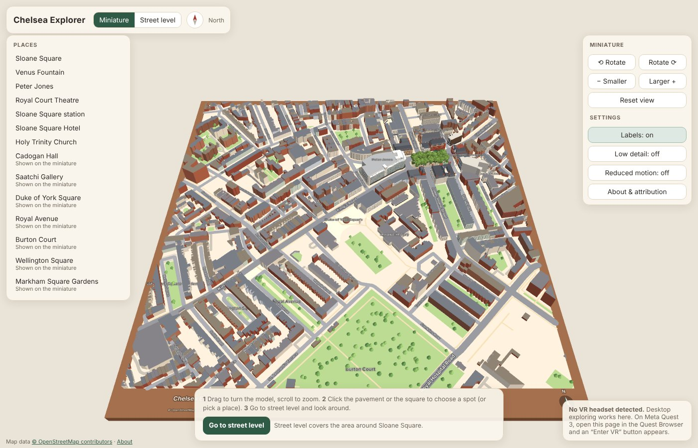 | 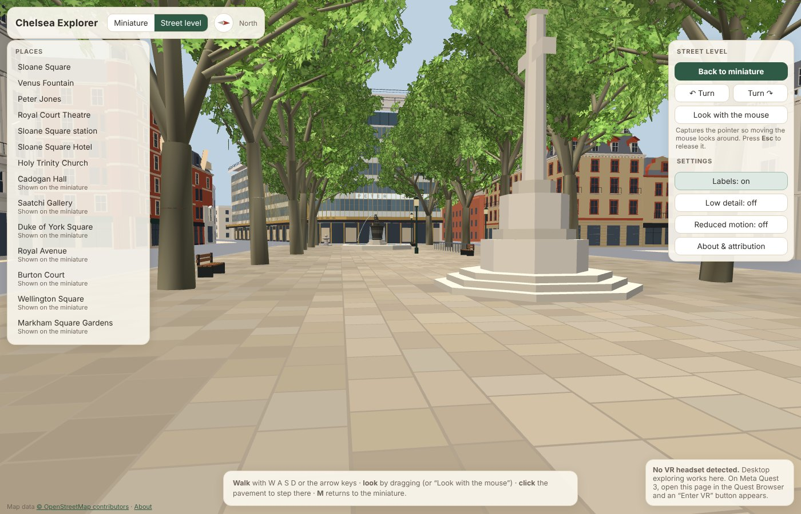 |

**Live (after deployment):** https://vrmaria27.github.io/chelsea-mini-city-/

This project began as a city-builder ("Chelsea Mini City"). That version is preserved on the `game-final` branch; what changed, how old saves are kept, the remaining approximations and the Quest checklist are in **[docs/explorer.md](docs/explorer.md)**.

## How to explore

1. **Look at the miniature.** Drag to turn it, scroll to zoom, and use Rotate, Larger and Smaller to adjust the model. The north indicator follows your view.
2. **Choose a spot.** Click the pavement or the square, or pick a place from the list.
3. **Go to street level** and look around. **Back to miniature** (or `M`) returns.

Street level covers the area around Sloane Square, the best-reconstructed part of the model. Places further away (the Saatchi Gallery, Royal Avenue, Burton Court and others) are shown on the miniature with a pin.

| | Desktop | VR (Quest 3) |
|---|---|---|
| Switch views | **Miniature / Street level** buttons, or `M` | Panel: **Go to street level** / **Back to miniature** |
| Miniature | Drag to orbit, scroll to zoom, right-drag to pan; `Q` `E` rotate, `-` `+` resize, `R` reset | Point at the table and pull the trigger to choose a spot; thumbstick flicks rotate (15°) and resize; **Reset table position** |
| Move at street level | `W` `A` `S` `D` / arrow keys (hold `Shift` to go faster), or click the pavement to step there | Point at the pavement and pull the trigger to teleport (within 40 m) |
| Look / turn | Drag, or **Look with the mouse** (pointer lock; **Esc** releases it); `Q` `E` turn 30° | Turn your head; flick the thumbstick to snap-turn 30° (or 45°) |
| Places | Places list (left) | Places on the panel |
| Settings | Labels (`L`), Low detail, Reduced motion | Labels, Low detail, Less motion, Snap 30°/45°, Seated (raises a seated view to standing height) |
| About and attribution | **About & attribution** | **About & attribution** on the panel |

You can only stand on pavements and in public spaces. Buildings, carriageways, the fountain, trees and the area beyond the modelled zone refuse with a short explanation. Moving between viewpoints uses a brief fade (instant with Reduced motion); the camera never flies through buildings or moves on its own.

Settings and your last street-level spot are saved in the browser (`chelsea-explorer.prefs`). The app always opens on the curated scene in the miniature.

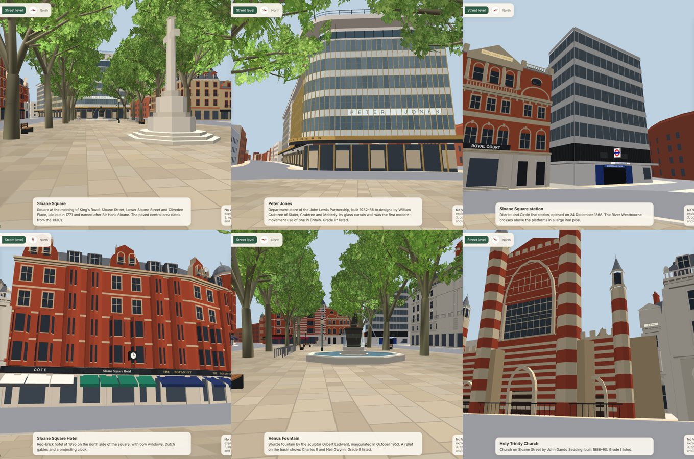

## Map data

| | |
|---|---|
| Area | 700 m × 700 m, centred on **51.4912 N, 0.1600 W**, between Duke of York Square and the western part of the King's Road section |
| Bounding box | south 51.488052, west -0.165055, north 51.494348, east -0.154945 |
| Source | OpenStreetMap via the Overpass API (`overpass-api.de`) |
| Retrieved | 2026-11-09 21:08 UTC (OSM data as of 2026-11-09T21:07:05Z) |
| Licence | Open Database License 1.0; attribution "© OpenStreetMap contributors" is shown on the model, the HUD, the VR panel and the About panel |

**How it's built (reproducible).**
1. `npm run import:map:fetch` queries Overpass for a slightly larger box: highways, buildings, parks and gardens, squares, pedestrian areas and named landmarks. It saves `data/osm/raw.json` with the query, endpoint and timestamp. This sandbox can't reach Overpass, so the **Import OSM map data** GitHub Action ran the same script and committed the extract. Any Overpass JSON placed at `data/osm/raw.json` also works.
2. `npm run import:map` (`scripts/osm/process.mjs`, no dependencies) then:
   - projects to local metres (equirectangular about the centre; x east, z south; < 0.01% scale error) and clips to the box,
   - simplifies roads (0.5 m; 0.8 m for footways) while **keeping every junction vertex**, and simplifies footprints (0.3 m, area kept within 4%),
   - triangulates roofs and areas, keeping courtyards as holes,
   - places labels,
   - writes `src/map/osm/chelsea-osm.json` (bundled; the app makes **no map requests at runtime**) and archives the old game's site list in `data/legacy/game-sites-v2.json` (not loaded).

   It also keeps OSM ids, names, highway classes and building tags, and prints validation checks.

**Sourced vs estimated vs fictional.**
- **From OSM:**
  - street centrelines, curves, junctions, names and classes (main / street / service / pedestrian / footpath),
  - pedestrian areas and squares, parks and gardens,
  - 716 building footprints; heights from `height` (2, counted across the whole extract) or `building:levels` × 3.2 m + 1 m (2174),
  - landmark positions.
- **Estimated (documented):**
  - Road widths: OSM `width` where tagged (only 1 segment), otherwise by class:

    | Class | Width |
    |---|---|
    | primary | 12 m |
    | secondary | 11 m |
    | tertiary | 9 m |
    | residential | 7 m |
    | service | 4.5 m |
    | pedestrian | 6 m |
    | footway | 2.2 m |

    These are not surveyed measurements.
  - Building heights without tags (489 across the extract): a deterministic 3–5 storeys from the OSM id (3.5 m sheds; 18 m churches).
- **Stylised:** façade colours, flat roofs on generic buildings, generic window rows near the square, and trees inside green spaces other than Sloane Square.
- **Former game sites:** the 32 footprints the city-builder had cleared are restored as ordinary buildings at their OSM heights (see [docs/explorer.md](docs/explorer.md#restored-development-sites)).

## Peter Jones model

Peter Jones (Grade II*, 1936–39, W. Crabtree with Slater & Moberly and C. H. Reilly) has a custom landmark model (`src/map/landmarks/peterJones.ts`), replacing its generic extrusion. It has the stable id `landmark:peter-jones`.


**References used:**
- Historic England listing 1226626, via https://britishlistedbuildings.co.uk/101226626-peter-jones-store-royal-hospital-ward (text).
- https://modernism-in-architecture.org/buildings/peter-jones/ (text).
- Panel size and panel counts as supplied by the project owner, citing https://awards.mediaarchitecture.org/mab/project/363.
- Four reference photos supplied by the project owner: the corner from Sloane Square (two recent, one older), and the King's Road side from Sloane Square.
- The photos were used for appearance only. No images or textures from them are in the app; all geometry and materials are original.

**Fitted to the real map:**
- The footprint is OSM way 28682626, used unsimplified.
- OSM part 532097395 (white, 7 storeys) is the upper storey with the rounded drum.
- Part 532534275 confirms the facade strip along King's Road, the curve and Sloane Square.
- The modelled frontage is the run of outline edges that front King's Road and Sloane Square (118 m: 74.5 m straight, a 22 m curve, then 21 m). The importer detects it.
- The curve is smoothed but stays within 9 cm of the OSM outline. The gentle reverse bend just before the curve is in the OSM data and is kept.
- The footprint and 25 Cadogan Gardens (way 1186000571, listed as part of the store) are protected. Tests check that.
- The canopy (2.2 m) and slab (1.2 m) overhang the pavement only.

| | Status |
|---|---|
| Curved corner at King's Road / Sloane Square, overall mass and footprint | **Observed** (OSM outline + photos) |
| Five window rows above the canopy: each a pale spandrel panel then two glazed panels, 965 × 1245 mm modules, with gold/bronze vertical mullions dominating | **Observed** (photos; panel size supplied). Mullions are placed at the uniform module; Crabtree's deliberate bay tapering is not modelled |
| Plate-glass ground floor under a dark cantilevered canopy with a bronze band | **Observed** (listing, photos) |
| "PETER JONES & PARTNERS" on the canopy band around the curve | **Observed** (photos 1 and 4); letter style approximate |
| Thick white top slab sweeping up in an S-curve toward the corner, recessed glazed storey beneath, tubular railings on top | **Observed** (photos 1, 3, 4; listing); the rise's exact start and end points are estimated |
| White upper storey with rounded drum and railings | **Observed** (photos; OSM part 532097395) |
| "PETER JONES" letters on white panels on the Sloane Square face | **Observed** in the older photo and the listing; may differ today (not visible in the recent photo) |
| White stair tower with a column of small windows; more muted extension to its west along King's Road | **Observed** (photos 1, 2; modernism-in-architecture.org); position along King's Road estimated |
| Storey heights (ground 4.6 m, canopy to 5.8 m, 3.735 m per row, slab 25.5 → 28.2 m, top ≈ 32.4 m) | **Approximate**, from the panel module and photo proportions |
| Symons Street and Cadogan Gardens elevations, roofs | **Approximate** (not in the references): plain cream walls with window bands |
| Glass reflections | Stylised: per-panel tint variation only (no real-time reflections) |

**Cost:** about 14,000 triangles merged into the existing single static draw call. Two small sign textures (2048 × 96 and 1024 × 80 px) are drawn as decals.

**Not done:** no side-by-side comparison against Google Maps or Street View, and no headset testing. The checks were renders compared with the supplied photos (`docs/peter-jones-*.jpg`).

## Sloane Square

The central public space of Sloane Square is a dedicated model (`src/map/landmarks/sloaneSquare.ts`, `planeTree.ts`, `leafAtlas.ts`):
- Yorkstone paving inside the real OSM kerb line (about 83 × 29 m), with a granite kerb.
- The Venus Fountain (Gilbert Ledward, 1953): octagonal pool from OSM, stepped stone base, bronze vase with a relief band, the kneeling figure with her conch, and gently moving water.
- The Chelsea war memorial, the 1882 drinking fountain, benches, lamps and cycle stands at their OSM positions.
- Fourteen London plane trees at their OSM-mapped positions, each with its own height, branching, rotation and sway phase.

The square is open public space and walkable at street level. Trees sway subtly; **Reduced motion** stops them and the water. **Low detail** swaps the leaf cards for cheaper opaque foliage.

| Top-down | Angled |
|---|---|
| 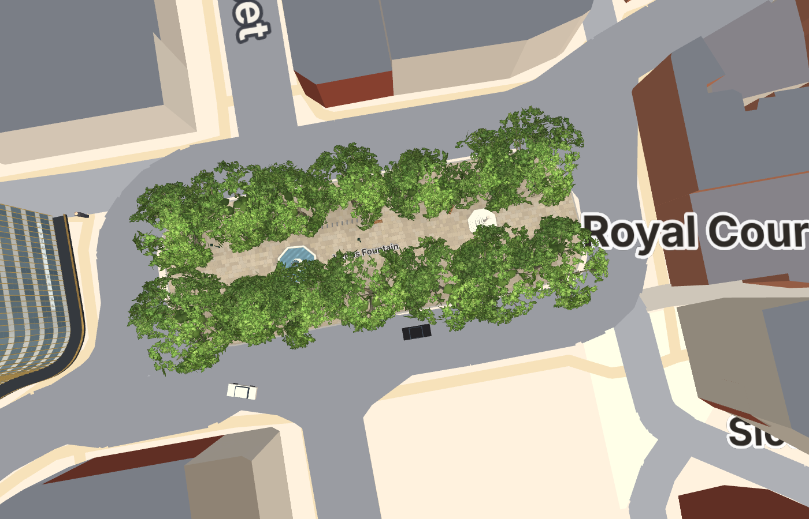 | 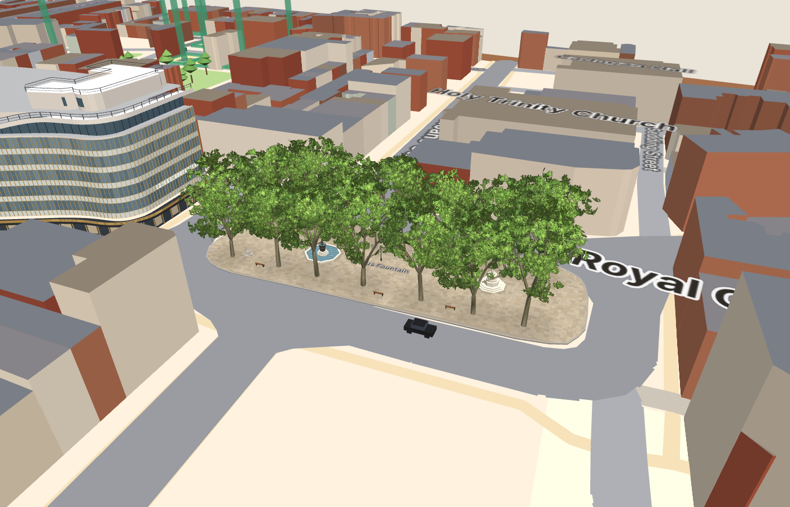 |
| 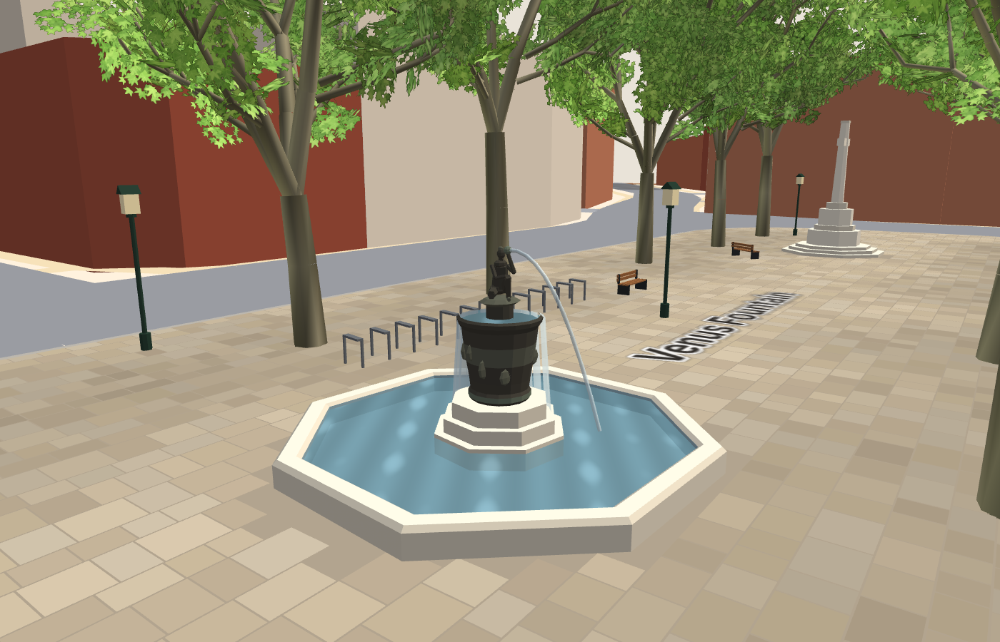 | 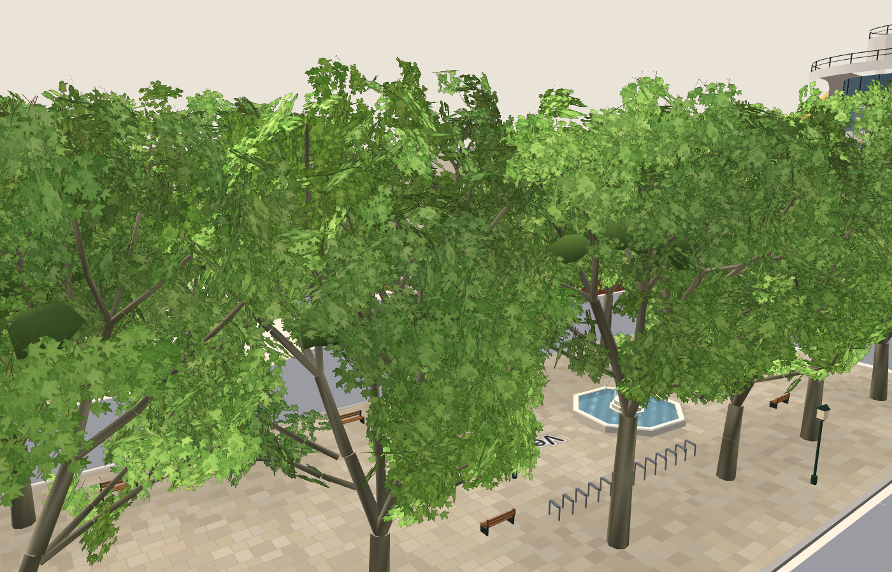 |

References (dated, openly licensed photos), observed vs estimated dimensions, the tree-approach comparison (`docs/tree-comparison.png`), measurements, simplifications and a headset checklist are in [docs/sloane-square.md](docs/sloane-square.md). `npm run lab:trees` serves the tree comparison harness at http://localhost:8000/.

Square detail comes from a focused OSM extract (`data/osm/square-raw.json`). It is refreshed by the *Import Sloane Square OSM detail* GitHub Action (push to the `osm-square` branch), then `npm run import:map`.

## Buildings around Sloane Square

The square's perimeter is rebuilt building by building:
- the Royal Court Theatre, the Underground station and Sloane Square House, and the Sloane Square Hotel;
- the Court Lodge / King's Arms block with Colbert, Nos. 52–56, Nos. 1–6 and the former bank at 13–14;
- Nos. 15–16 and 141–145 Sloane Street, Wyndham House, Wellesley House, Lurgan Mansions and Nos. 28–31;
- Holy Trinity on Sloane Street.

Each has its own façade definition, based on the RBKC Conservation Area Appraisal, Historic England listings and dated, openly licensed photographs. Peter Jones and the central square are unchanged. Two listed buildings that were missing from the map (Wyndham House and Wellesley House) are restored.

| Looking north | Looking east |
|---|---|
| 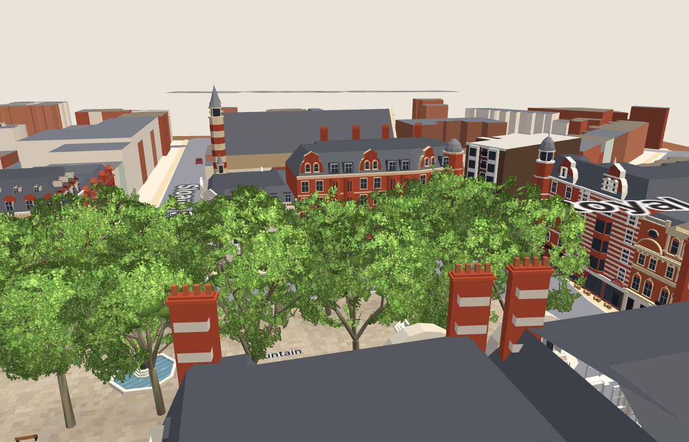 | 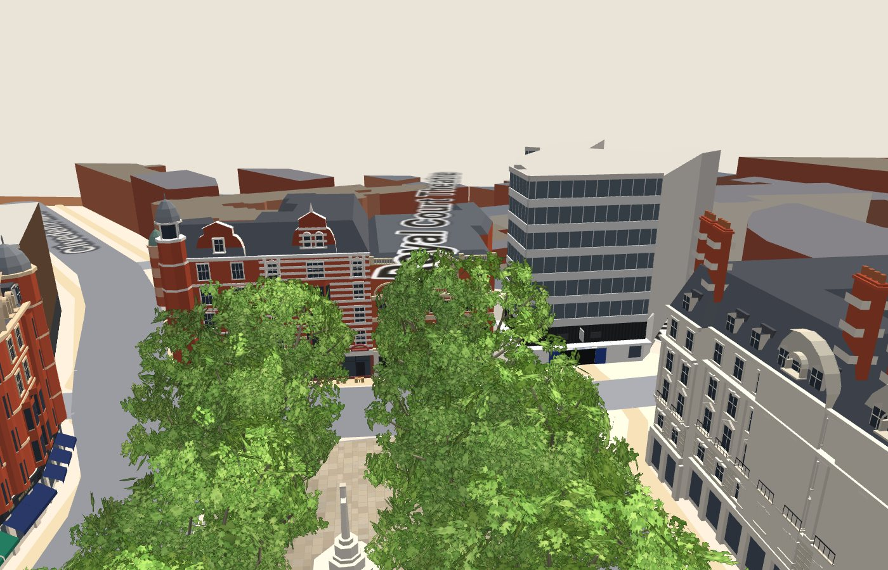 |
| 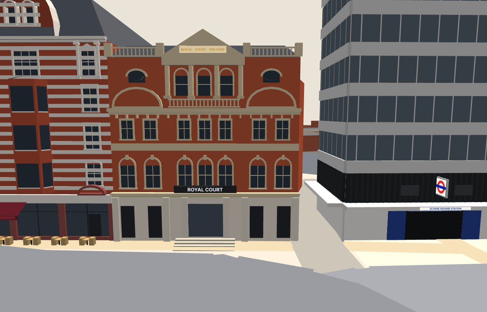 | 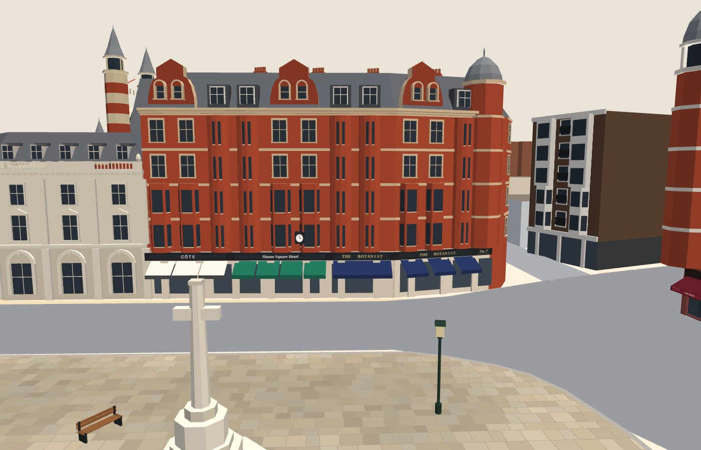 |

The inventory, references, coverage table (with unresolved frontages), performance figures and a headset checklist are in [docs/square-buildings.md](docs/square-buildings.md).

## Install, run, build

Requires **Node.js 20+**.

```bash
npm install        # dev tools only: esbuild, TypeScript, tsx
npm run dev        # dev server with live rebuild → http://localhost:5173/
npm test           # unit tests (exploration, navigation, preferences, legacy saves, geography, landmark models)
npm run import:map # rebuild the bundled map from data/osm/raw.json (offline, deterministic)
npm run build      # type-check + production bundle → dist/
npm run preview    # serve dist/ → http://localhost:5173/
npm run check      # typecheck + tests + build
```

`dist/` is a fully static site with relative paths, so it can be hosted on any static host or subpath.

## Opening it on Quest 3

WebXR only works in a **secure context (HTTPS)**. Your laptop's `http://localhost:5173` is **not** reachable as `localhost` on the headset: on the Quest, `localhost` means the headset itself. Your laptop's LAN address (`http://192.168.x.x:5173`) is reachable, but it isn't HTTPS, so the Enter VR button won't appear. Use one of these instead:

**A. GitHub Pages (easiest, free):** push to `main`. The included workflow (`.github/workflows/deploy.yml`) tests, builds and deploys automatically (unchanged by the Explorer refactor). One-time setup: repo **Settings → Pages → Build and deployment → Source: GitHub Actions**. Then on the Quest open **https://vrmaria27.github.io/chelsea-mini-city-/** in the Quest Browser and press **Enter VR**.

**B. Local HTTPS dev server (same Wi-Fi):**
```bash
mkdir -p certs
openssl req -x509 -newkey rsa:2048 -nodes -days 30 -subj "/CN=chelsea-dev" \
  -keyout certs/key.pem -out certs/cert.pem
npm run dev        # now serves https:// and prints a "Network:" URL
```
Open the printed `https://192.168.x.x:5173/` on the Quest and accept the self-signed certificate warning (Advanced → Proceed).

**C. USB (developer mode):** `adb reverse tcp:5173 tcp:5173`, then open `http://localhost:5173` on the Quest. Browsers treat `localhost` as secure, so this works over the forwarded port.

## Manual headset checklist (Quest 3)

Not yet verified on a headset. See [docs/explorer.md](docs/explorer.md#manual-quest-3-checklist), plus the detail checklists in [docs/sloane-square.md](docs/sloane-square.md#manual-headset-checklist-sloane-square) and [docs/square-buildings.md](docs/square-buildings.md#manual-quest-review-checklist-square-buildings).

## Project layout

```
src/main.ts         Desktop camera and input, HTML HUD, WebXR session, controllers, teleport and snap turn
src/explore/        Exploration state (explorer.ts), walkable surfaces (nav.ts), landmark catalogue (landmarks.ts),
                    preferences (prefs.ts), read-only legacy-save access (legacy.ts). No rendering code
src/view/           The one 3D scene (miniature and street-level transforms, visibility tiles, markers) and the VR panel
src/map/            osmMap.ts (scene from bundled OSM data), palette.ts, types
src/map/landmarks/  Peter Jones; Sloane Square (paving, fountain, memorial, furniture), plane trees, leaf atlas;
                    squareBuildings.ts + facadeKit.ts (the reconstructed buildings around the square)
src/map/osm/        chelsea-osm.json: processed, bundled OSM-derived geography (ODbL)
src/engine/         Tiny WebGL2 renderer (incl. the nature shader for trees and water), geometry builder, maths, text atlas
src/lab/            Tree comparison harness (development only; npm run lab:trees)
scripts/osm/        fetch.mjs / fetch-square.mjs (Overpass extracts), process.mjs (projection, clipping, labels)
data/osm/           Unmodified OSM extracts the bundled map is built from (ODbL)
data/legacy/        Archived gameplay data from the city-builder (not loaded by the app)
tests/              node:test unit tests (run with tsx)
public/             index.html (HUD markup and styles)
```

**Technical notes:**
- **Renderer.** A small hand-written WebGL2 + WebXR renderer bundled with esbuild, with no runtime dependencies.
- **One scene for both views.** The static scenery is built once and split into 4 × 4 tiles for frustum culling. The miniature and street level draw the same meshes through different model matrices. In VR the model is placed under you; your viewpoint is never moved.
- **Lighting.** Hemisphere + sun, with no shadows, reflections or post-processing.
- **Measurements.** Before/after figures are in [docs/explorer.md](docs/explorer.md#performance). Frame rate on Quest 3 has **not** been measured.

## Known limitations

- Not yet tested on a Quest 3 headset (controllers, hand panel, teleport comfort and performance are unverified).
- Street level is limited to the area around Sloane Square. Elsewhere the model is for viewing as a miniature.
- Most buildings away from the square are approximate masses with flat roofs. The full list, ordered by impact on realism, is in [docs/explorer.md](docs/explorer.md#remaining-visual-approximations-largest-impact-on-realism-first).
- Road widths are class estimates, so some pavements are narrower than real.
- Hand tracking without controllers isn't specifically supported.
- No sound.
- The app needs a WebGL2-capable browser, and shows an explanation where WebGL2 can't start.
