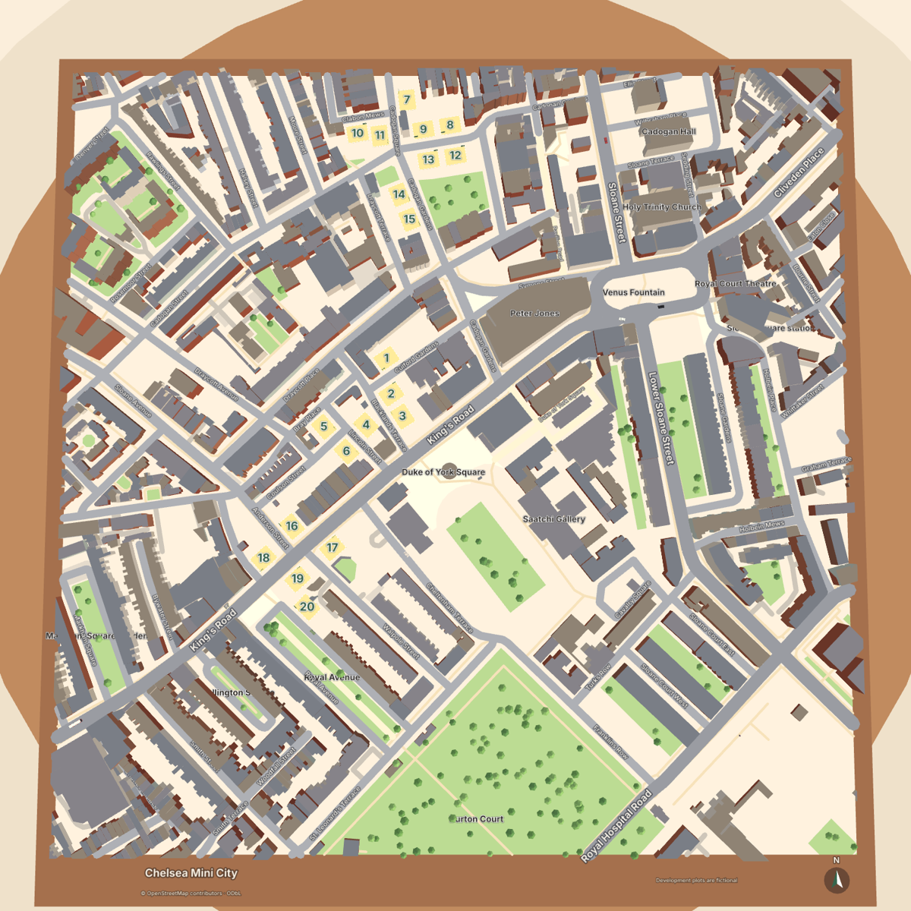
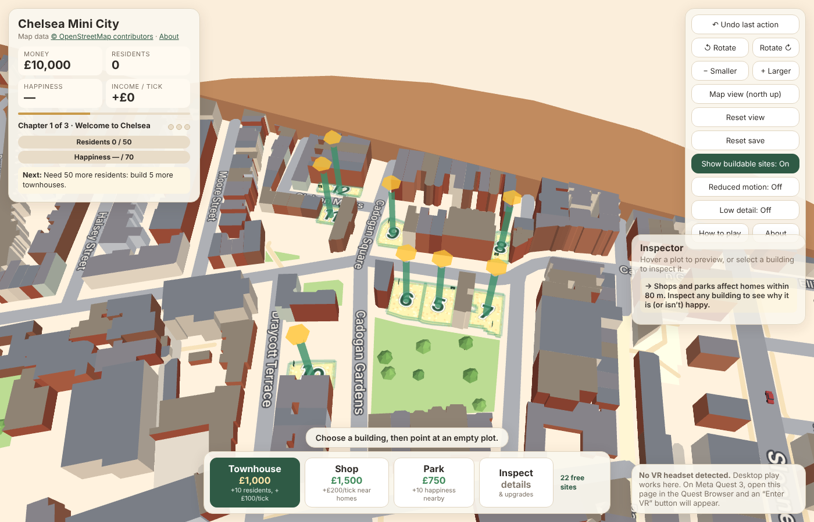
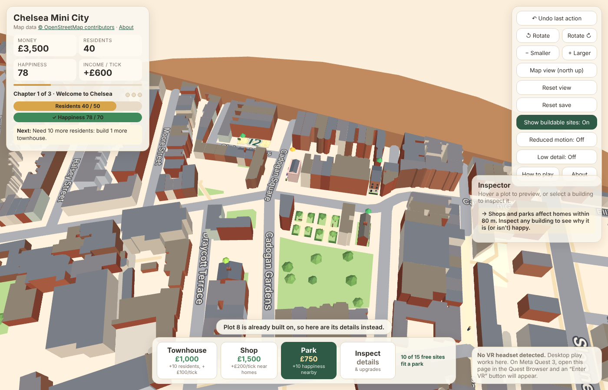
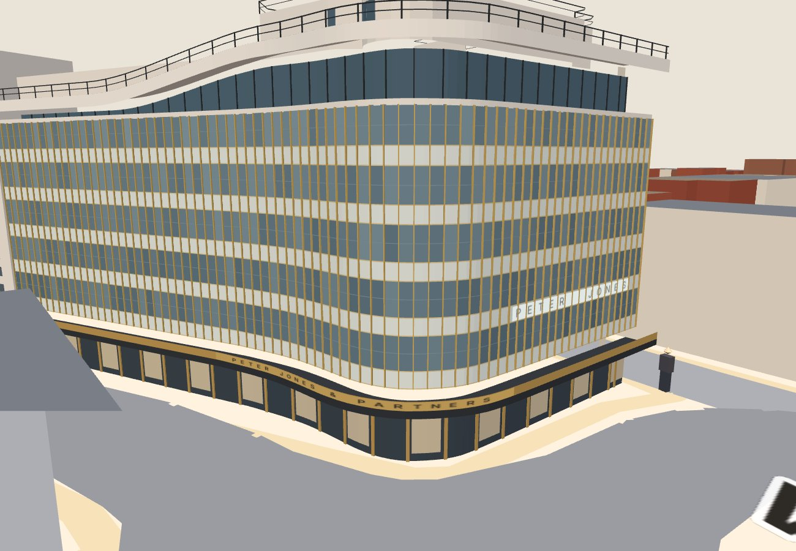

# Chelsea Mini City

A cosy, single-player tabletop city-builder for **Meta Quest 3** (WebXR in the Quest Browser), with a desktop fallback. You look down at a miniature of the real streets around King's Road, Duke of York Square and Sloane Square in Chelsea, London, and improve the neighbourhood by building homes, shops and parks on fictional development plots.

> **Map data © [OpenStreetMap contributors](https://www.openstreetmap.org/copyright)** (ODbL 1.0). Streets, squares, green spaces, building footprints and landmark positions come from OpenStreetMap. Architecture is stylised, and the numbered development plots are fictional.



**Live (after deployment):** https://vrmaria27.github.io/chelsea-mini-city-/

## How to play

1. **Choose a building**: Townhouse £1,000, Shop £1,500 or Park £750.
2. **Point at an empty plot**: one of the 22 numbered development sites, each marked by a green post with a gold diamond and a sandy, fenced pad. You'll see a ghost preview, the cost and the **exact effect** before you buy. Homes that would gain happiness get a green outline and a "+10 ♥" label, and shops and parks show their 80 m reach ring. The inspector lists the before → after residents, income and average happiness.
3. **Build a happier Chelsea**: click (desktop) or pull the trigger (VR) to confirm.

**Development sites.** There are 22 fictional sites spread over six neighbourhoods: Cadogan Gardens (8), Blacklands Terrace (4), Holbein Place & Mews (3), King's Road & Royal Avenue (3), Sloane Avenue & Sprimont Place (3) and Draycott Avenue (1). Each one replaces one ordinary building footprint, or a short row of them, and faces its street. Buildings are sized to fit each site rather than stretched: a wide site gets a longer terrace with more houses, a larger shop front or a bigger park. Some narrow sites can't take a park (it needs 8 × 8 m), and the preview says so before you pay. When you choose a tool, every site that fits it is outlined in pulsing green, and the counter beside the tools shows how many free sites fit (for example, "10 of 15 free sites fit a park"). If none fit, the message suggests what to build instead. **Show buildable sites** (or `B`) turns the posts and the always-on outlines on and off. Compatible sites are still outlined while a build tool is selected.

| Empty sites, townhouse tool selected | The same area after two parks, a shop and four homes |
|---|---|
|  |  |

*Tip for chapter 3:* the Cadogan Gardens cluster is the place for it. Two upgraded parks there (for example, sites 5 and 6) reach most of the homes around them.

**Inspect and upgrade.** Choose **Inspect**, or select any occupied plot with any tool, to see:
- the building's level, residents and income,
- its happiness breakdown,
- the shops and parks affecting it (blue outlines),
- one actionable hint.

Each building can be upgraded once to **Level 2**. The values below replace Level 1's:

| Building | Level 1 | Upgrade | Level 2 | Look |
|---|---|---|---|---|
| Townhouse | 10 residents, £100/tick | £1,500 | 20 residents, £180/tick | extra storey, columned porches, cornice, window boxes, planters |
| Shop | £200/tick when a home is within 80 m | £2,000 | £350/tick (same rule) | deeper striped awning, gilded sign, café umbrellas, flower boxes |
| Park | +10 happiness to homes within 80 m | £1,000 | +15 (same radius) | flower beds, extra benches, lamp posts |

Homes start at 50 happiness. A shop within 80 m adds 10 (once, however many shops), and each park within 80 m adds its bonus, up to 100. Average happiness is shown as "—" until someone lives here. Income arrives every 10 seconds of active play.

**Chapters** (each completes once and stays complete):
1. **Welcome to Chelsea:** 50 residents and 70 happiness.
2. **A Thriving High Street:** 80 residents, two active shops and two upgraded townhouses.
3. **A Greener Chelsea:** 100 residents and 80 happiness, with two upgraded parks.

After chapter 3 you can keep building freely (sandbox). The status panel shows a progress bar for each goal and one "Next:" hint.

| Control | Desktop | VR (Quest 3) |
|---|---|---|
| Choose tool | Bottom buttons, or keys `1` `2` `3`, `4`/`I` for Inspect | Menu panel (left of the table) |
| Build / inspect | Click a plot (touch: tap to preview, tap again to build) | Point the controller ray, pull trigger |
| Upgrade | Inspector card → Upgrade, or `U` | Inspector panel (right of the table) → Upgrade |
| Close inspector | ✕ or `Esc` | Close ✕ |
| Orbit / zoom / pan | Drag / scroll wheel / right-drag or shift-drag | No forced camera motion |
| Rotate model | Rotate buttons or `Q` `E` | Panel buttons, or flick thumbstick left/right (15° steps) |
| Model size | Smaller/Larger or `-` `+` | Panel buttons, or flick thumbstick up/down |
| Table height | n/a | ▼ Lower / ▲ Raise |
| Reset view | Button or `R` | Reset view (re-centres the table in front of you; works seated or standing) |
| Map view (north up) | Button or `M`: top-down camera, north at the top, all street names; press again for the tabletop view | Map view: the model turns north-away and tilts up toward you like a wall map (your viewpoint never moves); Tabletop view returns |
| About / attribution | "About" link under the title | Attribution line on the menu panel |
| Undo last action (build or upgrade, exact refund) | Button or `Z` | ↶ Undo last action |
| Show buildable sites | Toggle in the controls card, or `B` | Show sites toggle on the menu panel |
| Reduced motion / Low detail | Toggles in the controls card | Toggles on the menu panel |
| Reset save | Button + confirmation dialog | Press twice within 5 s |

- **Reduced motion** (on automatically if your system asks for reduced motion) freezes people and traffic, removes confetti and keeps the placement pulses static.
- **Low detail** hides people and traffic entirely.
- Neither setting changes gameplay.

Progress, chapters and preferences save to the browser's local storage after every build, upgrade, undo, setting change and income tick. The simulation pauses while the page is hidden, and it never fast-forwards on resume. Nothing is earned offline.

## Map data

| | |
|---|---|
| Area | 700 m × 700 m, centred on **51.4912 N, 0.1600 W**, between Duke of York Square and the western part of the King's Road section |
| Bounding box | south 51.488052, west -0.165055, north 51.494348, east -0.154945 |
| Source | OpenStreetMap via the Overpass API (`overpass-api.de`) |
| Retrieved | 2026-11-09 21:08 UTC (OSM data as of 2026-11-09T21:07:05Z) |
| Licence | Open Database License 1.0; attribution "© OpenStreetMap contributors" is shown on the model, the HUD, the VR panel and the About panel |
| Map version | `chelsea-osm` v1 (saves record the map id and version) |

**How it's built (reproducible).**
1. `npm run import:map:fetch` queries Overpass for a slightly larger box: highways, buildings, parks and gardens, squares, pedestrian areas and named landmarks. It saves `data/osm/raw.json` with the query, endpoint and timestamp. This sandbox can't reach Overpass, so the **Import OSM map data** GitHub Action ran the same script and committed the extract. Any Overpass JSON placed at `data/osm/raw.json` also works.
2. `npm run import:map` (`scripts/osm/process.mjs`, no dependencies) then:
   - projects to local metres (equirectangular about the centre; x east, z south; < 0.01% scale error) and clips to the box,
   - simplifies roads (0.5 m; 0.8 m for footways) while **keeping every junction vertex**, and simplifies footprints (0.3 m, area kept within 4%),
   - triangulates roofs and areas, keeping courtyards as holes,
   - places labels and fits the game plots,
   - writes `src/map/osm/chelsea-osm.json` (bundled; the game makes **no map requests at runtime**).

   It also keeps OSM ids, names, highway classes and building tags, and prints validation checks.

**Sourced vs estimated vs fictional.**
- **From OSM:**
  - street centrelines, curves, junctions, names and classes (main / street / service / pedestrian / footpath),
  - pedestrian areas and squares, parks and gardens,
  - 716 building footprints; heights from `height` (2, counted across the whole extract) or `building:levels` × 3.2 m + 1 m (2174),
  - landmark positions.
- **Estimated (documented):**
  - Road widths: OSM `width` where tagged (only 1 segment), otherwise by class:

    | Class | Width |
    |---|---|
    | primary | 12 m |
    | secondary | 11 m |
    | tertiary | 9 m |
    | residential | 7 m |
    | service | 4.5 m |
    | pedestrian | 6 m |
    | footway | 2.2 m |

    These are not surveyed measurements.
  - Building heights without tags (489 across the extract): a deterministic 3–5 storeys from the OSM id (3.5 m sheds; 18 m churches).
- **Stylised:** façade colours, flat roofs, trees inside green spaces, people and traffic.
- **Fictional:** the 22 development sites (map version 2). Each is an ordinary OSM building footprint, or a group of 2–4 adjoining small footprints, that the game "clears" for redevelopment. The 32 real footprints under them are hidden on the model. They are not claims that any property is vacant, for sale or available. Peter Jones, other landmarks, named buildings, squares, parks, streets and footpaths are never used.

**How the sites are chosen** (`scripts/osm/process.mjs`):
- The list is curated and versioned in `data/osm/sites-v2.json` (OSM way ids per site). The importer rebuilds each site from that list and warns if one is no longer valid. It does not silently pick new ones. `node scripts/osm/process.mjs data/osm/raw.json src/map/osm/chelsea-osm.json --propose` regenerates the proposal.
- Each candidate is 140–1000 m², roughly rectangular (≥ 72% of its oriented box) and at least 6 × 6 m inside. It needs a frontage edge running parallel to, and within 12 m of, a named street. The street-facing direction is the edge that touches the street.
- Each site stores its real boundary polygon, an oriented building rectangle inset at least 0.5 m inside that boundary, its street, its allowed types (townhouse 6 × 6 m, shop 7 × 6 m, park 8 × 8 m) and a sentence for each type that doesn't fit.
- Rejected: anything touching a protected landmark, overlapping a green space or plaza, crossing a road or footway buffer, or containing any other visible building (sampled on a 1 m grid).
- One shared definition drives rendering, picking (desktop ray and VR ray both test the boundary polygon), validation and the simulation's real-metre distances.

**Verification (automated, `tests/geo.test.ts` and importer checks):**
- No mirroring, axis swap or stretch: east is +x and north is −z, and projected distances match great-circle distances to within 0.1%.
- King's Road runs south-west to north-east (bearing 45–75°) into Sloane Square.
- Junction connectivity holds: King's Road ↔ Sloane Square, Lower Sloane Street ↔ Sloane Square, Cheltenham Terrace ↔ King's Road, Blacklands Terrace ↔ King's Road, Turks Row ↔ Lower Sloane Street.
- Seven landmarks appear in their correct relative positions: Sloane Square station, the Royal Court Theatre east of Peter Jones, the Saatchi Gallery east of Duke of York Square, Holy Trinity north of the Royal Court, and Burton Court south of the Saatchi Gallery.
- Sites don't touch roads, footpaths, other sites, plazas, green spaces, visible buildings or protected landmarks. Each faces its street, its building rectangle lies inside its boundary, and every building model (both levels) stays inside its site (`tests/sites.test.ts`).
- An exhaustive search confirms that all three chapters can be completed with legal, affordable placements. The best layout reaches 82 average happiness against the 80 target.
- Simulation distances are map metres, independent of tabletop zoom.
- No `fetch`/XHR/tile requests appear in the app source. A browser run of the built game recorded no external requests.

The map was **not** compared side by side with Google Maps by me. Use the top-down screenshot above (or press **Map view** in the game) to compare it yourself.

## Peter Jones model

Peter Jones (Grade II*, 1936–39, W. Crabtree with Slater & Moberly and C. H. Reilly) has a custom landmark model (`src/map/landmarks/peterJones.ts`), replacing its generic extrusion. It has the stable id `landmark:peter-jones`.



**References used:**
- Historic England listing 1226626, via https://britishlistedbuildings.co.uk/101226626-peter-jones-store-royal-hospital-ward (text).
- https://modernism-in-architecture.org/buildings/peter-jones/ (text).
- Panel size and panel counts as supplied by the project owner, citing https://awards.mediaarchitecture.org/mab/project/363.
- Four reference photos supplied by the project owner: the corner from Sloane Square (two recent, one older), and the King's Road side from Sloane Square.
- The photos were used for appearance only. No images or textures from them are in the game; all geometry and materials are original.

**Fitted to the real map:**
- The footprint is OSM way 28682626, used unsimplified.
- OSM part 532097395 (white, 7 storeys) is the upper storey with the rounded drum.
- Part 532534275 confirms the facade strip along King's Road, the curve and Sloane Square.
- The modelled frontage is the run of outline edges that front King's Road and Sloane Square (118 m: 74.5 m straight, a 22 m curve, then 21 m). The importer detects it.
- The curve is smoothed but stays within 9 cm of the OSM outline. The gentle reverse bend just before the curve is in the OSM data and is kept.
- The footprint and 25 Cadogan Gardens (way 1186000571, listed as part of the store) are protected. Plot generation can never use them, and tests check that.
- The canopy (2.2 m) and slab (1.2 m) overhang the pavement only.

| | Status |
|---|---|
| Curved corner at King's Road / Sloane Square, overall mass and footprint | **Observed** (OSM outline + photos) |
| Five window rows above the canopy: each a pale spandrel panel then two glazed panels, 965 × 1245 mm modules, with gold/bronze vertical mullions dominating | **Observed** (photos; panel size supplied). Mullions are placed at the uniform module; Crabtree's deliberate bay tapering is not modelled |
| Plate-glass ground floor under a dark cantilevered canopy with a bronze band | **Observed** (listing, photos) |
| "PETER JONES & PARTNERS" on the canopy band around the curve | **Observed** (photos 1 and 4); letter style approximate |
| Thick white top slab sweeping up in an S-curve toward the corner, recessed glazed storey beneath, tubular railings on top | **Observed** (photos 1, 3, 4; listing); the rise's exact start and end points are estimated |
| White upper storey with rounded drum and railings | **Observed** (photos; OSM part 532097395) |
| "PETER JONES" letters on white panels on the Sloane Square face | **Observed** in the older photo and the listing; may differ today (not visible in the recent photo) |
| White stair tower with a column of small windows; more muted extension to its west along King's Road | **Observed** (photos 1, 2; modernism-in-architecture.org); position along King's Road estimated |
| Storey heights (ground 4.6 m, canopy to 5.8 m, 3.735 m per row, slab 25.5 → 28.2 m, top ≈ 32.4 m) | **Approximate**, from the panel module and photo proportions |
| Symons Street and Cadogan Gardens elevations, roofs | **Approximate** (not in the references): plain cream walls with window bands |
| Glass reflections | Stylised: per-panel tint variation only (no real-time reflections) |

**Cost:** about 14,000 triangles merged into the existing single static draw call. Two small sign textures (2048 × 96 and 1024 × 80 px) are drawn as decals.

**Not done:** no side-by-side comparison against Google Maps or Street View, and no headset testing. The checks were renders compared with the supplied photos (`docs/peter-jones-*.jpg`).

## Install, run, build

Requires **Node.js 20+**.

```bash
npm install        # dev tools only: esbuild, TypeScript, tsx
npm run dev        # dev server with live rebuild → http://localhost:5173/
npm test           # unit tests (simulation, upgrades, previews, undo, chapters, save migration, geography)
npm run import:map # rebuild the bundled map from data/osm/raw.json (offline, deterministic)
npm run build      # type-check + production bundle → dist/
npm run preview    # serve dist/ → http://localhost:5173/
npm run check      # typecheck + tests + build
```

`dist/` is a fully static site with relative paths, so it can be hosted on any static host or subpath.

## Opening it on Quest 3

WebXR only works in a **secure context (HTTPS)**. Your laptop's `http://localhost:5173` is **not** reachable as `localhost` on the headset: on the Quest, `localhost` means the headset itself. Your laptop's LAN address (`http://192.168.x.x:5173`) is reachable, but it isn't HTTPS, so the Enter VR button won't appear. Use one of these instead:

**A. GitHub Pages (easiest, free):** push to `main`. The included workflow (`.github/workflows/deploy.yml`) tests, builds and deploys automatically. One-time setup: repo **Settings → Pages → Build and deployment → Source: GitHub Actions**. Then on the Quest open **https://vrmaria27.github.io/chelsea-mini-city-/** in the Quest Browser and press **Enter VR**.

**B. Local HTTPS dev server (same Wi-Fi):**
```bash
mkdir -p certs
openssl req -x509 -newkey rsa:2048 -nodes -days 30 -subj "/CN=chelsea-dev" \
  -keyout certs/key.pem -out certs/cert.pem
npm run dev        # now serves https:// and prints a "Network:" URL
```
Open the printed `https://192.168.x.x:5173/` on the Quest and accept the self-signed certificate warning (Advanced → Proceed).

**C. USB (developer mode):** `adb reverse tcp:5173 tcp:5173`, then open `http://localhost:5173` on the Quest. Browsers treat `localhost` as secure, so this works over the forwarded port.

## Manual headset checklist (Quest 3)

Not yet verified on a headset. Please check:

- [ ] Page loads in the Quest Browser over HTTPS and shows **Enter VR**. An older save moves to the real map with its buildings intact (message shown).
- [ ] Peter Jones is recognisable from the tabletop (curved corner, white top, gold-striped glazing) and holds up when you lean in close.
- [ ] The real street layout is recognisable at tabletop scale: King's Road, Sloane Square, Duke of York Square and the street names are readable. The "N" arrow on the plinth points north.
- [ ] **Map view** turns the model north-away and tilts it toward you without moving your viewpoint; **Tabletop view** returns it.
- [ ] The table appears in front of you at a comfortable height, **standing** and **seated** (use *Reset view* after sitting down). The menu panel is on the left and the inspector on the right, both readable at arm's length.
- [ ] Both controller rays appear and stop on the panels and on the map.
- [ ] **Panels block the map:** pulling the trigger on a panel (including the gaps between buttons) never builds on a plot behind it.
- [ ] With a build tool selected, the free sites that fit it pulse green and the counter updates. Green-and-gold site posts are visible from the tabletop. **Show sites** on the menu panel hides and shows the posts.
- [ ] The controller ray can target every numbered site, including the narrow ones (for example, sites 12 and 13). Pointing a park at a narrow site explains "Too small for a park" before you pull the trigger.
- [ ] Previewing a park or shop shows the ring, green outlines and "+10 ♥" labels on affected homes, and the inspector lists before → after numbers. The building you then get matches the preview.
- [ ] Pointing at an occupied plot and pulling the trigger opens its details. **Upgrade** charges once, shows the Level 2 look and a gold "Level 2" pulse, then greys out.
- [ ] **Undo last action** reverses an upgrade or a build with an exact refund.
- [ ] Chapter goals and the hint update. Completing a chapter shows a short banner and confetti without blocking play (no confetti with Reduced motion).
- [ ] Reduced motion freezes people and traffic; Low detail hides them. Both settings survive a reload.
- [ ] Rotate / Larger / Smaller / Lower / Raise / Reset view behave; thumbstick flicks rotate and resize in steps.
- [ ] Opening the Quest menu or removing the headset pauses income; nothing jumps ahead on return.
- [ ] Exit VR returns to the desktop view; reload restores the city.
- [ ] Motion feels comfortable and frame rate feels smooth, including with people and traffic on. (Use the OVR Metrics Tool if you want numbers.)

## Project layout

```
src/sim/        Pure rules: simulation, upgrades, estimates, inspection, chapters, tick clock, save v2 + migration
src/map/        osmMap.ts (real map from bundled OSM data), legacyMap.ts + chelsea.ts (old approximate map), types
src/map/osm/    chelsea-osm.json: processed, bundled OSM-derived map (ODbL)
scripts/osm/    fetch.mjs (Overpass extract), process.mjs (projection, clipping, plots, labels), geo.mjs
data/osm/       raw.json: the unmodified OSM extract the bundled map was built from (ODbL)
docs/           screenshots (top-down map view, gameplay)
src/engine/     Tiny WebGL2 renderer (incl. instancing), geometry builder, maths, text + marker atlases
src/game/       Game controller, inspector view model, city model, scene + overlays + picking, VR panels, life
src/main.ts     Desktop camera/input, HTML HUD, WebXR session and controllers
tests/          node:test unit tests (run with tsx)
public/         index.html (HUD markup and styles)
scripts/        esbuild build and dev/preview server
```

### Technical notes

- **Why not Three.js/Vite?** The environment this prototype was built in had no package-registry access, so it uses a small hand-written WebGL2 + WebXR renderer bundled with esbuild (the bundler Vite uses internally). There are no runtime dependencies, and the bundle is about 90 KB. Rendering is isolated in `src/engine` and `src/game/scene.ts`, so swapping in Three.js later wouldn't touch the game rules.
- **Performance choices:** all static scenery (terraces, roads, squares and trees, about 25k triangles) is merged into **one** vertex buffer and one draw call. The building layer is rebuilt only when buildings change. All map labels share one texture atlas. Lighting is a cheap hemisphere + sun model, with no shadows, post-processing or large textures. Frame rate on Quest 3 has **not** been measured.
- **Neighbourhood life:** at most 24 pedestrians (more as the population grows) walk fixed pavement loops around populated blocks, inset from the kerb so they never cross buildings. Six vehicles, including a red bus, drive fixed King's Road and side-street lanes on the left. People and vehicles each take one instanced draw call. There's no pathfinding or collision.
- **Previews are exact:** placement and upgrade estimates are computed by applying the real rules to a copy of the city, and tests check them against actual results.
- **Save format (v3):** `localStorage["chelsea-mini-city.save"] = { version: 3, map: { id, version }, state: { money, buildings: {plot: {type, level}}, lastAction, chapter, ticks }, prefs }`.
- **Moving saves to the real map:** v1/v2 saves belong to the legacy approximate map. On load they are moved through a deterministic table (`legacyPlotMap` in the bundled map data).
  - The importer builds three real-map clusters with the same sizes as the legacy ones (6, 9 and 5 plots). It pairs plots by distance rank from each cluster centre, so a legacy centre plot maps to the most central real plot.
  - Building types, levels, money, ticks, undo history and completed chapters are kept. Chapters never decrease. Happiness can change slightly because real distances differ.
  - The original save is always copied to `chelsea-mini-city.save.backup`.
- **If a placement can't be mapped** (or the save belongs to an unknown map), the game saves nothing and asks the player to **continue on the legacy map** or **start on the real map**. The backup stays either way. The legacy map can also be chosen any time from About (`?map=legacy` works too).
- Unreadable or unsupported saves start a new game with a notice and a backup. Unknown plots or building types are skipped, and refunds always use the canonical price.

## Economy and pacing

No prices or incomes were changed from the brief. The automated playthroughs complete all three chapters with legal moves on both maps. On the real map a solver finds a route in the Cadogan Gardens cluster (`tests/geo.test.ts`) that waits only **9 income ticks (≈1.5 minutes)** in total. Real sessions are dominated by deciding, previewing and inspecting, so they should land in the 15–20 minute range, but this hasn't been playtested with people. If chapters 2–3 feel too quick, the simplest lever is the upgrade prices in `src/sim/rules.ts`. The chapter thresholds were checked as achievable on the existing map and are unchanged.

## Known limitations

- Not yet tested on a Quest 3 headset (controller input, panel readability, comfort and performance are unverified).
- Geography is limited to a 700 m square and to what OpenStreetMap contains. Road widths are class estimates, and some building heights are estimated (see Map data). Roofs are flat and façades stylised.
- One-way streets and lane counts aren't modelled; decorative vehicles use both directions.
- The 22 development sites are fictional and the player can't choose other buildings. Narrow sites accept only townhouses and shops. Chapter 3 needs a deliberate layout: it is achievable, but with little slack (best case 82 happiness against 80).
- Saves from map version 1 (plots g1–g20) move each building to the matching new site, or to the nearest free site that fits it. If any building can't be placed, the game asks before changing anything. A backup of the old save is always kept (`chelsea-mini-city.save.backup` in local storage).
- Undo covers only the most recent build or upgrade. Completed chapters are never revoked by undo.
- People and vehicles are decorative and tiny at this scale. Pedestrians walk OSM footways and turn back at their ends. Vehicles drive real carriageways, pass through junctions without stopping and reappear at the start of their route.
- Hand tracking without controllers isn't specifically supported (controllers are expected).
- No sound.
- Some automated review browsers can't start WebGL2. The game shows an explanatory message there and otherwise needs a WebGL2-capable browser.
