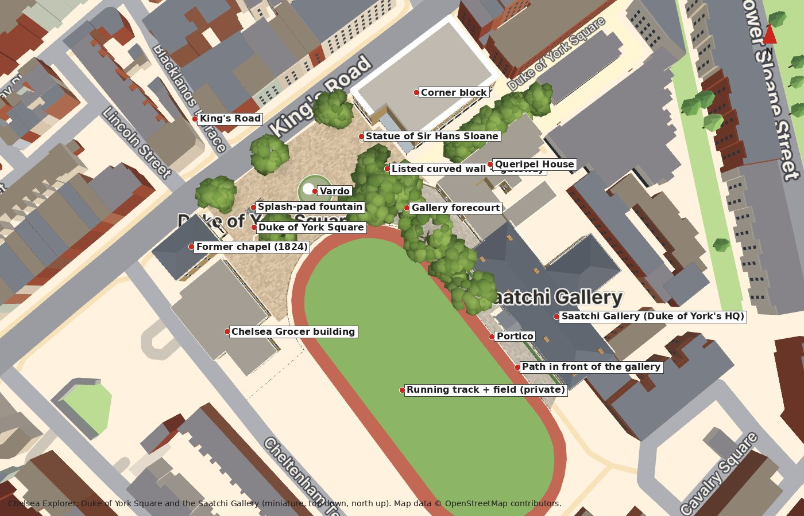
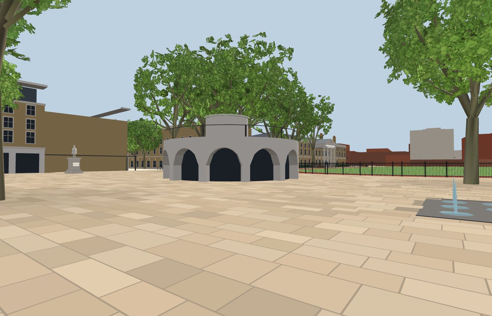
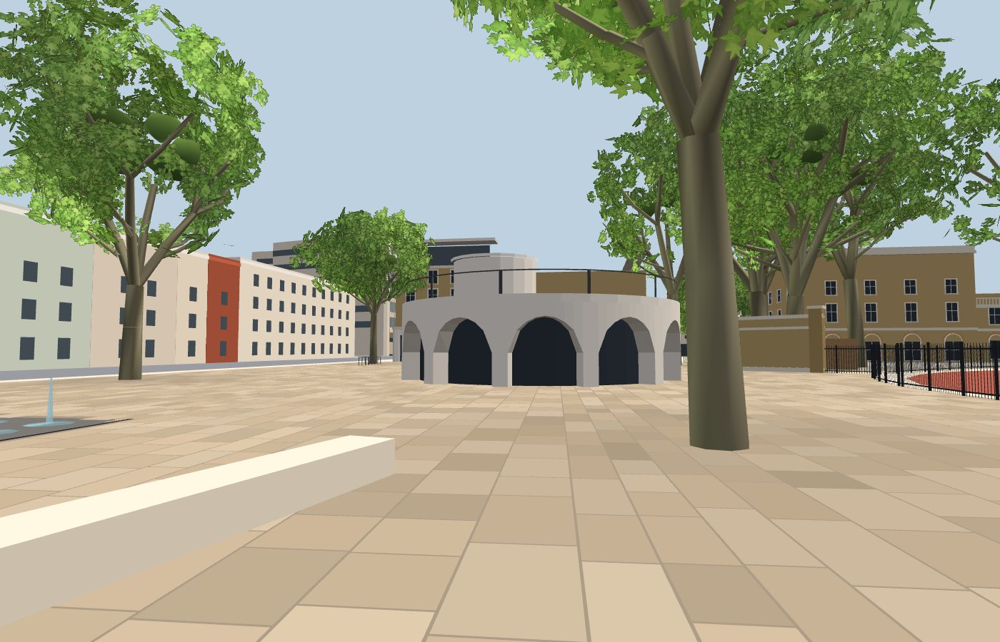
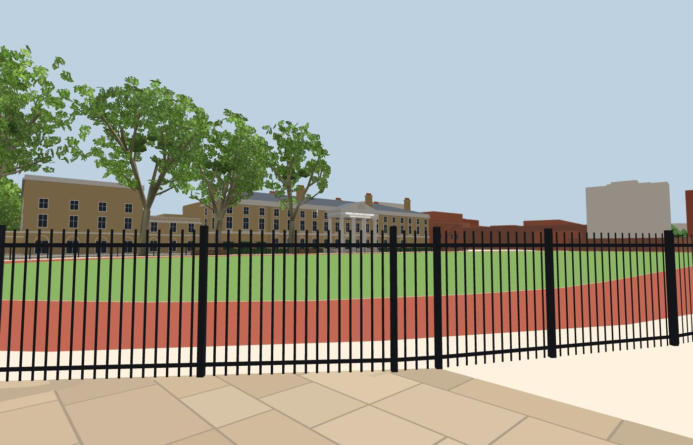
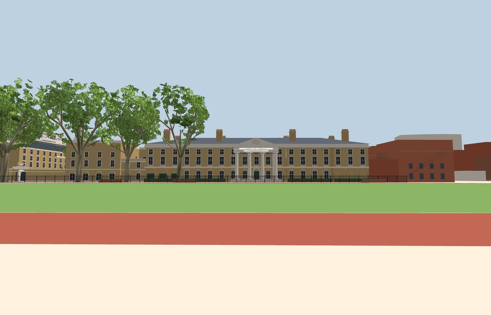
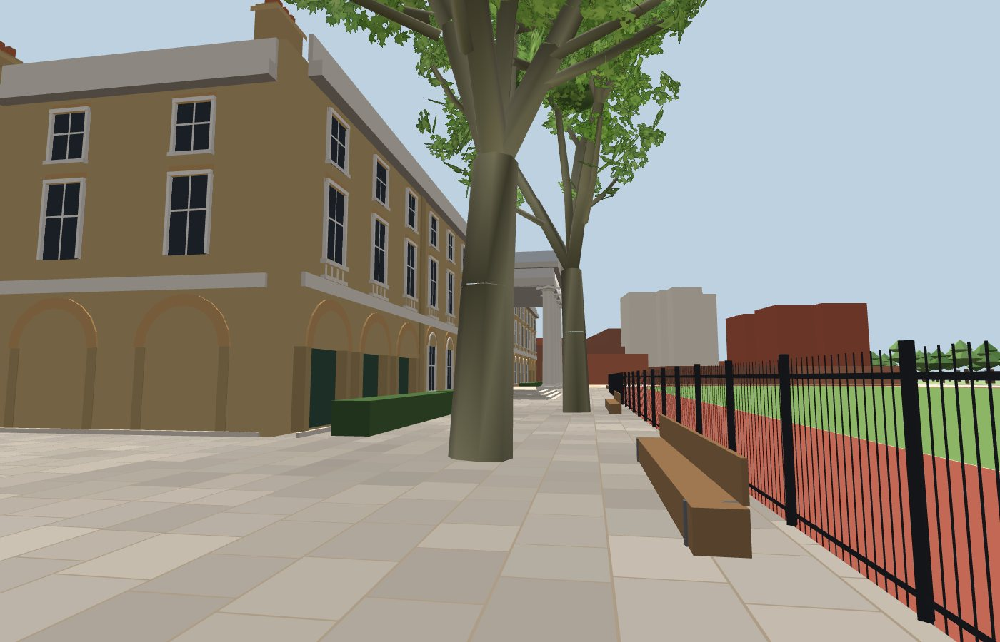
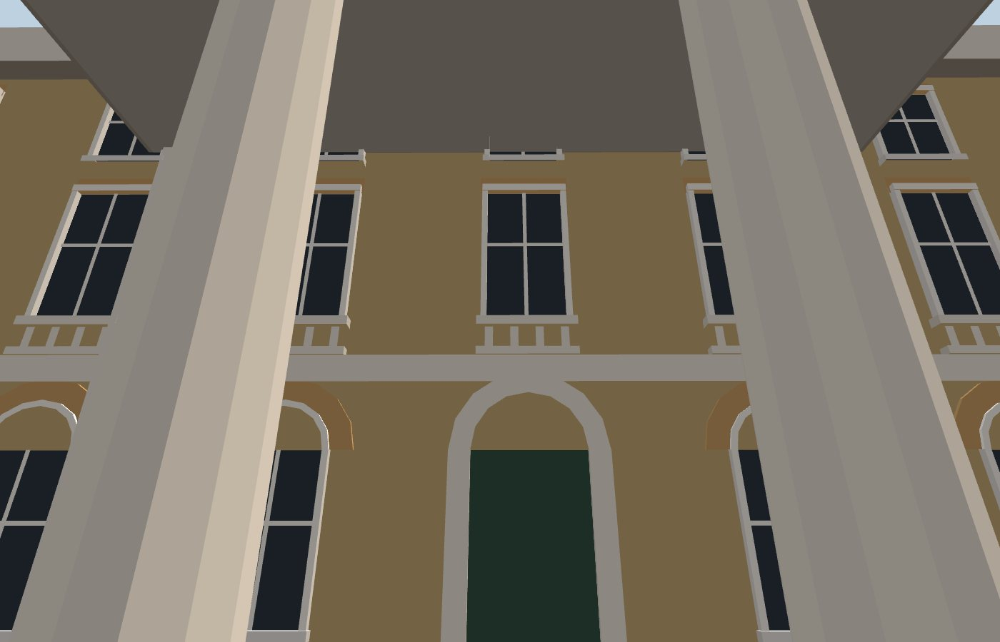
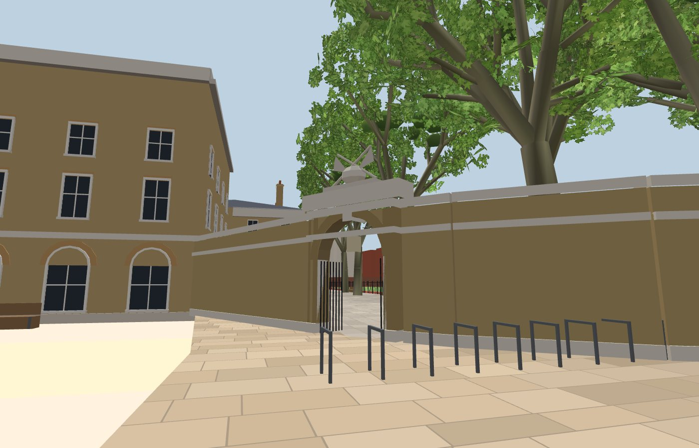
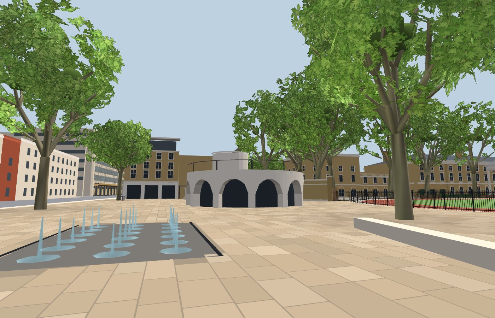
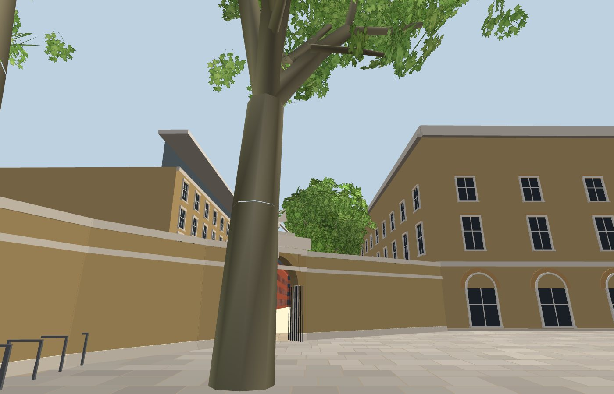

# Duke of York Square and the Saatchi Gallery: references, reconstruction and checks

This milestone adds individually modelled exteriors for the Saatchi Gallery (the Duke of York's
Headquarters) and the buildings that enclose Duke of York Square. It also adds the square's paving and
landscape, the gallery forecourt inside the listed curved wall, and street-level navigation for both
areas. The experience is still exploration only.

## 1. Reference inventory

**Geography.** All positions come from OpenStreetMap (ODbL, © OpenStreetMap contributors):
- the main extract (`data/osm/raw.json`), for footprints, streets and the plaza areas;
- a focused extract fetched for this milestone (`data/osm/doy-raw.json` and `doy-buildings.json`,
  retrieved 2026-11-11 by the *Import Duke of York Square OSM detail* workflow on the `osm-doy` branch).

The focused extract supplied:
- 21 trees and the listed curved wall (`way/101938927`, `height=4`);
- 7 gates, including the wall's gateway node `node/1176917584`;
- the railings round the track (`way/101938918`, `height=1`);
- benches (`seats=12` on the gallery path, and a stone bench);
- the splash-pad fountain (`node/7112868347`, `fountain=splash_pad`);
- the statue of Sir Hans Sloane (`node/8595860926`);
- the running track (`relation/18845038`, private) and the pitch (`way/1368124984`, private);
- footways with their surfaces, cycle parking, and shop and entrance nodes.

No Google imagery or third-party models were used.

**Written sources:**

| Source | Used for |
|---|---|
| [Historic England 1266717](https://historicengland.org.uk/listing/the-list/list-entry/1266717) (via [britishlistedbuildings.co.uk](https://britishlistedbuildings.co.uk/101266717-duke-of-yorks-headquarters-royal-hospital-ward), RBKC listing 420754) | Duke of York's HQ, 1801, John Sanders, Grade II*. Three storeys; **13 windows wide, wing ends 3 windows wide**; yellow brick; **stone pedimented Roman Doric tetrastyle portico**; stone cornice and blocking course; a band below the first-floor balustrade; arched, recessed ground-floor windows; gauged flat arches above; quadrant screens on either side |
| [Historic England 1224627](https://historicengland.org.uk/listing/the-list/list-entry/1224627) | Chapel to the Duke of York's HQ (Grade II*). The OSM description says it was built in 1824 as the HQ's chapel; it is now a shop |
| [RIBA Journal on Nex's pavilion](https://ribaj.com/buildings/kings-road-cafe-pavilion-duke-of-yorks-square-public-private-space-nex-jan-carlos-kucharek) | Vardo: circular with "no front or back"; precast Dolomite-quartz concrete arches; three 10 m curved glass walls; a planted, walkable roof reached by a rear timber stair; yorkstone setts in the square; the walled gallery grounds "opened out" to King's Road with a curved, gated wall |
| [Studio PDP, *Duke of York Square revisited*](https://studiopdp.com/blog/news-duke-of-york-square-revisited) | Masterplan (PDP), landscape by Elizabeth Banks Associates; stonework, trees, water features; direct access from King's Road |
| [Building, *Hip to be square*](https://www.building.co.uk/news/hip-to-be-square/1027020.article) | Masterplan by Paul Davis & Partners; Elizabeth Banks Associates, landscape architect |
| [Duggan Morris competition entry (site plan key)](https://competitions.malcolmreading.com/cadogancafe/shortlist/Duggan-Morris.pdf) | Names on the site: listed wall, Left Wing, Block A, Chapel Building, Queripel Building, access to the gallery, running track, playing field |

**Photographs.** These are openly licensed photographs from Wikimedia Commons, fetched by
`scripts/refs/fetch-commons-doy.mjs` on the `references-doy` branch, where `references/doy/index.json`
lists authors, licences and dates. They were used for reference only; none is shipped or used as a
texture.

| Subject | Files (Commons) | Author | Licence | Date |
|---|---|---|---|---|
| Main front, frontal | The Saatchi Gallery – geograph 6326084 | John Myers | CC BY-SA 2.0 | 2019-11-21 |
| Main front, frontal | Duke of York's Headquarters, Chelsea – geograph 8274815 | Stephen McKay | CC BY-SA 2.0 | 2026-03-19 |
| Main front | Saatchi Gallery – geograph 7987172 | Wayland Smith | CC BY-SA 2.0 | 2024-04-07 |
| Main front, oblique | The Saatchi Gallery – geograph 6111483 | Neil Theasby | CC BY-SA 2.0 | 2019-04-05 |
| Portico | Chelsea, Saatchi Gallery portico – geograph 6163828 | Jim Osley | CC BY-SA 2.0 | 2019-05-22 |
| Portico | Saatchi Gallery Portico.jpg | Matt Brown | CC BY 2.0 | 2023-11-29 |
| Portico frieze | Duke of Yorks Headquarters (29162713115) | Amanda Slater | CC BY-SA 2.0 | 2016-08-21 |
| North-west end and arcade | West Face / North Face of the Duke of York's HQ (01) | Doyle of London | CC BY-SA 4.0 | 2022-05-23 |
| North-west end and arcade | The Duke of York's HQ, approached from the north – geograph 7028258 | Stefan Czapski | CC BY-SA 2.0 | 2021-11-25 |
| Listed wall, gateway, trophy | Wall to the Northwest of the Duke of York's HQ (North Face 01; South Face 01, 02) | Doyle of London | CC BY-SA 4.0 | 2022-05-23 |
| Gallery name pylons | Saatchi Gallery signs, Chelsea 2026-09-12 | Bex Walton | CC BY 4.0 | 2026-09-12 |
| Field, railings, track | The Saatchi Gallery – geograph 4518938 | Anthony O'Neil | CC BY-SA 2.0 | 2014-12-24 |
| Field, railings, track | Duke of York Square, Chelsea – geograph 8274905 | Stephen McKay | CC BY-SA 2.0 | 2026-03-19 |
| Chapel | Duke of York's HQ Chapel – geograph 7390841 | N Chadwick | CC BY-SA 2.0 | 2022-10-30 |
| Chapel | Chapel to Duke of York's Headquarters 03, 06 | Edwardx | CC BY-SA 3.0 | 2013-09-22 |
| Square: statue, wall, Vardo, paving | Duke of York's Square, Chelsea – geograph 7628684 | Dylan Moore | CC BY-SA 2.0 | 2023-10-13 |
| Statue | Statue of Hans Sloane in the Duke of York Square (01) | Doyle of London | CC BY-SA 4.0 | 2022-05-23 |
| Vardo | View of the Vardo restaurant – geograph 7679482 | Robert Lamb | CC BY-SA 2.0 | 2023-11-25 |
| Vardo, King's Road edge | Duke of York Square – Kings Road – During COVID lock down | Kwh1050 | CC BY-SA 4.0 | 2020-04-20 |
| Corner block | Christmas Tree in the Duke of York Square – 2025-12-10 (architecture only) | Jim Linwood | CC BY 4.0 | 2025-12-10 |
| Grocer building | Duke of York Square, Chelsea – geograph 8275095 | Stephen McKay | CC BY-SA 2.0 | 2026-03-19 |
| Square, east side | Duke of York Square – geograph 8312043 | N Chadwick | CC BY-SA 2.0 | 2025-02-23 |

The following were classed as temporary and excluded:
- Christmas trees, the twelve-days-of-Christmas sculptures, festive tunnels and wreaths;
- exhibition banners on the portico and the wall (2016–2023);
- the "Flower sculpture" (2024) and the "Sandcastle" (2017);
- market stalls (Duke of York Square Fine Food Market);
- café umbrellas and branded parasols.

The grey **SAATCHI GALLERY** pylons on the wall are modelled. They appear, unchanged, in photographs
from 2022 and 2026.

## 2. Spatial arrangement

All dimensions are map metres in the existing projection.

**Fixed by OpenStreetMap:**
- every building footprint;
- the plaza outline (`way/5318345`) and the market area;
- the wall line and its gateway;
- the railings, track and pitch rings;
- the footpath in front of the gallery (`way/124031663`);
- tree, bench, statue and fountain positions.

Nothing was moved or enlarged.

**Derived (offline, `scripts/osm/process.mjs`):**
- *The gallery forecourt.* It runs from the curved wall, along the south-west faces of Queripel House
  and the north-west wing, to the gallery front, then out to the footpath centreline + 2.5 m.
- *The gallery frame.* The front line runs at bearing ≈ 142°; the façade is 65.7 m long.

**Measured from the OSM footprint:**
- the portico jog: 17.8 m wide, projecting 5.3 m, centred on the front;
- the main range: 21–22 m deep;
- the rear wing: 18.6 m wide, 20 m deep.

**Estimated from photographs** (window bay ≈ 3.4 m, from 13 windows across the 44.5 m main range):

| Feature | Height or size |
|---|---|
| Cornice | 10.75 m |
| Blocking course | 11.55 m |
| Hipped slate roof | +3.4 m |
| Chimney stacks | to ≈ 16 m |
| Portico columns | Ø 0.95 m, ≈ 7.5 m |
| Pediment apex | ≈ 12.5 m |
| Curved wall | 4 m (OSM) |
| Railings | 1.8 m (see note) |

OSM tags the railings at 1 m; photographs show them clearly taller than people. The model follows the
photographs; this is a documented discrepancy.

## 3. What was built and how closely it follows the evidence

**Saatchi Gallery** (`doy:saatchi`, `src/map/landmarks/dukeOfYork.ts`):

| | Status |
|---|---|
| South-west front: 3 + 13 + 3 windows, arched ground floor, stone band with balustrade panels, sashes with gauged flat arches, stone cornice and blocking course | **Matches** HE 1266717 and photographs |
| Tetrastyle Roman Doric portico on a stepped podium; pediment with the arms (simplified relief); *DUKE OF YORK'S* on the frieze and *HEADQUARTERS* on the architrave | **Observed**. The arms and lettering are simplified |
| Wing ends with open ground-floor arches and green doors; the same treatment on the exposed part of the north-west end | **Observed** |
| Hipped slate roofs, four paired stacks | Roof form **observed**; stack positions **estimated** |
| Rear and south-east elevations | **Approximate**: same storeys, plain arches. Not visible from public viewpoints |
| Depth: portico, steps, cornices, arcade recesses, window surrounds and balustrades are geometry | Implemented. Window glass sits just in front of the wall plane (as elsewhere in the project) |

**Square-defining buildings:**

| Building | Model | Basis |
|---|---|---|
| Former chapel (`w124030230`, now a shop) | Two-storey body with round-headed windows and a low hipped roof. The King's Road front is 4 bays with arched windows in recesses. A single-storey projection toward the square has a two-column colonnade | Photographs 2013–2022 and HE 1224627. The colonnade's placement is **estimated** from a simplified OSM outline |
| Corner block on King's Road (`w124032943`) | White stone ground floor with shopfronts; 3 storeys of buff brick with stone-framed windows and Juliet balconies; recessed top storey under a thin white canopy | Photograph 2025. **No shop brand is modelled** |
| Queripel House (`w124030228`) and the north-west wing (`w124030204`, `w124030200`) | Yellow stock brick, stone bands, arched ground floor, sashes, parapets (balustraded on the wing) | **Estimated**: few clear photographs |
| Chelsea Grocer building (`w124030209`) | Two storeys, tall sashes over a stone band, cornice | Photograph 2026-03. **No brand** |
| Vardo (`w124030215`) | Twelve wide precast arches on slim piers round a dark glazed drum; planted roof with a parapet and steel rail; small rooftop drum | RIBA Journal and photographs. The drum's position and the arch count are **estimated** |
| Ticket kiosk, canopy | Small boxes | OSM marks the kiosk position as approximate |

**Public spaces** (`src/map/landmarks/dukeOfYorkSquare.ts`):
- **Paving.**
  - *The square:* warm buff Yorkstone flags (0.6–0.9 × 0.9–1.5 m), coursed along King's Road.
  - *The forecourt:* greyer flags coursed along the gallery front.
  - Both are clipped exactly to the OSM areas, with mortar joints and soft tree shade.
- **Splash-pad fountain.** A granite field with 18 flush jets (the jet layout is estimated) and low animated jets.
- **Statue of Sir Hans Sloane.** A stepped stone pedestal with an inscription panel and a simplified marble figure.
- **The listed curved wall.**
  - Brick on a stone plinth, with a string course and coping, along the OSM line.
  - The arched gateway has gauged-brick voussoirs, a keystone, open iron gates and a lantern, and carries the raised stone block and trophy.
  - A brick pier stands at the wall's end, and the gallery name pylons face the square.
- **Railings, hedges and landscape.**
  - Spear-top railings run round the track and along the forecourt edge (the second run is estimated where OSM maps the path but no fence).
  - A clipped hedge runs along the gallery front, broken at the portico.
  - The red track and grass field are private; there are no scatter trees on the field.
- **Furniture.** Long timber benches on the gallery path, the stone bench in the square, and Sheffield stands in rows.
- **Trees.** The 18 London planes within the area come from OSM and use the project's plane-tree generator:
  - mature trees in the gallery grounds, 23–28 m;
  - medium trees in the square, 15–19 m;
  - smaller trees in the lane, 12–15 m.

  Each has its own size, branching, rotation and sway phase. They are lighter than the Sloane Square trees: branches to depth 2 and two leaf cards per tip.
- **Ground levels.** The paving is at 0.32 m, above the 0.22 m footways; buildings start at ground level.

## 4. Navigation and viewpoints

Street level now covers a second zone: the square, the forecourt and 5 m round them (including the
King's Road pavement). It excludes:
- buildings, with 1.3 m façade clearance;
- the Vardo, the statue, the fountain field, tree trunks, benches and cycle stands;
- the curved wall (its gateways stay open);
- the railings;
- the hedge band along the gallery;
- the track and the field, which are private and fenced.

The playing field is never walkable, and no viewpoint implies access to it.

| Viewpoint (places menu) | Position | View |
|---|---|---|
| Duke of York Square from King's Road | King's Road pavement at the square's edge | Into the square toward the Vardo, the wall and the gallery |
| Duke of York Square | South-west corner of the square | Across the square to the statue, the corner block and the Vardo |
| Saatchi Gallery | South-west part of the square, 5 m from the railings | The main front across the track and field (the only public frontal view; ≈ 95 m) |
| Saatchi Gallery: the portico | Footpath in front of the portico | Up at the columns, the door and the frieze |

All four are tested: they are walkable, have room around them and a clear line of sight, and no tree
trunk sits in front of the view.

## 5. Comparison with the references

I compared renders with photographs taken from similar angles. No numerical similarity is claimed.

**Matches closely:**
- the gallery's silhouette;
- its 3 + 13 + 3 window rhythm;
- the central portico with pediment and frieze lettering;
- the stone band with balustrade panels;
- the arched ground floor and the green-doored arcades at the wing ends;
- the hipped roofs with stacks;
- the relationship of the field, railings and track to the front (compare `doy-gallery-frontal.jpg` with the 2019 frontal photograph);
- the curved wall's gateway with the trophy, the lantern and the open gates;
- the position of the gallery-name pylons;
- the square's relationship of the Vardo, the statue, the curved wall and King's Road;
- the warm buff paving.

**Estimated:**
- all storey heights;
- the chimney positions;
- the coat of arms;
- the chapel's colonnade placement;
- Queripel House and the north-west wing's elevations;
- the Vardo's arch count and rooftop drum;
- the fountain jet layout;
- railing heights;
- tree sizes.

**Incomplete:**
- the quadrant screens (HE) are not modelled separately;
- the gallery's rear and south-east elevations are generic;
- the shopfronts on the lane north of the square are generic masses (out of scope);
- there are no lamp columns (none are mapped);
- there are no planters, because their positions are unknown;
- there is no wall "blind arch" detail;
- the paving joints are flat colour.

Screenshots (headless Chrome, software rendering):

| | |
|---|---|
|  |  |
|  |  |
|  |  |
|  |  |
|  | |

`doy-gallery-frontal.jpg` is taken from the private field to match the angle of the reference photograph. It is not a viewpoint in the app.

## 6. Assets and performance

**Assets:**
- All geometry is original.
- The only textures are the existing leaf atlas and the shared sign atlas: two new inscription lines, the statue panel and the pylon lettering.
- No photographs or third-party models are embedded.

**Performance.** Measured in headless Chromium with SwiftShader software rendering at 1400 × 900 on a 2-vCPU container. These numbers compare builds; they are not Quest frame rates, which have not been measured.

| View | Before (`main`, d2828df) | After |
|---|---|---|
| Static mesh | 115.7k triangles | 175.6k (DoY models ≈ 34k, landscape ≈ 25k) |
| Nature layers (full) | 49k (14 trees) | 79k (32 trees) |
| Default miniature | 217 ms, 27 calls, 143k triangles drawn | 300 ms, 47 calls, 225k |
| Miniature close-up, Sloane Square | 433 ms, 154k | 450 ms, 187k |
| Miniature close-up, Duke of York Square | 217 ms, 129k | 483 ms, 239k |
| Street, Sloane Square looking west | 533 ms, 164k | 617 ms, 247k |
| Street, Sloane Square looking east | 500 ms, 144k | 500 ms, 159k |
| Street, across Duke of York Square | n/a | 483 ms, 236k |
| Street, from King's Road | n/a | 367 ms, 234k |
| Street, at the portico | n/a | 333 ms, 258k |

The figures shown in the "After" column follow these optimisations:
- the static scene is now split into 6 × 6 visibility tiles instead of 4 × 4;
- railings use thin quads, not boxes;
- the Duke of York Square trees use lighter branches and fewer leaf cards;
- the paving uses larger flags;
- the miniature uses clump foliage unless the view is close to either square.

## 7. Remaining approximations (largest impact on realism first)

1. **Generic elevations around the square.** Queripel House, the north-west wing and the gallery's rear are
   generic Georgian treatments, not surveyed façades. The lane shops north of the square are plain masses.
2. **Flat colour.** Brick, stone and paving are flat colours with no texture or weathering; there are no shadows.
3. **Simplified details.**
   - Portico: the coat of arms and the trophy are simplified, and the lettering is approximate.
   - Chapel: its colonnade placement is estimated.
   - Vardo: its arch count is estimated.
4. **Missing pieces.** There are no lamp columns, planters, bollards or drainage details, and the paving has no kerbs or steps.
5. **Estimated heights** throughout (from photographs).

## 8. Quest 3 review checklist (Duke of York Square)

Not yet verified on a headset.

- [ ] From the places menu, *Duke of York Square from King's Road* stands you on the pavement facing into the square. Nothing moves on its own.
- [ ] Teleporting works across the square and through the wall's gateway into the forecourt. The Vardo, statue, fountain field, benches, wall, railings, hedge and the track and field all refuse with a reason.
- [ ] At the portico, the column scale, steps, door and frieze lettering read correctly at arm's length, and the soffit is not too dark.
- [ ] The gallery seen across the field (*Saatchi Gallery* viewpoint) is recognisable: portico, 3 + 13 + 3 windows, roofs and stacks.
- [ ] The paving joints, railing bars and leaf cards don't shimmer badly when moving the head.
- [ ] The frame rate feels smooth looking from the square toward the gallery with the planes in view (check with OVR Metrics).
- [ ] The miniature still shows both squares clearly. Labels are optional, and the pins for the gallery and the square sit in the right places.
- [ ] Returning to the miniature and back keeps your heading. Snap turn and seated mode work as at Sloane Square.
