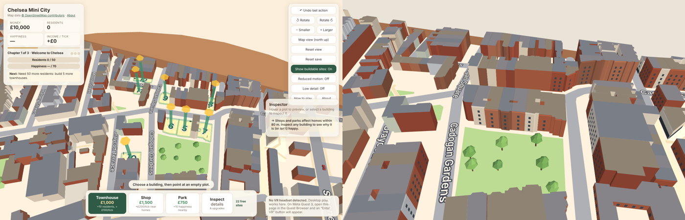

# Chelsea Explorer: refactor notes

Chelsea Explorer replaces the city-builder ("Chelsea Mini City") with a way to explore the reconstructed
neighbourhood around Sloane Square, first as a tabletop miniature and then at street level. The last version
of the game is preserved on the **`game-final`** branch (commit `e7b0886`).

## What changed

| Area | Before (game) | Now (explorer) |
|---|---|---|
| Runtime | `src/sim/*` (rules, simulation, chapters, save) and `src/game/*` (controller, panels, inspector, plot meshes, people and traffic) | Removed. `src/explore/*` holds the exploration state, walkable surfaces, landmarks and preferences; `src/view/*` holds the one scene and the VR panel |
| Update loop | 10-second income ticks, chapter checks, celebrations | Rendering only. There is no timer, tick or background state |
| UI | Money, residents, happiness, build tools, inspector, undo, chapters | View switch (Miniature / Street level), north indicator, places list, settings, a short help line, About |
| Scene data | `chelsea-osm.json` held plots, site boundaries and save-migration tables | Geography only. The gameplay data is archived in `data/legacy/game-sites-v2.json` and is not loaded |
| Former sites | 32 OSM footprints hidden under 22 fictional plots | Restored as buildings (see below) |
| Saves | `chelsea-mini-city.save` (v3) | New key `chelsea-explorer.prefs` (v1). The old keys are only read |

The separation is deliberately small. The geography is `src/map/*` (unchanged landmark models, plus `osmMap.ts`
without plots). Exploration code depends on the geography, never the other way round. Building and feature ids are
the OSM ids (`w28682626`, `r12224305` …) and the model ids (`square:hotel`, `landmark:peter-jones` …), so any
future gameplay can attach to locations without changing the map.

## Restored development sites

The importer (`scripts/osm/process.mjs`) still derives the old site list from `data/osm/sites-v2.json`, but only to
write the archive. It no longer adds plots to the scene data. Each footprint that a site replaced now carries
`formerSite: true` and is drawn like any other building:

- **All 32 footprints are back, in their OSM positions.** Where one site had covered a row of 2–4 small footprints,
  each footprint is restored on its own.
- **Heights come from the OSM `building:levels` tags** on every one of them (7.4–17 m).
- **The masses are approximate.** Each is a flat-roofed extrusion in a deterministic colour. Near the square it also
  gets generic window rows and a cornice line. None of this is a reconstruction of the real façade.
- **The ground was not touched.** The sites never overlapped mapped pavements, gardens or plazas, so plot outlines,
  signs, posts and pads simply disappear. Courtyards (holes in footprints) stay open.
- **Player-built homes, shops and parks never appear.** The explorer does not read their positions at all.



## Legacy saves

| Key | What it was | What the explorer does |
|---|---|---|
| `chelsea-mini-city.save` | The city-builder save (v1–v3) | Reads it only to describe it in About and to offer **Download a copy** |
| `chelsea-mini-city.save.backup` | The game's automatic backup | Same |
| `chelsea-mini-city.map` | Legacy map choice | Included in the download |
| `chelsea-mini-city.onboarded` | Game onboarding flag | Included in the download |

These keys are never written, migrated or deleted. A test checks this: after a full session, the only key written is
`chelsea-explorer.prefs`.

The download (`chelsea-mini-city-legacy-save.json`) contains every legacy key exactly as stored.

To play an old city again, build the `game-final` branch (`git checkout game-final && npm install && npm run build`).
It reads the same keys, so a save left in the browser loads as before. `data/legacy/game-sites-v2.json` documents
which OSM footprints the site ids `k01`–`k22` referred to.

## Exploration preferences

`localStorage["chelsea-explorer.prefs"]`:

```json
{ "version": 1, "viewpoint": { "x": 212, "z": -152, "yaw": 1.62 }, "miniature": { "yaw": 0, "scale": 1 },
  "labels": true, "lowDetail": false, "reducedMotion": false, "snapTurnDeg": 30, "seated": false }
```

- **Units.** Map metres, with x east and z south. A yaw of 0 faces north.
- **No height is stored.** The eye height always comes from the walking surface.
- **Loading is defensive:**
  - malformed JSON or an unknown version falls back to the defaults;
  - fields with the wrong type fall back one by one;
  - the scale is clamped;
  - a viewpoint is kept only if it is still on a walkable surface, so a changed map can't place you inside a building or below the ground.
- **No audio settings.** The app has no sound, so there is nothing to store.
- **The app always opens on the curated scene, in the miniature.** The saved viewpoint is offered as the spot to return to.

## Navigation surfaces

`src/explore/nav.ts` decides where you can stand.

**Inside the zone.** Street level is bounded to the well-reconstructed area: the square and everything within 38 m of
its kerb (the façades all round it, the station forecourt and the south end of Sloane Street). A second zone covers
Duke of York Square, the Saatchi Gallery forecourt inside the curved wall, and 5 m round them; see
[duke-of-york-square.md](duke-of-york-square.md#4-navigation-and-viewpoints). A third zone covers both pavements of King's Road
from Sloane Square to the Markham Square junction, with an end-of-area message at its western end; see
[kings-road.md](kings-road.md#6-navigation-and-the-boundary). Within a zone a point
is walkable if it is one of these:
- the paved square;
- a mapped plaza;
- the pavement band beside a carriageway;
- a mapped footway.

**Never walkable:**
- building footprints, or anywhere within 1.3 m of one (bays, columns and shopfronts project beyond the footprint);
- carriageways and mapped carriageway or parking areas;
- the fountain basin, the memorial, the drinking fountain, lamp posts and tree trunks;
- gardens, which may be private;
- block interiors.

**Teleporting.** Targets must be within 40 m and in line of sight; a point behind a building counts as the building.
Desktop walking slides along obstacles and never leaves walkable ground. In VR, if you physically walk into a building
footprint, the view dims.

## Discovery

The places menu (`src/explore/landmarks.ts`) lists the 18 landmarks in the scene, each with its verified name, a short
statement and its sources:
- **Seven are in the street-level area.** Selecting one moves you to a tested viewpoint after a brief fade (no flight
  through buildings). Each viewpoint is walkable, has room around it, has a clear line of sight to the landmark and has
  no tree trunk in front.
- **The others are shown on the miniature with a pin:** Cadogan Hall, the Saatchi Gallery, Duke of York Square,
  Royal Avenue, Burton Court, Wellington Square and Markham Square Gardens.
- **Where no fact could be checked, none is given.** The two garden squares say only that they are garden squares off
  King's Road, as mapped.

## Performance

Measured in headless Chromium (Playwright) with **SwiftShader** software rendering, at 1400 × 900 and device pixel
ratio 1, on a 2-vCPU container. These numbers compare builds; **they are not Quest frame rates, which have not been
measured.**

| View | Game (`e7b0886`) | Explorer |
|---|---|---|
| Static mesh (triangles) | 103.8k | 115.7k (32 restored masses, window rows near the square) |
| Default tabletop / miniature | 283 ms, 61 draw calls, 161k triangles drawn | 217 ms, 27 draw calls, 143k triangles |
| Square close-up, 1.8× | 483 ms | 433 ms, 23 draw calls, 154k triangles |
| Street level in the square, looking west | n/a | 467 ms, 22 draw calls, 164k triangles (15 of 16 tiles visible) |
| Street level in the square, looking east | n/a | 433 ms, 15 draw calls, 144k triangles (8 of 16 tiles visible) |

What keeps the cost down:
- **Shared resources.** Each layer is built once: the static scenery, the decals, the trees and water, and the label atlas. The miniature and street-level views share them and differ only in a matrix.
- **Visibility handling.** The static scenery is split into 4 × 4 tiles, and tiles outside the view frustum are skipped.
- **Level of detail for the trees.** The miniature uses the opaque clump foliage unless you are close to the square; street level uses the alpha-tested leaf cards.
- **Less drawn every frame.** Labels and the plinth are drawn only in the miniature, and the people, traffic, overlays and panels from the game are gone.
- **What was not added:** reflections, shadows, post-processing and additional transparency.

SwiftShader is CPU-bound and dominated by fill rate (the leaf cards fill much of the screen at street level), so a GPU
will behave differently.

## Remaining visual approximations (largest impact on realism first)

1. **Most buildings are plain masses.** Everything outside the square's perimeter, including the 32 restored
   footprints, is a flat-roofed extrusion at its OSM storey height in a deterministic colour. The masses within 240 m
   get generic window rows and a cornice line. Looking down King's Road or Sloane Street, they read as blocks, not as
   Chelsea terraces.
2. **Streets are class-estimated.** Main roads are 12 m wide unless tagged, so some real pavements come out narrower.
   Outside the square there are no kerbs, road markings, crossings, traffic signals or bus stops.
3. **Lighting and materials are minimal:**
   - one sun plus ambient light, with no shadows or occlusion;
   - flat colours with no façade textures (signs are the only textures);
   - a plain sky colour;
   - the map edge (350 m away) is the horizon, with no distant skyline.
4. **The square's perimeter models are simplified.** Ornament, bay glazing and gable sizes are approximate, and a few
   frontages are less well referenced (see [square-buildings.md](square-buildings.md#coverage-and-resemblance)).
5. **Peter Jones is partly approximate.** The mullions follow a uniform module, and the Symons Street and Cadogan
   Gardens elevations are approximate.
6. **Only the square's trees are detailed.** Its 14 trees are individual plane trees at their OSM positions. Trees in
   other green spaces are stylised clumps at unsourced positions, and there are no street trees along King's Road.
7. **Street furniture is limited to the square,** and there are no people or vehicles.

## Manual Quest 3 checklist

Not yet verified on a headset.

- [ ] **Loading.** Over HTTPS the page shows **Enter VR**. The miniature appears on a table in front of you, at a comfortable height standing and seated (use **Reset table position** after sitting down).
- [ ] **Miniature controls.** The panel on the left of the table is readable. Rotate, Larger, Smaller and Reset work, and thumbstick flicks rotate (15°) and resize. The plinth's N arrow points north.
- [ ] **Choosing a spot.** Pointing at the pavement or the square and pulling the trigger shows a green ring with an arrow; buildings and roads show red and explain why. Pulling the trigger on the panel, including between buttons, never picks a spot behind it.
- [ ] **Entering street level.** **Go to street level** fades briefly and puts you in the square at eye height, facing the way the arrow pointed. Nothing jumps or moves on its own.
- [ ] **Teleporting.** The ray shows a green ring on valid pavement, and pulling the trigger steps there with a brief fade, keeping your heading. Red rings appear on buildings, roads, the fountain, trees, beyond the edge of the area and beyond 40 m.
- [ ] **Snap turn.** Flicking the thumbstick left or right turns 30° (45° with **Snap 45°**). Turning feels comfortable and does not move you.
- [ ] **Hand panel.** At street level the panel sits above the left controller and is easy to aim at with the right ray. **Back to miniature** is always reachable.
- [ ] **Places.** A place in the street-level area fades you to a viewpoint facing it. Other places return you to the miniature with a pin above them. Descriptions are readable.
- [ ] **Seated mode.** **Seated on** raises a seated view to standing eye height at street level.
- [ ] **Walking into a building.** Physically walking into a façade dims the view.
- [ ] **Exiting.** **Exit VR** returns to the desktop view, and a reload offers your last street spot.
- [ ] **Visuals.** Leaf cards don't shimmer badly at street level, and the frame rate feels smooth looking across the square (use the OVR Metrics Tool for numbers).
