# King's Road, Sloane Square to Markham Square: survey, reconstruction and checks

This milestone rebuilds both sides of King's Road from Sloane Square to the Markham Square junction, building by building. The scene stops there. Completed models are unchanged: Peter Jones, the Sloane Square perimeter, Duke of York Square and the Saatchi Gallery. The experience is still exploration only.

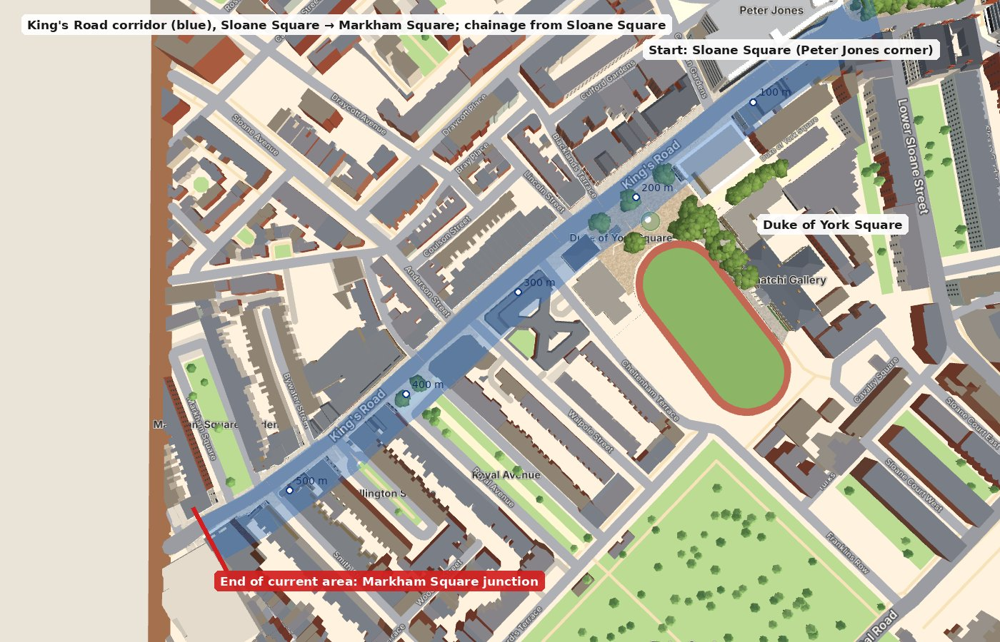

## 1. Scope and endpoint

- **Route:** the King's Road centreline is assembled from the OpenStreetMap primary-road ways named *King's Road*. Chainage runs from the Sloane Square end, at 0 m.
- **Endpoint:** chainage **562 m**, a line across the corridor just west of the Markham Square junction (red in the overview).
  - The junction's corner buildings are complete: No. 138A on the east corner, the west-corner range, and Atlantic Court opposite.
  - Atlantic Court's footprint crosses the line and is kept whole rather than sliced.
- **Beyond the endpoint:**
  - Buildings stay in the scene as plain pale massing, with no colour or windows, so they don't suggest a reconstruction.
  - Walking is refused with *"End of the current area"*.
  - No wall or gate is placed across the road.
- **Included:** every building with a footprint edge facing King's Road within 16 m of the centreline between 3 m and 562 m.
  - That is **60 buildings in 62 footprints**: two multipolygons have a second outer ring.
  - The importer detects them (`scripts/osm/process.mjs`), so nothing relies on a hand-picked list.
  - Corner buildings get a short return façade (at most 16 m) on the side street.
  - Side streets themselves are not extended.

## 2. Sources

**Geometry.** © OpenStreetMap contributors (ODbL).
- Footprints, the road network, crossings, post boxes and street trees come from the main extract (2026-11-09).
- They are complemented by two focused corridor extracts retrieved on 2026-11-12, OSM data as of 08:39 UTC (`data/osm/kr-buildings.json`, `data/osm/kr-raw.json`, from the *Import King's Road corridor OSM detail* workflow on the `osm-kr` branch).
- The newer extract supplies three footprints missing from the main one:
  - No. 138, the former Markham Arms;
  - Nos 114–116;
  - Whitelands House.
- OSM maps no street lamps or bollards along this stretch, so none are modelled.

**Heritage and planning.**

| Source | Used for |
|---|---|
| Historic England 1224735 | Nos 74–108: mid-19th-century stucco terrace, a balanced composition with central and subsidiary features |
| Historic England 1224736 | Nos 110–112: houses with shops, Doric pilasters to the first and second storeys |
| Historic England 1224816 | No. 72, the former Colville Tavern |
| Historic England 1224691, 1224629 | Nos 55–59 and 61–65 (Wellington Square development): symmetrical, centre house advanced and pedimented, iron balconies |
| Historic England 1225025 | No. 138A: early 19th century, three storeys, full-height bow |
| RBKC Royal Hospital Conservation Area Appraisal (2016), south side of King's Road | Nos 51–53 (gauged arches, shared mansard), 67–67a, 69 (Wright's Dairy, cow's head), 69A; Duke of York Square buildings |
| Brick Development Association, Brick Awards 2024 shortlist, and planning application PP/21/02928 | 120 King's Road (Squire & Partners, 2023): reclaimed stock brick, arched openings, darker base, green tiles |

**Photographs.** These are openly licensed photographs from Wikimedia Commons, fetched by `scripts/refs/fetch-commons-kr.mjs` on the `references-kr` branch; `references/kr/index.json` there lists all 260 images with authors and licences. They are reference only: none is shipped or used as a texture. The images cited in the configurations are:

| Ref | Commons file | Author | Licence | Date |
|---|---|---|---|---|
| C:027 | [Chelsea , Atlantic Court, King's Road - geograph.org.uk - 8043716.jpg](https://commons.wikimedia.org/wiki/File:Chelsea_,_Atlantic_Court,_King%27s_Road_-_geograph.org.uk_-_8043716.jpg) | Jim Osley | CC BY-SA 2.0 | 2025-04-30 |
| C:031 | [Duke of York Square - geograph.org.uk - 8312043.jpg](https://commons.wikimedia.org/wiki/File:Duke_of_York_Square_-_geograph.org.uk_-_8312043.jpg) | N Chadwick | CC BY-SA 2.0 | 2025-02-23 |
| C:032 | [Kings Rd - geograph.org.uk - 8312040.jpg](https://commons.wikimedia.org/wiki/File:Kings_Rd_-_geograph.org.uk_-_8312040.jpg) | N Chadwick | CC BY-SA 2.0 | 2025-02-23 |
| C:033 | [Kings Rd - geograph.org.uk - 8312036.jpg](https://commons.wikimedia.org/wiki/File:Kings_Rd_-_geograph.org.uk_-_8312036.jpg) | N Chadwick | CC BY-SA 2.0 | 2025-02-23 |
| C:040 | [138a King's Road Chelsea London SW3 4XB.jpg](https://commons.wikimedia.org/wiki/File:138a_King%27s_Road_Chelsea_London_SW3_4XB.jpg) | Spudgun67 | CC0 | 2024-05-07 |
| C:047 | [Former Chelsea Drugstore now a McDonald's.jpg](https://commons.wikimedia.org/wiki/File:Former_Chelsea_Drugstore_now_a_McDonald%27s.jpg) | Matt Brown | CC BY 2.0 | 2023-11-29 |
| C:049 | [King's Road gable.jpg](https://commons.wikimedia.org/wiki/File:King%27s_Road_gable.jpg) | Matt Brown | CC BY 2.0 | 2023-11-29 |
| C:066 | [King's Road, Chelsea - geograph.org.uk - 7628775.jpg](https://commons.wikimedia.org/wiki/File:King%27s_Road,_Chelsea_-_geograph.org.uk_-_7628775.jpg) | Dylan Moore | CC BY-SA 2.0 | 2023-10-13 |
| C:078 | [A3217 - geograph.org.uk - 7390839.jpg](https://commons.wikimedia.org/wiki/File:A3217_-_geograph.org.uk_-_7390839.jpg) | N Chadwick | CC BY-SA 2.0 | 2022-10-30 |
| C:080 | [Kings Rd - geograph.org.uk - 7390843.jpg](https://commons.wikimedia.org/wiki/File:Kings_Rd_-_geograph.org.uk_-_7390843.jpg) | N Chadwick | CC BY-SA 2.0 | 2022-10-30 |
| C:099 | [Kings Road - geograph.org.uk - 7180899.jpg](https://commons.wikimedia.org/wiki/File:Kings_Road_-_geograph.org.uk_-_7180899.jpg) | James Emmans | CC BY-SA 2.0 | 2022-05-08 |
| C:127 | [Kings Road from Sloane Square - geograph.org.uk - 6227946.jpg](https://commons.wikimedia.org/wiki/File:Kings_Road_from_Sloane_Square_-_geograph.org.uk_-_6227946.jpg) | Roy Hughes | CC BY-SA 2.0 | 2019-08-03 |
| C:128 | [Smith Street, Chelsea, June 2019.jpg](https://commons.wikimedia.org/wiki/File:Smith_Street,_Chelsea,_June_2019.jpg) | Peter Trimming | CC BY-SA 2.0 | 2019-06-24 |
| C:133 | [Shops on King's Road, Chelsea - geograph.org.uk - 8269756.jpg](https://commons.wikimedia.org/wiki/File:Shops_on_King%27s_Road,_Chelsea_-_geograph.org.uk_-_8269756.jpg) | David Howard | CC BY-SA 2.0 | 2018-06-12 |
| C:134 | [72 Kings Road.jpg](https://commons.wikimedia.org/wiki/File:72_Kings_Road.jpg) | Tillmann Lenz | CC BY-SA 4.0 | 2017-09-27 |
| C:155 | [View of Markham Square from King's Road - geograph.org.uk - 4810276.jpg](https://commons.wikimedia.org/wiki/File:View_of_Markham_Square_from_King%27s_Road_-_geograph.org.uk_-_4810276.jpg) | Robert Lamb | CC BY-SA 2.0 | 2016-01-30 |
| C:156 | [View up Smith Street - geograph.org.uk - 4810277.jpg](https://commons.wikimedia.org/wiki/File:View_up_Smith_Street_-_geograph.org.uk_-_4810277.jpg) | Robert Lamb | CC BY-SA 2.0 | 2016-01-30 |
| C:158 | [Kings Rd - geograph.org.uk - 4800572.jpg](https://commons.wikimedia.org/wiki/File:Kings_Rd_-_geograph.org.uk_-_4800572.jpg) | Nigel Mykura | CC BY-SA 2.0 | 2015-11-27 |
| C:175 | [Walpole St - geograph.org.uk - 4181465.jpg](https://commons.wikimedia.org/wiki/File:Walpole_St_-_geograph.org.uk_-_4181465.jpg) | N Chadwick | CC BY-SA 2.0 | 2014-05-24 |
| C:176 | [Whitelands House - geograph.org.uk - 4181473.jpg](https://commons.wikimedia.org/wiki/File:Whitelands_House_-_geograph.org.uk_-_4181473.jpg) | N Chadwick | CC BY-SA 2.0 | 2014-05-24 |
| C:218 | [Trotters, Kings Road - geograph.org.uk - 2976156.jpg](https://commons.wikimedia.org/wiki/File:Trotters,_Kings_Road_-_geograph.org.uk_-_2976156.jpg) | Oast House Archive | CC BY-SA 2.0 | 2012-06-03 |
| C:235 | [Chelsea Building Society, Kings Road SW3 - geograph.org.uk - 2105105.jpg](https://commons.wikimedia.org/wiki/File:Chelsea_Building_Society,_Kings_Road_SW3_-_geograph.org.uk_-_2105105.jpg) | Robin Sones | CC BY-SA 2.0 | 2010-10-10 |
| C:255 | [The King's Road Chelsea - geograph.org.uk - 1569036.jpg](https://commons.wikimedia.org/wiki/File:The_King%27s_Road_Chelsea_-_geograph.org.uk_-_1569036.jpg) | Rod Allday | CC BY-SA 2.0 | 2009-11-01 |

**Shop branding.** Business names are not modelled. Fascias are plain and the photographs' brands (bank, café, fashion chains) are omitted, because occupancy changes and several images are years old. Seasonal decorations, scaffolding (No. 1–15 in 2019) and promotional displays are excluded.

## 3. Fitting the street between the building lines

West of Royal Avenue, the OSM centreline runs about 2.5 m closer to the south frontage than the north. The street between the façades there is only 14.5–17 m wide. The default 12 m carriageway therefore reached the south façades and left no pavement.

The footprints are the better-surveyed edge, so the importer now fits the carriageway between them:
- **Re-centring:** it measures the building lines either side every 5 m (garden railings count as a line at Markham Square and Royal Avenue), then re-centres the carriageway between them, by at most 3 m.
- **Narrowing:** it narrows the carriageway only where needed to keep at least 3 m of pavement each side (minimum 8.5 m, normally 12 m).
- **Side streets:** the shift fades out over 23 m from the centreline, so side streets stay joined at their junctions.

The result is 8.5–10.4 m of carriageway west of Tryon Street, with 12 m kept east of it.

## 4. How the buildings are made

Each building has its own configuration in `src/map/landmarks/kingsRoadSpecs.ts`:
- storey heights, upper-floor bays and window treatment per storey;
- wall and base materials;
- string courses, pilasters and quoins;
- parapet, cornice or blocking course; roof (flat, mansard with dormers, pitched, gables); chimney stacks;
- shopfront arrangement: units, entrance positions, recessed lobbies, consoles, fascia colour;
- a hook for features unique to that building.

`kingsRoad.ts` turns a configuration into geometry on the OSM footprint:
- **King's Road fronts:** detected from the footprint and merged.
- **Corner returns:** treated for one bay of shopfront, then rendered wall with a side door.
- **Party walls and backs:** stay plain.
- **Shared components:** sash windows, shopfront units, cornices and dormers, used only where buildings genuinely share them.
- **Real depth:** recessed shop entrances (lobby, reveals and soffit), window reveals, surrounds, hoods, pediments, balconies and fascia cornices have depth. Glass sits slightly back. There are no interiors or reflections.

Unique features have hooks (`kingsRoadHooks.ts`):
- the former Chelsea Drugstore's base and corner tower;
- the Colville Tavern's attic blocking;
- the pedimented centres of Nos 55–65 and the attic of the terrace's central house;
- the pedimented bay of Nos 68–70;
- Wright's Dairy;
- Atlantic Court's piers and coved cornice;
- 120 King's Road's tiles and set-back storey;
- the bow of No. 138A;
- the Wellington Square kiosk.

Behind the corridor, generic masses within 60 m of the road now carry window rows, so side-street views have no blank boxes.

## 5. Coverage

Every surveyed building, in walking order from Sloane Square, by side:
- **Chainage:** metres along the road.
- **Front:** the length of King's Road frontage, plus any corner return.
- **Status:**
  - *Observed:* the configuration follows a listing or a clear photograph.
  - *Partly observed:* some elements are estimated.
  - *Estimated:* no adequate reference; the frontage is unresolved.

The table is generated by `npx tsx scripts/docs/kr-coverage.ts`. Peter Jones (north side, 0–80 m) and the Duke of York Square models keep their existing models and are not repeated here.
### North side (even numbers), walking west from Sloane Square

| Chainage | Address | OSM | Storeys, height | Front (m) | Upper bays | Materials | Roof / top | Ground floor | Status | Sources | Remaining approximations |
|---|---|---|---|---|---|---|---|---|---|---|---|
| 122 m | 34–46 (Sidney Smith Buildings) | w897420433 | 4 + gables, ≈17 m | 38 (+16 return) | 11 | red | pitched, cornice, 3 stacks | 5 shopfronts | Observed | C:158 (2015): red brick, four storeys with Dutch-gabled attics and stone dressings; C:049 (2023): gable with the "Kings Road" cartouche over three round-headed windows with shell tympana; C:218 (2012): canted corner shopfront at Cadogan Gardens | Cartouche and shell tympana simplified; OSM levels (3 + 2 roof) differ from the four storeys seen |
| 144 m | 52 | w897420432 | 4, ≈15 m | 6 | 1 | red | parapet, 2 stacks | 1 shopfront, recessed doors | Partly observed | C:032 (2025, looking east along the north side), C:158 (2015), OSM levels 4 | Gable count and window pairing estimated from oblique photographs; shopfronts generic |
| 149 m | 54 | w897420431 | 4 + gables, ≈17 m | 5 | 1 | red | pitched, parapet, 2 stacks | 1 shopfront, recessed doors | Partly observed | C:032 (2025, looking east along the north side), C:158 (2015), OSM levels 4 | Gable count and window pairing estimated from oblique photographs; shopfronts generic |
| 157 m | 56–58 | w897420430 | 4 + gables, ≈17 m | 11 | 3 | red | pitched, parapet, 2 stacks | 2 shopfronts, recessed doors | Partly observed | C:032 (2025, looking east along the north side), C:158 (2015), OSM levels 4 | Gable count and window pairing estimated from oblique photographs; shopfronts generic |
| 169 m | 60–62 | w897420429 | 4, ≈15 m | 12 | 3 | red | parapet, 2 stacks | 2 shopfronts, recessed doors | Partly observed | C:032 (2025, looking east along the north side), C:158 (2015), OSM levels 4 | Gable count and window pairing estimated from oblique photographs; shopfronts generic |
| 181 m | 64–66 | w897420428 | 4 + gables, ≈17 m | 11 | 3 | red | pitched, parapet, 2 stacks | 2 shopfronts, recessed doors | Partly observed | C:032 (2025, looking east along the north side), C:158 (2015), OSM levels 4 | Gable count and window pairing estimated from oblique photographs; shopfronts generic |
| 189 m | 68–70 (corner of Blacklands Terrace) | w897420427 | 4, ≈15 m | 8 (+16 return) | 3 + 3 | red over portland | cornice | 2 shopfronts | Observed | C:099 (2022) and C:032 (2025): red brick with stone quoins and dressings, a central bay with an iron balcony, arched window and pediment, stone ground floor; OSM levels 4 | — |
| 212 m | 72 (former Colville Tavern) | w124038807 | 3, ≈12 m | 17 (+16 return) | 3 + 2 | stucco | cornice | Victorian pub front | Observed | HE 1224816 (formerly the Colville Tavern and Wine Stores; mid C19, stucco, three storeys, three bays, Doric pilasters to first and second storeys, plain east wing); C:134 (2017): Victorian pub front with arched windows and red granite piers, dentilled cornice, central attic blocking | — |
| 233 m | 74 | w120654470 | 3, ≈12 m | 5 (+8 return) | 1 | stucco | cornice, 1 stack | 1 shopfront, consoles, recessed doors | Partly observed | HE 1224735 (mid C19 stucco terrace, 3 storeys, balanced composition with central and subsidiary features; cornices partly altered); C:033 (2025), C:078 (2022), C:099 (2022) | Window rhythm estimated per house width; shopfront details generic |
| 241 m | 76–78 | w120654446 | 3, ≈12 m | 11 | 2 | stucco | blocking, 1 stack | 2 shopfronts, consoles, recessed doors | Partly observed | HE 1224735 (mid C19 stucco terrace, 3 storeys, balanced composition with central and subsidiary features; cornices partly altered); C:033 (2025), C:078 (2022), C:099 (2022) | Position and form of the central/subsidiary features estimated from the listing and distant photographs |
| 250 m | 80 | w120654494 | 3, ≈12 m | 5 | 1 | stucco | cornice, 1 stack | 1 shopfront, consoles, recessed doors | Partly observed | HE 1224735 (mid C19 stucco terrace, 3 storeys, balanced composition with central and subsidiary features; cornices partly altered); C:033 (2025), C:078 (2022), C:099 (2022) | Window rhythm estimated per house width; shopfront details generic |
| 255 m | 82 | w120654475 | 3, ≈12 m | 5 | 1 | stucco | cornice, 1 stack | 1 shopfront, consoles, recessed doors | Partly observed | HE 1224735 (mid C19 stucco terrace, 3 storeys, balanced composition with central and subsidiary features; cornices partly altered); C:033 (2025), C:078 (2022), C:099 (2022) | Window rhythm estimated per house width; shopfront details generic |
| 263 m | 84–86 | w896933677 | 3, ≈12 m | 11 | 2 | stucco | cornice, 1 stack | 2 shopfronts, consoles, recessed doors | Partly observed | HE 1224735 (mid C19 stucco terrace, 3 storeys, balanced composition with central and subsidiary features; cornices partly altered); C:033 (2025), C:078 (2022), C:099 (2022) | Window rhythm estimated per house width; shopfront details generic |
| 271 m | 88 | w896933678 | 3, ≈12 m | 5 | 1 | stucco | cornice, 1 stack | 1 shopfront, consoles, recessed doors | Partly observed | HE 1224735 (mid C19 stucco terrace, 3 storeys, balanced composition with central and subsidiary features; cornices partly altered); C:033 (2025), C:078 (2022), C:099 (2022) | Window rhythm estimated per house width; shopfront details generic |
| 277 m | 90 | w120654501 | 3, ≈12 m | 6 | 2 | stucco | blocking, 1 stack | 2 shopfronts, consoles, recessed doors | Partly observed | HE 1224735 (mid C19 stucco terrace, 3 storeys, balanced composition with central and subsidiary features; cornices partly altered); C:033 (2025), C:078 (2022), C:099 (2022) | Position and form of the central/subsidiary features estimated from the listing and distant photographs |
| 283 m | 92 | w120654477 | 3, ≈12 m | 6 | 2 | stucco | blocking, 1 stack | 2 shopfronts, consoles, recessed doors | Partly observed | HE 1224735 (mid C19 stucco terrace, 3 storeys, balanced composition with central and subsidiary features; cornices partly altered); C:033 (2025), C:078 (2022), C:099 (2022) | Position and form of the central/subsidiary features estimated from the listing and distant photographs |
| 288 m | 94 | w120654464 | 3, ≈12 m | 5 | 1 | stucco | cornice, 1 stack | 1 shopfront, consoles, recessed doors | Partly observed | HE 1224735 (mid C19 stucco terrace, 3 storeys, balanced composition with central and subsidiary features; cornices partly altered); C:033 (2025), C:078 (2022), C:099 (2022) | Window rhythm estimated per house width; shopfront details generic |
| 293 m | 96 | w120654472 | 3, ≈12 m | 5 | 1 | stucco | cornice, 1 stack | 1 shopfront, consoles, recessed doors | Partly observed | HE 1224735 (mid C19 stucco terrace, 3 storeys, balanced composition with central and subsidiary features; cornices partly altered); C:033 (2025), C:078 (2022), C:099 (2022) | Window rhythm estimated per house width; shopfront details generic |
| 299 m | 98 | w120654450 | 3, ≈12 m | 6 | 1 | stucco | cornice, 1 stack | 1 shopfront, consoles, recessed doors | Partly observed | HE 1224735 (mid C19 stucco terrace, 3 storeys, balanced composition with central and subsidiary features; cornices partly altered); C:033 (2025), C:078 (2022), C:099 (2022) | Window rhythm estimated per house width; shopfront details generic |
| 305 m | 100 | w120654489 | 3, ≈12 m | 5 | 1 | stucco | cornice, 1 stack | 1 shopfront, consoles, recessed doors | Partly observed | HE 1224735 (mid C19 stucco terrace, 3 storeys, balanced composition with central and subsidiary features; cornices partly altered); C:033 (2025), C:078 (2022), C:099 (2022) | Window rhythm estimated per house width; shopfront details generic |
| 310 m | 102 | w120654473 | 3, ≈12 m | 6 | 1 | stucco | cornice, 1 stack | 1 shopfront, consoles, recessed doors | Partly observed | HE 1224735 (mid C19 stucco terrace, 3 storeys, balanced composition with central and subsidiary features; cornices partly altered); C:033 (2025), C:078 (2022), C:099 (2022) | Window rhythm estimated per house width; shopfront details generic |
| 315 m | 104 | w120654484 | 3, ≈12 m | 5 | 1 | stucco | cornice, 1 stack | 1 shopfront, consoles, recessed doors | Partly observed | HE 1224735 (mid C19 stucco terrace, 3 storeys, balanced composition with central and subsidiary features; cornices partly altered); C:033 (2025), C:078 (2022), C:099 (2022) | Window rhythm estimated per house width; shopfront details generic |
| 324 m | 106–108 (corner of Anderson Street) | w120654453 | 3, ≈12 m | 12 (+8 return) | 2 | stucco | blocking, 1 stack | 2 shopfronts, consoles, recessed doors | Partly observed | HE 1224735 (mid C19 stucco terrace, 3 storeys, balanced composition with central and subsidiary features; cornices partly altered); C:033 (2025), C:078 (2022), C:099 (2022) | Position and form of the central/subsidiary features estimated from the listing and distant photographs |
| 348 m | 110–112 (corner of Anderson Street) | w781302179 | 3, ≈12 m | 14 (+12 return) | 3 + 2 | stucco | cornice | 2 shopfronts, consoles | Observed | HE 1224736 (houses with shops below, mid C19, stucco, three storeys, five bays altogether, Doric pilasters to first and second storeys); C:235 (2010) | Five bays split three to King's Road and two to Anderson Street (estimated) |
| 361 m | 114–116 | r12200265-2 | 2, ≈8 m | 15 (+10 return) | 4 | stucco | parapet | 2 shopfronts | Estimated | OSM r12200265 (114–116 King's Road, levels 2 and 4) | Unresolved frontage: no openly licensed photograph found; two-storey street range from OSM levels, finish and windows assumed |
| 379 m | 118 (part of 120 King's Road, 2023) | w806116008 | 4, ≈16 m | 8 (+10 return) | 2 | buff over brown | parapet | full-height glazing | Partly observed | BA 2024 (Squire & Partners: reclaimed London stock in Flemish bond, arched brick openings, darker brick base, green tiles and dark metalwork, fully glazed shopfronts); planning PP/21/02928 (ground + 3 + set-back roof storey) | Arch rhythm and set-back storey estimated (no openly licensed photograph found); OSM footprint predates the rebuild |
| 389 m | 120 (120 King's Road, 2023, Tryon Street corner) | w806116007 | 4, ≈16 m | 10 | 2 + 3 | buff over brown | parapet | full-height glazing | Partly observed | BA 2024; planning PP/21/02928 | As No. 118 |
| 405 m | 122 (120 King's Road, 2023; former Kings Walk) | w755651495 | 4, ≈16 m | 26 | 6 | buff over brown | parapet | full-height glazing | Partly observed | BA 2024; planning PP/21/02928 (demolition of Kings Walk mall) | As No. 118 |
| 426 m | 124 (Mitre House) | w896079929 | 4, ≈14 m | 20 | 7 | red | parapet | 3 shopfronts | Estimated | OSM (apartments, 4 levels, 9 flats); C:066 (2023, distant): red brick block between 120 King's Road and No. 126 | Only seen at a distance: window pattern and parapet estimated |
| 441 m | 126 | w896079928 | 3 + mansard, ≈14 m | 10 | 2 | stucco | mansard, cornice | 1 shopfront | Partly observed | C:066 (2023): white stucco, pedimented first-floor aedicules on columns, segmental hoods above | — |
| 449 m | 128 | w896079927 | 3, ≈12 m | 7 | 1 | stucco pink | cornice | 1 shopfront | Partly observed | C:066 (2023): pink-painted stucco with an aedicule first-floor window, black shopfront | — |
| 455 m | 130 | w896079926 | 4 + mansard, ≈16 m | 4 | 2 | stucco | mansard, parapet | 1 shopfront | Partly observed | C:066 (2023): taller white stucco house with plain architraves and dormers | — |
| 461 m | 132 (corner of Bywater Street) | w896079924 | 3, ≈12 m | 5 (+14 return) | 1 + 2 | stucco | cornice | 1 shopfront | Partly observed | C:066 (2023): white stucco corner house with a pale green shopfront and the Bywater Street name plate | — |
| 480 m | 134–136 | w896079920 | 3, ≈12 m | 11 (+15 return) | 2 | stucco grey | cornice | 2 shopfronts, consoles | Observed | C:133 (2018): No. 136 painted brick with stucco pilasters, hooded first-floor window and a shopfront with scrolled consoles; No. 134 with an Ionic pilaster | — |
| 493 m | 138 (former Markham Arms) (Former Markham Arms) | r12200227 | 3, ≈11 m | 15 (+2 return) | 5 | stucco warm | cornice | Victorian pub front | Partly observed | OSM r12200227 (138 King's Road; Wikipedia: Markham Arms, Chelsea); C:133 (2018): painted former pub with round-headed first-floor windows behind a continuous cast-iron balcony, pub front with pilasters, canted front | Balcony ironwork simplified; second-floor windows partly hidden in the photograph; no bank branding |
| 507 m | 138A (Markham Square east corner) | w104770625 | 3, ≈11 m | 12 (+10 return) | 2 + 2 | stock over stucco | parapet, 2 stacks | 1 shopfront | Observed | HE 1225025 (early C19 brick house, three storeys, three bays, sashes, full-height bow to the right); C:040 (2024): stock brick, six-over-six sashes with gauged arches, stucco ground floor and parapet; Mary Quant plaque; C:133 (2018) shows the bow beside No. 138 | OSM tags this footprint "49 Markham Square"; the frontage is No. 138A |
| 560 m | Markham Square west corner (King's Road frontage) | w104770550 | 3, ≈11 m | 21 (+10 return) | 5 + 2 | stucco | cornice | 3 shopfronts | Estimated | OSM (retail, 3 levels); C:155 (2016, view into Markham Square) | End of the reconstruction: no clear photograph of this frontage; generic stucco treatment matching its neighbours |

### South side (odd numbers), walking west from Sloane Square

| Chainage | Address | OSM | Storeys, height | Front (m) | Upper bays | Materials | Roof / top | Ground floor | Status | Sources | Remaining approximations |
|---|---|---|---|---|---|---|---|---|---|---|---|
| 6 m | 1–15 (shops 9–15; 27a Sloane Square) | w899802872 | 4, ≈15 m | 44 | 12 | stock over stucco | blocking, 3 stacks | 4 shopfronts | Estimated | C:255 (2009) and C:127 (2019, under scaffolding); docs/square-buildings.md (shops at Nos 9–15) | No clear recent photograph after the 2019 works: stock brick with stucco dressings taken from the 2009 view |
| 47 m | 17 | w532534287 | 4 + mansard, ≈17 m | 4 | 1 | stock over stucco | mansard, blocking | 1 shopfront | Estimated | C:255 (2009); OSM levels 4 + roof | Upper-floor details from a 2009 oblique view |
| 51 m | 19 | w532534288 | 4 + mansard, ≈17 m | 4 | 1 | stock over stucco | mansard, blocking | 1 shopfront | Estimated | C:255 (2009); OSM levels 4 + roof | — |
| 63 m | 21–27 | w532534289 | 4 + mansard, ≈17 m | 21 | 8 | stock over stucco | mansard, blocking, 3 stacks | 4 shopfronts | Estimated | C:255 (2009); OSM building=terrace, levels 4 + roof | — |
| 76 m | 29 | w532534290 | 4, ≈14 m | 6 | 2 | stock over stucco | blocking | 1 shopfront | Estimated | C:255 (2009); OSM levels 4 | — |
| 82 m | 31 (corner of Duke of York Square lane) | w532534291 | 4, ≈14 m | 6 (+14 return) | 2 + 2 | stock over stucco | blocking | 1 shopfront | Estimated | C:255 (2009); OSM levels 4 | — |
| 107 m | 20 Duke of York Square (King's Road end) | w899956695 | 3, ≈11 m | 6 | 1 | stock over portland | parapet | full-height glazing | Partly observed | RH CAA (Duke of York Square 2006: yellow stock brick, tall paired windows); C:031 (2025) | — |
| 113 m | 18–21 Duke of York Square (King's Road end) | w899956698 | 3, ≈11 m | 6 | 1 | stock over portland | parapet | full-height glazing | Partly observed | RH CAA (Duke of York Square 2006); C:031 (2025) | — |
| 288 m | Whitelands House (corner of Cheltenham Terrace) | r12236014, r12236014-2 | 10 + mansard, ≈35 m | 53 (+16 return) | 12 + 3 | red over portland | mansard, parapet | 6 shopfronts | Partly observed | OSM r12236014 (apartments, 10 levels + roof level); C:176 (2014): 1930s red-brick block of nine storeys with a set-back grey roof storey, regular small-paned windows, shops under black fascias along King's Road, white corner shop at Cheltenham Terrace | Balcony stack on the wing and the stepped massing simplified; no shop branding |
| 350 m | 35–47 (Royal Avenue House) | w37754178 | 5, ≈17 m | 42 (+16 return) | 12 + 4 | brown over concrete | parapet | 4 shopfronts | Partly observed | C:080 (2022), C:175 (2014): brown brick with white concrete floor bands and wide windows, shops below; buildington.co.uk (5 storeys, 35–47 King's Road) | Window widths and balcony arrangement at the Walpole Street corner simplified |
| 413 m | 49 (former Chelsea Drugstore, corner of Royal Avenue) | w455055799 | 4, ≈15 m | 10 (+10 return) | 2 + 4 | red bright over travertine | cornice | stone base, large openings | Observed | C:047 (2023): two-storey travertine-clad base with tall arched openings over a red-brick Victorian upper part with carved panels, stone dressings and a pedimented corner tower with finial | Carved brick panels and the tower finial simplified; no McDonald's branding |
| 421 m | 51 | w901024029 | 3 + mansard, ≈13 m | 5 | 2 | stock | mansard, parapet | 1 shopfront | Observed | RH CAA: London stock brick, yellow rubbed (gauged) arches, external secondary glazing; shared slate mansard with No. 53 | — |
| 426 m | 53 | w901024031 | 3 + mansard, ≈13 m | 5 | 2 | stock | mansard, parapet | 1 shopfront | Observed | RH CAA: rebuilt with red rubbed arches; oversized fascia; shared slate mansard | — |
| 436 m | 55–59 | w901024032 | 3, ≈12 m | 16 (+15 return) | 3 | stucco | cornice | 3 shopfronts, consoles | Observed | HE 1224691 (three houses of the Wellington Square development, early–mid C19, stucco, three storeys, one window each, symmetrical with the centre house advanced and pedimented); RH CAA (decorative shopfront pilasters retained); C:066 (2023) | — |
| 447 m | Kiosk at Wellington Square | w223339597 | 1, ≈4 m | 4 (+3 return) | 0 | green | none | rendered base | Partly observed | OSM (kiosk, shop=florist); C:066 (2023: green timber kiosk at the Wellington Square opening) | No branding |
| 474 m | 61–65 | w901033329 | 3, ≈12 m | 16 (+16 return) | 3 | stucco | cornice | 3 shopfronts | Observed | HE 1224629 (as Nos 55–59: symmetrical, centre house advanced and pedimented, iron balconies, C20 shops); RH CAA (plainer shopfronts) | — |
| 490 m | 67–67a | w901033331 | 3 + mansard, ≈13 m | 15 | 3 | stock | mansard, parapet | 2 shopfronts, consoles | Observed | RH CAA: No. 67 London stock brick, No. 67a painted; two-over-two sashes, slate mansard, original fascia cornice, modern timber shopfronts | No. 67a painted finish not separated from No. 67 (one OSM footprint) |
| 500 m | 69 (former Wright's Dairy, corner of Smith Street) | w901033332 | 4, ≈14 m | 9 (+3 return) | 2 + 2 | red | cornice | 1 shopfront | Partly observed | RH CAA: four-storey red-brick corner building with pilasters, a cow's head on the canted corner and embossed panels with segmental pediments; modern shopfront | Cow's head and embossed panels simplified |
| 500 m | Smith Street (east side) end house | w901124350 | 3, ≈10 m | 7 (+6 return) | 1 | stock over stucco | parapet | rendered base | Estimated | C:128 (2019), C:156 (2016): stock-brick terraces with stucco ground floors on Smith Street | Side-street terrace: only the end facing King's Road is treated; the rest of Smith Street is out of scope |
| 524 m | Smith Street (west side) end house | w903693755 | 3, ≈10 m | 5 (+16 return) | 1 | stock over stucco | parapet | rendered base | Estimated | C:128 (2019), C:156 (2016) | Side-street terrace end only |
| 525 m | 69A (corner of Smith Street) | w455055798 | 4 + mansard, ≈16 m | 12 (+4 return) | 2 + 3 | stucco | mansard, cornice | 1 shopfront | Observed | RH CAA: mid-Victorian four-storey stucco building with mansard, six-over-six sashes with bracketed hoods (Smith Street side), modern shopfront; C:128 (2019), C:027 (2025) | — |
| 537 m | 71 | w903693763 | 1, ≈6 m | 13 | 0 | stucco | parapet | 1 shopfront | Estimated | OSM (one storey with a two-storey part behind); C:027 (2025, partly hidden) | Single-storey shop: frontage details not visible in available photographs |
| 554 m | 73–77 (Atlantic Court) | w903693760 | 4, ≈15 m | 22 (+16 return) | 6 | brown over portland | none | full-height glazing | Observed | C:027 (2025): 1980s post-modern front with six giant stone-clad piers carrying a deep coved cornice, brown-brick gabled upper storeys with stone copings set back above; RH CAA (No. 77 broken pediment entrance to Lambard House) | Gable and set-back arrangement above the cove simplified to two gables |

60 buildings: 14 observed, 34 partly observed, 12 estimated.

### Unresolved frontages (exact missing information)

| Building | What is missing |
|---|---|
| 1–15 King's Road (w899802872) | A clear photograph after the 2019 works. Upper floors and dressings follow a 2009 view |
| Nos 17, 19, 21–27, 29, 31 (w532534287–91) | Recent frontal photographs. Window surrounds, mansards and shop divisions follow a 2009 oblique view |
| 71 King's Road (w903693763) | Any clear view of the single-storey shop; it is hidden in the 2025 photograph |
| 114–116 King's Road (r12200265) | Any openly licensed photograph. Built as a two-storey range from OSM levels only |
| 124, Mitre House (w896079929) | A close view. Window pattern and parapet estimated from a distant 2023 photograph |
| Markham Square west corner (w104770550) | A clear photograph of the King's Road frontage. Stucco treatment matching its neighbours |
| Smith Street end houses (w901124350, w903693755) | Only their King's Road ends are treated; the rest of Smith Street is out of scope |

## 6. Navigation and the boundary

**Walking:**
- Street level now covers a third zone: King's Road from Sloane Square to the endpoint, both pavements (carriageway plus 9.5 m each side).
- Crossings are possible only at OSM-mapped crossings: 14 nodes, as 3 m strips straight across the road.
- Side-street mouths can be crossed along the pavement line.
- Façade clearance on King's Road is 0.8 m (flush shopfronts), compared with 1.3 m around the square, so the narrower western pavements stay walkable.
- A test confirms a continuous walkable route on both pavements every 2 m from Sloane Square to the endpoint.

**At the boundary:**
- Within 14 m of the endpoint, a discreet *End of current area* message appears.
- It offers **Back to miniature** and **Return to** the last place chosen (or Sloane Square), in the desktop panel and on the VR hand panel.
- Points beyond the line are refused with the same reason.

**New places:**
- *King's Road*: the listed terrace, looking west.
- *King's Road at Markham Square*: the end of the area.

| | |
|---|---|
| 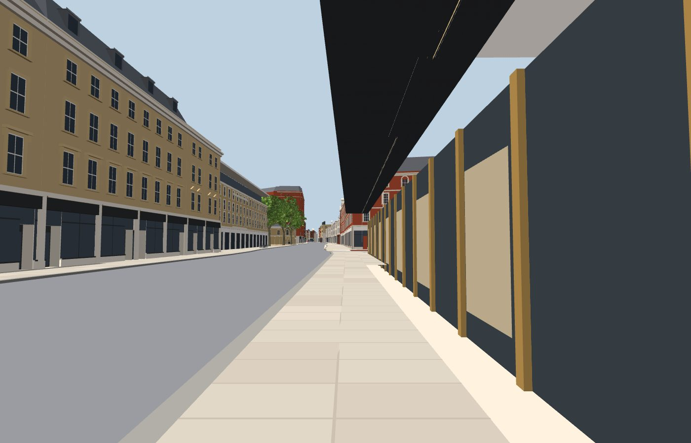 | 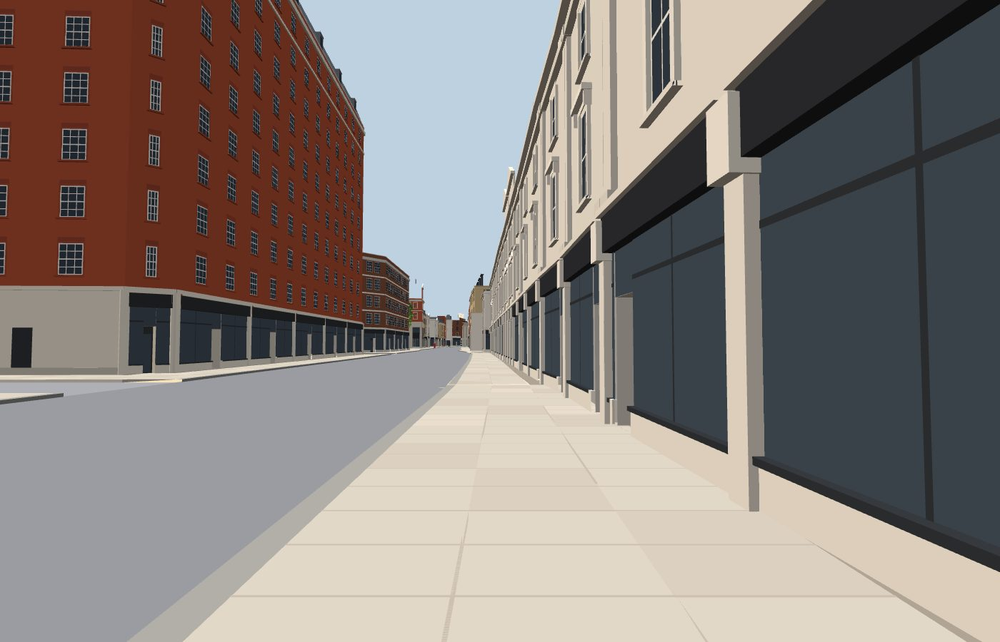 |
| 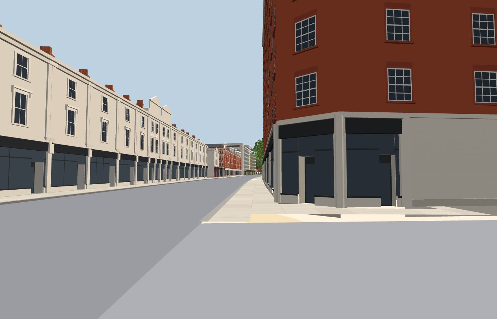 | 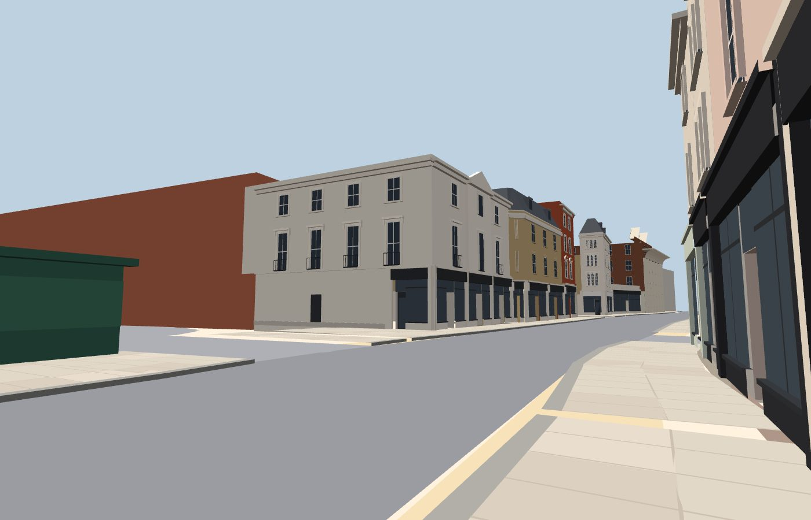 |
| 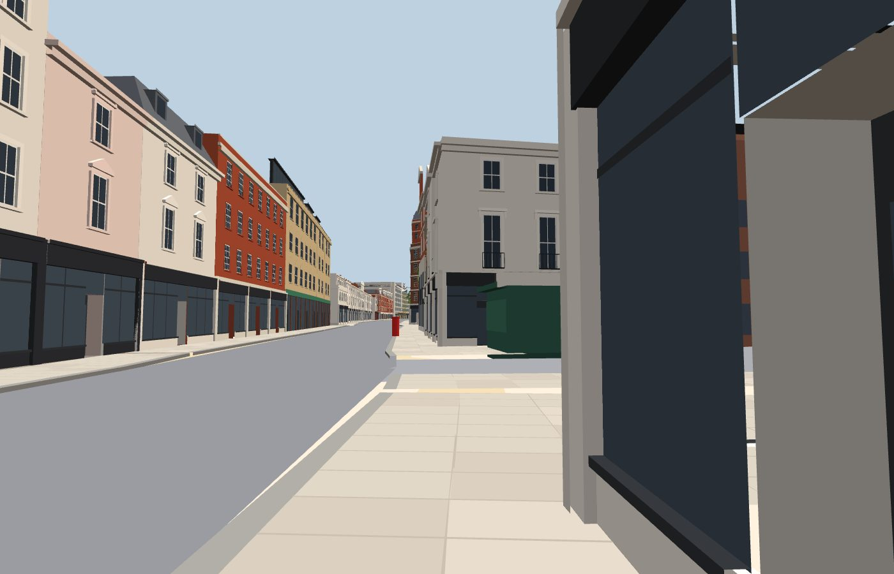 | 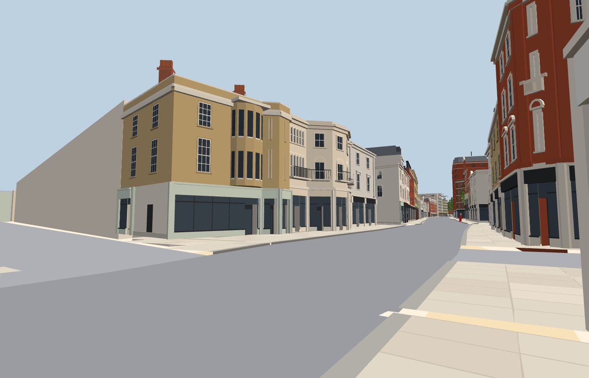 |
| 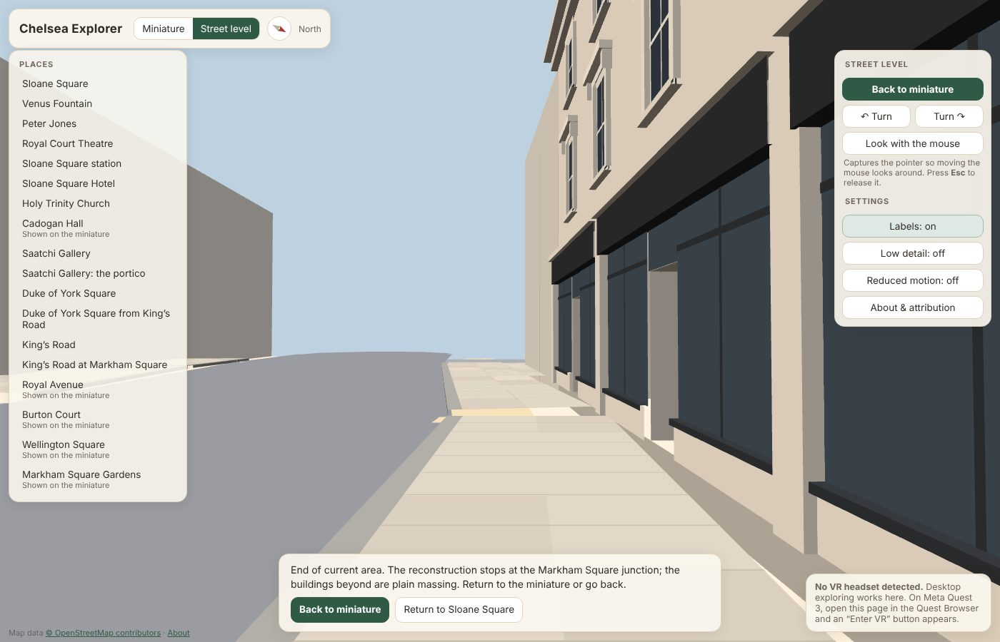 | |

**Façade close-ups:**

| | |
|---|---|
| 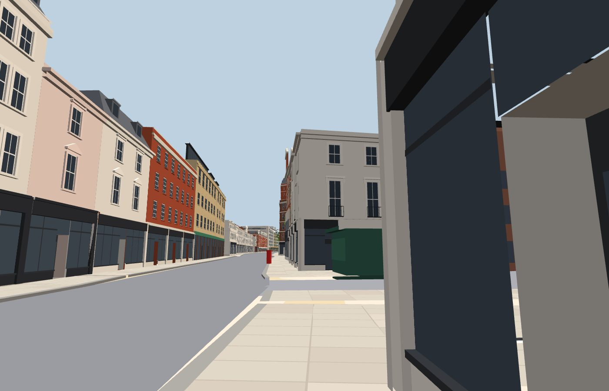 | 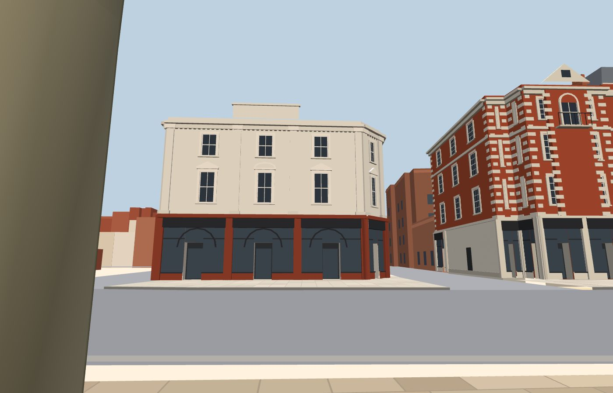 |
| 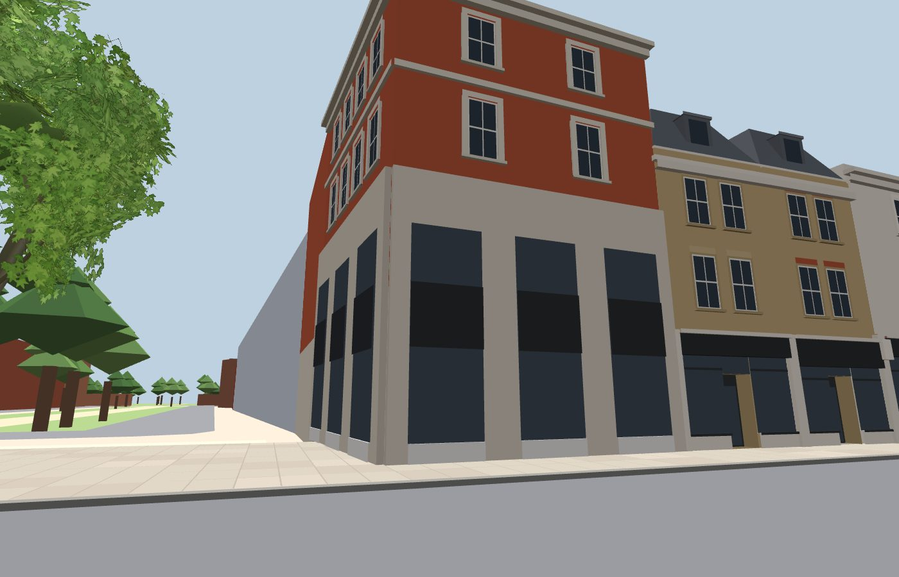 | 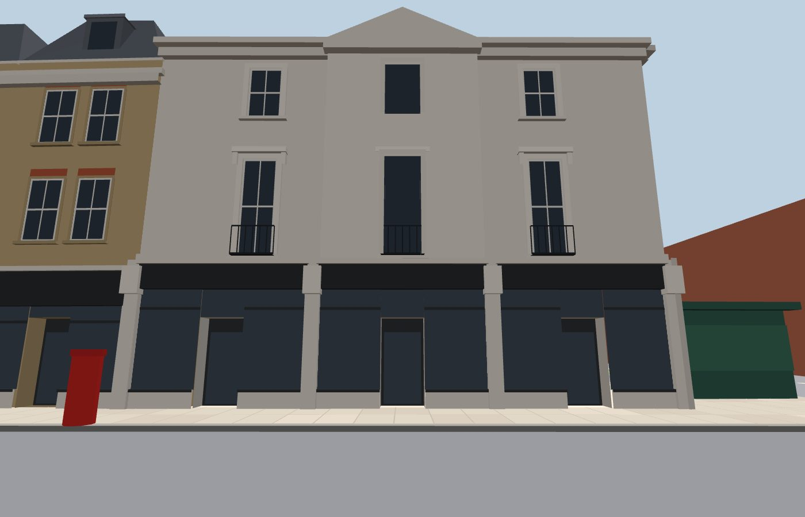 |
| 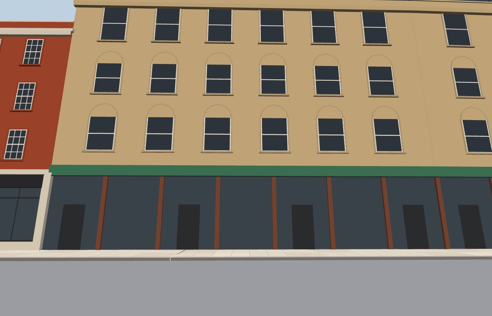 | 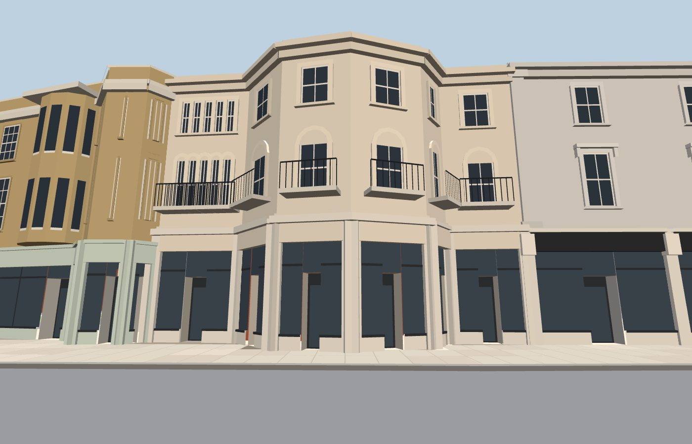 |

## 7. Performance

Measured in headless Chromium with SwiftShader software rendering at 1400 × 900 on a 2-vCPU container. These numbers compare builds; they are not Quest frame rates, which have not been measured.

| | Before (`main`, f52af8d) | After |
|---|---|---|
| Static mesh | 175.6k triangles | 253.2k triangles (the 62 King's Road models total ≈ 66k and replace generic masses; the rest is pavements, kerbs, furniture and the corridor's background window rows) |
| Default miniature | 383 ms, 47 draw calls, 225k triangles drawn | 400 ms, 47 calls, 305k |
| Street level, Sloane Square looking west | 767 ms, 38 calls, 247k | 833 ms, 38 calls, 328k |
| Street level, King's Road terrace | n/a | 233 ms, 23 calls, 184k |
| Street level, Royal Avenue House looking east | n/a | 450 ms, 33 calls, 307k |
| Street level, King's Road at Markham Square | n/a | 483 ms, 40 calls, 333k |

How the cost is kept down:
- Draw calls stay flat because the buildings are merged into the existing tiled static mesh (6 × 6 frustum-culled tiles).
- No textures were added.
- Windows are flat quads with thin frames rather than modelled sashes.

The added cost is mostly triangles in views along the road. No street-section loading was added, because draw calls did not grow and every view stayed within the existing frame budget on this machine. That should be revisited if the Quest frame-rate check fails.

## 8. Remaining approximations (largest impact first)

1. **Shopfronts are generic within each configuration.** Divisions, recessed doors and fascias are proportioned, but there is no lettering, branding, awnings or stall-riser detail. Brands were deliberately not modelled.
2. **Flat colour.** Brick, stucco and stone are flat colours; there is no bond texture, weathering or shadows.
3. **Twelve frontages are estimated** (listed above), and 34 are partly observed (window rhythm or roof estimated per house).
4. **Carriageway re-centred and narrowed** west of Tryon Street to fit the OSM building lines (section 3). The building lines are more reliable than the centreline, but the carriageway widths are fitted, not surveyed.
5. **Missing street detail.**
   - No lamp columns or bollards are mapped, so none are modelled; photographs show both.
   - Only five street trees are mapped in the corridor.
   - Mapped crossings are walkable but have no zebra markings.
   - Bus stops are not modelled.
6. **Cream patches at side-street corners.** The existing generic side-street pavements meet the raised King's Road pavement with a step and show as cream patches at some corners.
7. **Some details simplified:** gables, cartouches, the cow's head at No. 69, the Drugstore's carved panels and tower, and balcony ironwork.

## 9. Quest 3 walkthrough checklist (King's Road)

Not yet verified on a headset.

- [ ] *King's Road* in the places menu stands you on the north pavement facing west. Nothing moves on its own.
- [ ] Teleport along both pavements from Sloane Square to Markham Square. The road refuses with a reason except at mapped crossings. Side-street mouths can be crossed.
- [ ] Shopfronts, fascias and recessed doors read at a believable scale at arm's length. Window reveals don't shimmer when you move your head.
- [ ] Within about 14 m of Markham Square, the *End of current area* message appears on the hand panel with **Return to …** and **Back to miniature**. Teleporting beyond the line is refused.
- [ ] Looking west from the end, the plain massing beyond doesn't read as reconstructed, and nothing blocks the road.
- [ ] The frame rate feels smooth looking along the road in both directions near Royal Avenue and at Markham Square (check with OVR Metrics). Note the GPU level if it drops.
- [ ] The miniature still shows Sloane Square, Duke of York Square and the corridor clearly. Snap turn, seated mode and the saved settings behave as before.
