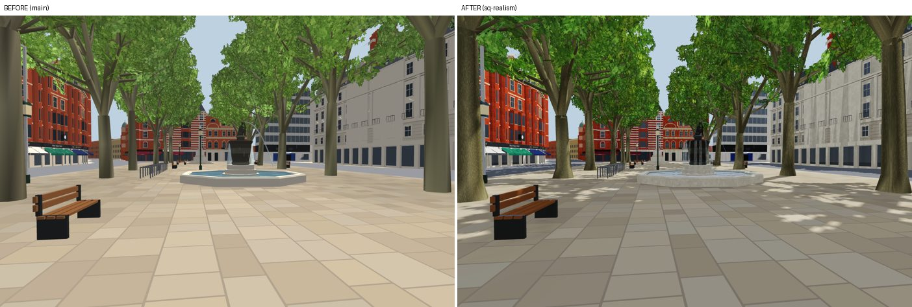
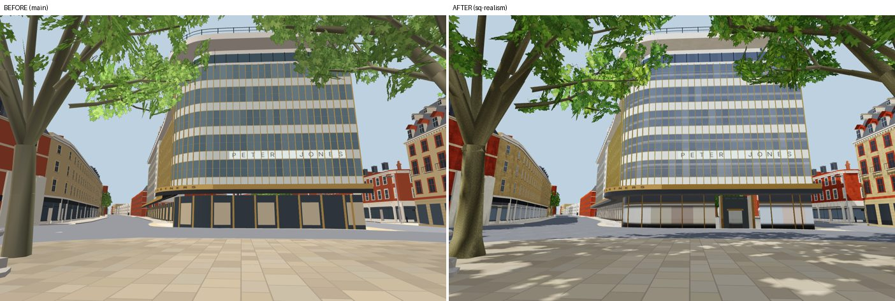
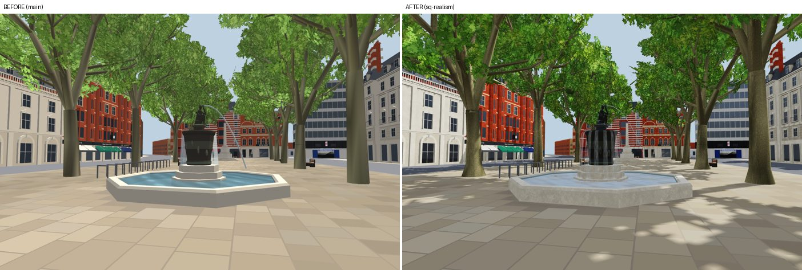
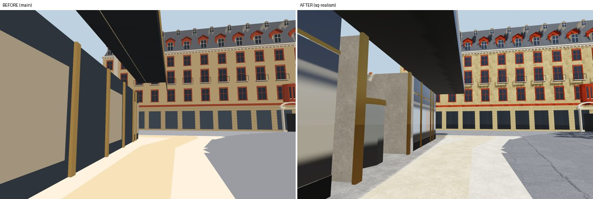
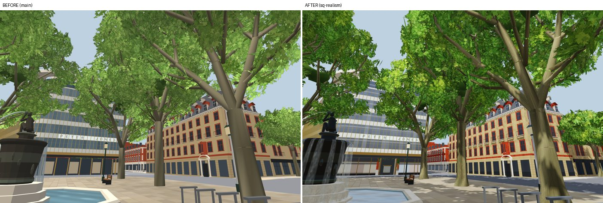
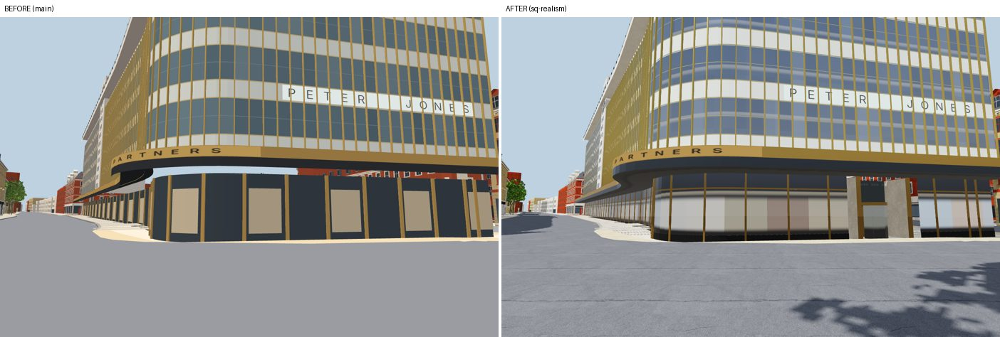
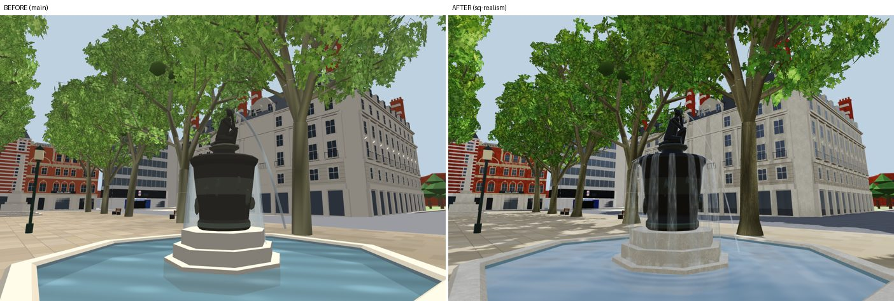
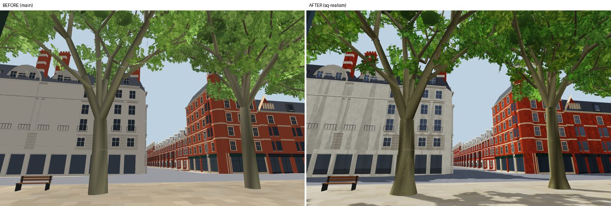
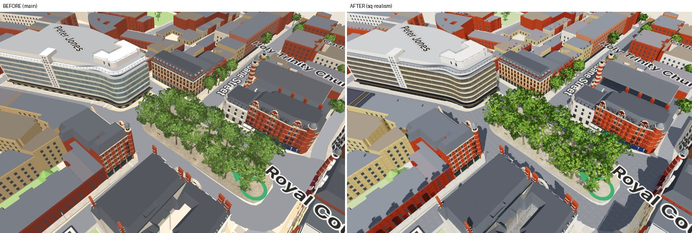

# Sloane Square: lighting, materials, Peter Jones, trees and fountain

This milestone makes one area — around the Venus Fountain, the square's trees, the paving and the Peter Jones façade — look materially more convincing at street level, without changing the engine, the street layout, building positions, navigation, the miniature or WebXR. It stays exploration-only.

Branch: `sq-realism` (not merged, not deployed).

## 1. What was found (inspection)

The renderer is a small custom WebGL2 engine (`src/engine/renderer.ts`). The world is merged, vertex-coloured triangle meshes with flat normals, split into frustum-culled tiles. Trees and water use a separate "nature" shader with alpha-tested leaf cards. There was no texture other than labels, panels and the leaf atlas, and no post-processing. The only quality setting was *Low detail*, which shortens the building level-of-detail distance and swaps leaf cards for clumps.

Surfaces looked flat and shadows weak for these reasons:

1. **No colour management.** Hex colours (sRGB) were multiplied by the light as if linear and written out directly, with no tone mapping. Light and shade were compressed, and dark colours went muddy.
2. **Ambient dominated.** Ambient was 0.47–0.80 against a sun of only 0.52 × N·L. Sunlit faces were at most about 2× brighter than shaded ones, so form barely read.
3. **No shadows of any kind**, and nothing tying objects to the ground (no contact or ambient occlusion).
4. **No surface detail.** Brick, stone, paving and asphalt were single flat colours. Glass was a flat dark colour with no reflection.

Fixing (1)–(3) mattered more than any texture work. Stronger lights would only have made the compression worse.

## 2. What changed

### Lighting
- **Linear lighting.** Vertex colours are decoded from sRGB in the vertex shader, lit in linear light and tone-mapped (fitted ACES curve, gamma 2.0).
- **Sun and sky.** A morning sun from the south-east, about 50° high, is fixed in map space. Ambient is a sky/ground hemisphere (cool sky above, warm bounce from the paving).
- **Baked shadows** (`src/view/bake.ts`, about 70–150 ms at start-up on desktop). The sun never moves, so the shadows are rendered once into two static shadow maps:
  - 2048² over the 300 m around the square (≈15 cm texels);
  - 2048² over the whole map.
  - At run time this costs one hardware 2×2 PCF lookup per pixel. Shadow coordinates are computed per vertex.
  - Trees cast dappled shadows through their alpha-tested leaves.
- **Contact shading.** A top-down height map of the same area is turned into a 1024² occlusion map. It darkens ground and wall bases next to kerbs, benches, the fountain and façades. Cost: one texture lookup per pixel.
- **Miniature.** It is lit the same way, so the model on the table now has shadows too.

### Materials
- **How materials are stored** (`src/engine/materials.ts`). Each vertex carries a material id in the length of its normal. The vertex layout, tile splitting and all builders are unchanged.
- **How they are assigned.** Builders tag materials by palette colour (`src/map/materialTags.ts`) or explicitly (Peter Jones).
- **Projection.** Detail uses planar projection: along the wall and up for walls, plan for the ground. Course lines stay level.

| Material | Treatment |
|---|---|
| Red brick | Brick-and-mortar detail at real course height (≈75 mm per course; the texture is 2.5 m wide), mild normal map. The model's own colour is kept; the texture adds only variation. |
| London stock brick | Same bond, colour-neutral detail. |
| Portland stone, stucco | Very light grain (strength 0.1–0.2), no visible pattern. |
| Paving, kerbs | Grain and slight wear over the existing individually modelled Yorkstone flags and joints. |
| Asphalt | Asphalt texture, darkened to a realistic road albedo. Kerbs stay lighter granite, so the separation is clear. |
| Painted iron, bronze, enamel | Roughness-based highlights and restrained sky reflection. Bronze is metallic; painted metal is not. |
| Glass | Sky and surroundings reflection with Fresnel, over a dark interior. |

### Peter Jones
- **Kept:** the curved footprint and proportions.
- **Curtain wall** (photos kr/029, kr/035, kr/142):
  - glazing set 3 cm behind the panel face, so the mullions stand proud;
  - glass reflects the sky and a dark band of surroundings at the horizon;
  - per-pane brightness varies, and about 1 pane in 6 shows pale blinds (as seen in the photos);
  - an impression of interior depth: a lit ceiling band seen through each pane shifts with the viewing angle, as if about 2.4 m deep;
  - gold mullions are metallic and the spandrels enamel-smooth.
- **Ground floor:**
  - plate-glass displays in slim bronze frames over a black stall riser, with a transom and top lights, set back under the canopy;
  - each bay shows a lit display band that shifts with the viewing angle, in varied colours.
  - The display colours are generic, not a record of real displays.
- **Entrances** with a revolving-door drum: two recessed lobbies, at the centre of the corner curve and under the "PETER JONES" letters (photos kr/142, kr/035, and kr/225 for the revolving door). Positions and sizes are approximate.
- **Canopy soffit.** It was missing from below on part of the curve, so you could see through to the buildings behind. It is now closed.
- **Reflections** are analytic: no reflection probes and no per-window rendering.

### Trees (the square's London planes)
- **Trunks:**
  - a root flare;
  - an irregular, lobed cross-section that turns as it rises (10 sides on trunks);
  - bark relief from a CC0 bark texture;
  - plane-tree flaking as broad pale and olive patches.
- **Branch joins.** Each new branch starts inside its parent with a slight collar, so there are no abrupt joins.
- **Canopy:**
  - gaps where a smooth 3D noise removes whole clusters of foliage;
  - cluster-to-cluster colour variation (yellower outer, bluer inner);
  - darker interiors;
  - leaves now receive the baked shadows, so the inner canopy is shaded.
  - The leaf-card count is lower than before, not higher.
- **Low detail** still swaps to the clump level of detail and skips shadow lookups on leaves.

### Fountain
- **Bronze vase and figure** are smooth-shaded and more finely tessellated: vase 28 sides, limbs 10, volumes 14×8. They use the metallic bronze material.
- **Water.** The solid "pipe" jet and opaque sheet are replaced by:
  - 18 thin translucent streams falling from the vase rim (reference ss/240), with moving streaks and brighter edges;
  - a flattened, thin conch jet;
  - low spray where the streams land.
- **Pool.** Wind ripples plus rings spreading from where the water lands, Fresnel sky reflection and a sun glint.
- **Not a sculpture model.** The statue is still a simplified procedural figure: no suitable openly licensed model of Ledward's Venus was available. Its pose follows the photographs. It is not an accurate likeness, and no historical accuracy is claimed.

## 3. Assets and licences

| Layer | Source | Author(s) | Licence |
|---|---|---|---|
| Brick | [Red Bricks 04](https://polyhaven.com/a/red_bricks_04) | Rob Tuytel | CC0 1.0 |
| Stone grain (unused at present; paving grain used instead) | [Concrete Wall 008](https://polyhaven.com/a/concrete_wall_008) | Dario Barresi, Charlotte Baglioni | CC0 1.0 |
| Paving, stone and stucco grain | [Concrete Floor 02](https://polyhaven.com/a/concrete_floor_02) | Rob Tuytel | CC0 1.0 |
| Asphalt | [Asphalt 02](https://polyhaven.com/a/asphalt_02) | Rob Tuytel | CC0 1.0 |
| Bark | [Bark Willow 02](https://polyhaven.com/a/bark_willow_02) | Charlotte Baglioni | CC0 1.0 |

**How the textures were obtained and packed:**
- They were downloaded by `scripts/assets/fetch-polyhaven.mjs`, run in a GitHub workflow on the `textures-sq` branch; the build sandbox has no network.
- `scripts/assets/pack-textures.py` (requires Pillow) packs them into two 512² × 5-layer strips in `public/tex/`:
  - `detail.jpg`, 646 KB: albedo divided by its mean, so building colours are preserved;
  - `surface.jpg`, 345 KB: normal map and roughness.
- `public/tex/sources.json` records the same sources.

**Fetched but not used:** yellow bricks (stone blocks, not London stock), metal plate (diamond plate), rusty metal. None is hotlinked, and nothing comes from Google Street View.

## 4. Before and after (same cameras, same build settings)

Rendered on desktop: headless Chrome with SwiftShader, 1400 × 900, on a 2-vCPU cloud VM. The left half of each image is `main`, the right half `sq-realism`.

## 5. Performance

**Test setup.** Desktop only, in software rendering: headless Chrome with SwiftShader, 1400 × 900, on a 2-vCPU cloud VM. **Not measured on a Quest 3.** SwiftShader frame times measure CPU-emulated pixel shading and are not GPU timings. Use them only to compare `main` with this branch.

| View | `main`: calls / triangles / frame | `sq-realism`: calls / triangles / frame | `sq-realism`, Low detail: frame |
|---|---|---|---|
| Miniature | 114 / 351k / 450 ms | 115 / 355k / 767 ms | 717 ms |
| Fountain across the square | 30 / 275k / 650 ms | 31 / 270k / 1067 ms | 717 ms |
| Facing Peter Jones | 72 / 407k / 467 ms | 73 / 403k / 1100 ms | 683 ms |
| Fountain close | 29 / 263k / 550 ms | 30 / 258k / 1033 ms | 583 ms |
| Peter Jones shopfront | 34 / 285k / 300 ms | 35 / 282k / 833 ms | 467 ms |
| Square trees | 52 / 348k / 567 ms | 53 / 344k / 1133 ms | 717 ms |

**Geometry and draw calls:**
- Draw calls: +1 per frame (the falling water).
- Triangles: essentially unchanged. The static mesh is 228k against 225k before; the extra detail on the fountain, the entrances and the trunks is offset by fewer leaf cards.

**Memory added (GPU):**
- two 2048² depth maps (≈32 MB);
- a 1024² RGBA occlusion map (4 MB);
- two 512² × 5-layer texture arrays with mipmaps (≈7 MB).
- Download: 1 MB of JPEG.

**Pixel cost.** In SwiftShader it rose by about 1.6–2.8× with full detail, and about 1.1–1.6× with Low detail. Two optimisations brought it down from about 4–5× during development:
- per-vertex shadow coordinates;
- one nature program per mode instead of per-pixel mode branches.

SwiftShader runs every branch of a shader. On the Quest's GPU, the per-material branches depend on a per-triangle constant, so most of them cost nothing. The real headset cost is therefore expected to be lower than this ratio suggests. **That is unverified.**

**Unverified performance risks on Quest 3 (at 72 Hz):**
- **Highp fragment shading.** It is needed for map-space texture and shadow coordinates at ±350 m, and is slower than mediump on mobile GPUs.
- **Leaf-card overdraw.** Each leaf fragment now also does a shadow lookup and tone mapping. If this is the bottleneck, use Low detail; it removes the shadow lookup on leaves.
- **Memory.** About 43 MB more GPU memory for the baked maps.
- **Bake time.** The bake runs once at start-up: 70–150 ms on desktop, probably 2–4× longer on the headset.

## 6. Checks

**Automated:**
- `npm run check` passes: typecheck, 78 tests, build.
- `tests/materials.test.ts` checks that:
  - material ids survive builder transforms and `append`;
  - the square area carries paving, asphalt, brick, stone, Peter Jones glass, shop glass, bronze and kerb materials;
  - the fountain's falling water is a separate translucent layer;
  - trunks are marked as bark.

**Desktop (SwiftShader):**
- All before/after views render with no console errors. The screenshot script reports any page error, and none occurred.
- Miniature and street level both render.
- Street-level navigation is unchanged: no changes to `nav.ts` or `explorer.ts`.
- Low detail switches off the surface textures, normal maps and leaf shadow lookups.
- The textures load asynchronously. If they fail, plain colours remain.

**Not changed:** WebXR entry and controls (`main.ts` is untouched). The XR path calls the same `scene.render`.

**Not tested:** anything on a headset.

## 7. Headset test procedure (Quest 3, 72 Hz)

1. Open the branch build over HTTPS on the Quest Browser (see the README; a laptop's `localhost` is not reachable as `localhost` from the headset). Enter VR. Check that start-up still completes in a few seconds.
2. Enable the browser's performance overlay, or use OVR Metrics Tool. Stand at the Venus Fountain viewpoint and at the Peter Jones viewpoint. Record the frame rate and GPU utilisation for 30 s each, with **Low detail** off and then on.
3. Look up into the trees near the fountain, the worst case for overdraw, and record the same.
4. Check visually:
   - shadows are stable, with no shimmering or acne on the paving and walls;
   - no seams where the detailed shadow map hands over to the coarse one, about 150 m from the square;
   - brick courses stay level;
   - Peter Jones' glass reflection doesn't swim as you move your head;
   - the falling water stays translucent with no sorting flicker against the pool.
5. Check the miniature on the table: shadows, labels, and the rotate, scale and reset controls.

If 72 fps isn't held, these are the cheapest fixes, in order:
1. make Low detail the default on the headset;
2. drop the near shadow map to 1024²;
3. use mediump for leaf shading.

## 8. Remaining limitations

- The fountain figure is a simplified procedural model, not a scan or sculpted model.
- Reflections are analytic (sky gradient and a horizon band). The glass doesn't reflect the actual buildings opposite.
- Peter Jones' interior depth is an impression: a ceiling band shifted with the view. There is no modelled interior.
- The display contents are generic colours.
- Shadows are static. The sun doesn't move and trees cast their rest-pose shadow while they sway.
- The lighting model is global, so every building in the map is now lit with linear lighting and shadows. Only the materials listed above get surface textures.
- The rest of the map is unchanged in detail, but now looks somewhat darker and more contrasty than before.
- The stock-brick layer reuses the red-brick bond with neutral colour detail. No suitable CC0 London-stock texture was among the candidates.
