# Sloane Street and Lower Sloane Street: survey, reconstruction and checks

This milestone rebuilds both sides of Sloane Street (north from Sloane Square) and Lower Sloane Street (south from it), building by building, within the existing map. Completed work is unchanged:
- Sloane Square and its perimeter models;
- Peter Jones and Holy Trinity Church;
- King's Road (still ending at Markham Square);
- Duke of York Square and the Saatchi Gallery.

The experience is still exploration only.

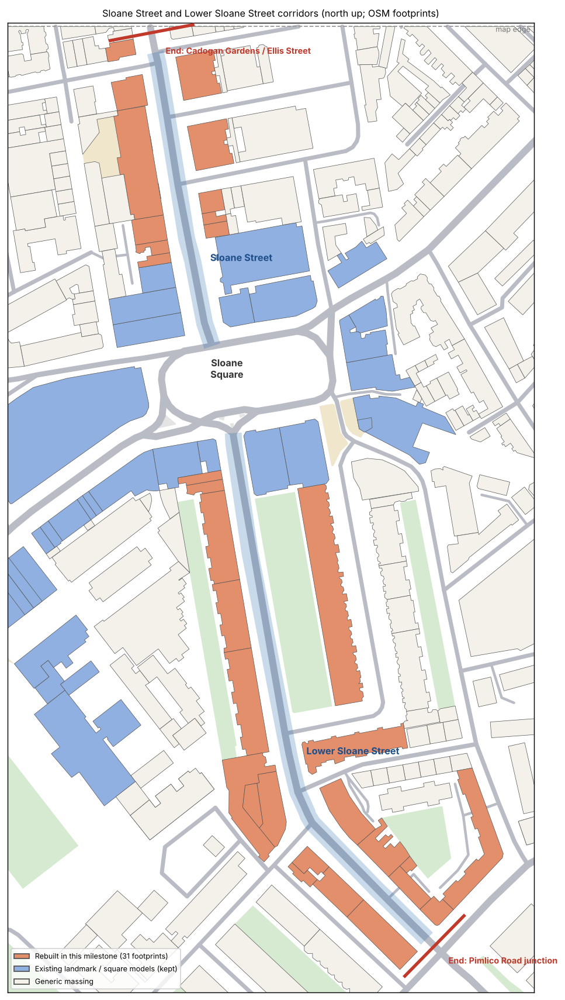

## 1. Scope and endpoints (decided before modelling)

**The map boundary.** It is explicit: a 700 m × 700 m square (`HALF = 350` m in `scripts/osm/process.mjs`), and footprints are clipped to it. The map is not enlarged.

**Sloane Street (north).**
- **Where it meets the boundary:** the centreline meets the map's north edge at about (125, −350), 187 m from the square.
- **Where the reconstruction ends:** chainage **182 m**, just past the junction with **Cadogan Gardens** (west, 164 m) and **Ellis Street** (east, 170 m).
- **Last building included:** the complete corner building on the north side of Cadogan Gardens (w531359436).
- **Left as plain massing:** the buildings beyond, on both sides (Royal Court House to the east, and w531359439 / w531359446 to the west). Their footprints are cut by the map edge, so they cannot be completed without enlarging the map. They are not sliced reconstructions.

**Lower Sloane Street (south).**
- **Where it ends:** the street ends inside the map, at its junction with **Pimlico Road, Chelsea Bridge Road and Royal Hospital Road**: chainage **326 m**, about (288, 177).
- **Corner buildings:** Holbein House is kept whole.
- **Beyond the junction:** the streets are not reconstructed.

**King's Road** keeps its endpoint at Markham Square (562 m).

**What counts as a frontage.**
- Every building with a footprint edge facing the street within 16 m (Sloane Street) or 26 m (Lower Sloane Street, set-back mansion blocks), between the square and the endpoint.
- The importer detects them (`scripts/osm/corridor.mjs`, shared with King's Road).
- One footprint is added explicitly: the Sloane Gardens west terrace, whose rear elevation faces the street across its communal garden.
- Corner returns (at most 16 m) are treated; side streets are not extended.

**Buildings and occupants.**
- Several shops in one building are units of that building.
- Two shop polygons drawn inside George House are merged into it rather than built twice: Saloni (No. 134) and Escada (No. 129).
- Multipolygon properties with two outer rings (The Sloane Club; Nos 85–95) get one configuration for both.

## 2. Sources

**Geometry.**
- **Data:** © OpenStreetMap contributors (ODbL). There is a focused extract for both streets (`data/osm/ss-buildings.json`, `ss-raw.json`), retrieved 2026-11-12 (OSM data as of 20:31 UTC) by the *Import Sloane Street corridors OSM detail* workflow on the `osm-ss` branch.
- **Addresses:** they come from the footprints' `addr` tags and from the shop nodes inside them. The west side of Sloane Street runs 140 → 125 going north, the east side 147 → 161. Lower Sloane Street runs 2 → 94 (west) and 65 → 97 (east).
- **Mapped street detail:** the extract supplies 16 street trees, 8 lamps and 13 crossings, which are used.

**Photographs.** These are openly licensed photographs from Wikimedia Commons, fetched by `scripts/refs/fetch-commons-ss.mjs` on the `references-ss` branch. That branch's `references/ss/index.json` lists all 260 images with authors and licences; about a third are relevant street views, and the rest (interiors, paintings, unrelated places) came from text searches and are ignored. They are reference only: none is shipped or used as a texture. The images cited in the configurations are:

| Ref | Commons file | Author | Licence | Date |
|---|---|---|---|---|
| C:041 | [123 Sloane Street, Chelsea, September 2024.jpg](https://commons.wikimedia.org/wiki/File:123_Sloane_Street,_Chelsea,_September_2024.jpg) | No Swan So Fine | CC BY-SA 4.0 | 2024-09-13 |
| C:042 | [139 Sloane Street, Chelsea, September 2024.jpg](https://commons.wikimedia.org/wiki/File:139_Sloane_Street,_Chelsea,_September_2024.jpg) | No Swan So Fine | CC BY-SA 4.0 | 2024-09-13 |
| C:083 | [KAT coffee in Chelsea.jpg](https://commons.wikimedia.org/wiki/File:KAT_coffee_in_Chelsea.jpg) | Matt Brown | CC BY 2.0 | 2023-11-29 |
| C:088 | [Construction barriers along Sloane Street, London, England (U.K.) (53321810897).jpg](https://commons.wikimedia.org/wiki/File:Construction_barriers_along_Sloane_Street,_London,_England_(U.K.)_(53321810897).jpg) | Charles from Port Chester, New York | CC BY 2.0 | 2023-09-01 |
| C:099 | [Sloane Gardens - geograph.org.uk - 7539235.jpg](https://commons.wikimedia.org/wiki/File:Sloane_Gardens_-_geograph.org.uk_-_7539235.jpg) | DS Pugh | CC BY-SA 2.0 | 2023-07-05 |
| C:124 | [Sloane Street Royal tribute 2022 (52120968796).jpg](https://commons.wikimedia.org/wiki/File:Sloane_Street_Royal_tribute_2022_(52120968796).jpg) | Loco Steve from Bromley , UK | CC BY-SA 2.0 | 2022-05-29 |
| C:127 | [Businesses on Lower Sloane Street, London SW1W - geograph.org.uk - 7299204.jpg](https://commons.wikimedia.org/wiki/File:Businesses_on_Lower_Sloane_Street,_London_SW1W_-_geograph.org.uk_-_7299204.jpg) | JThomas | CC BY-SA 2.0 | 2022-05-27 |
| C:128 | [Lower Sloane Street, London SW1W - geograph.org.uk - 7299206.jpg](https://commons.wikimedia.org/wiki/File:Lower_Sloane_Street,_London_SW1W_-_geograph.org.uk_-_7299206.jpg) | JThomas | CC BY-SA 2.0 | 2022-05-27 |
| C:129 | [Sloane Gardens, Chelsea (South Corner).jpg](https://commons.wikimedia.org/wiki/File:Sloane_Gardens,_Chelsea_(South_Corner).jpg) | Doyle of London | CC BY-SA 4.0 | 2022-05-23 |
| C:140 | [Catherine Prevost Sloane Street London April 2022.jpg](https://commons.wikimedia.org/wiki/File:Catherine_Prevost_Sloane_Street_London_April_2022.jpg) | Edwardx | CC BY-SA 4.0 | 2022-04-15 |
| C:141 | [Anya Hindmarch Sloane Street London April 2022.jpg](https://commons.wikimedia.org/wiki/File:Anya_Hindmarch_Sloane_Street_London_April_2022.jpg) | Edwardx | CC BY-SA 4.0 | 2022-04-15 |
| C:142 | [Escada Sloane Street London April 2022.jpg](https://commons.wikimedia.org/wiki/File:Escada_Sloane_Street_London_April_2022.jpg) | Edwardx | CC BY-SA 4.0 | 2022-04-15 |
| C:143 | [Hackett Sloane Street London April 2022.jpg](https://commons.wikimedia.org/wiki/File:Hackett_Sloane_Street_London_April_2022.jpg) | Edwardx | CC BY-SA 4.0 | 2022-04-15 |
| C:144 | [Mackage Sloane Street London April 2022.jpg](https://commons.wikimedia.org/wiki/File:Mackage_Sloane_Street_London_April_2022.jpg) | Edwardx | CC BY-SA 4.0 | 2022-04-15 |
| C:145 | [Façonnable Sloane Street London April 2022.jpg](https://commons.wikimedia.org/wiki/File:Fa%C3%A7onnable_Sloane_Street_London_April_2022.jpg) | Edwardx | CC BY-SA 4.0 | 2022-04-15 |
| C:147 | [A post Christmas scene of Sloane Street looking towards Sloane Square - geograph.org.uk - 7065566.jpg](https://commons.wikimedia.org/wiki/File:A_post_Christmas_scene_of_Sloane_Street_looking_towards_Sloane_Square_-_geograph.org.uk_-_7065566.jpg) | James Hamilton | CC BY-SA 2.0 | 2022-01-01 |
| C:158 | [View of Christmas trees in the garden of The Sloane Club from Lower Sloane Street - geograph.org.uk - 6698049.jpg](https://commons.wikimedia.org/wiki/File:View_of_Christmas_trees_in_the_garden_of_The_Sloane_Club_from_Lower_Sloane_Street_-_geograph.org.uk_-_6698049.jpg) | Robert Lamb | CC BY-SA 2.0 | 2020-12-06 |
| C:166 | [Lower Sloane Street from Sloane Square London - geograph.org.uk - 6227943.jpg](https://commons.wikimedia.org/wiki/File:Lower_Sloane_Street_from_Sloane_Square_London_-_geograph.org.uk_-_6227943.jpg) | Roy Hughes | CC BY-SA 2.0 | 2019-08-03 |
| C:168 | [Lower Sloane Street London - geograph.org.uk - 6227940.jpg](https://commons.wikimedia.org/wiki/File:Lower_Sloane_Street_London_-_geograph.org.uk_-_6227940.jpg) | Roy Hughes | CC BY-SA 2.0 | 2019-08-03 |
| C:183 | [Impression Escada Store.jpg](https://commons.wikimedia.org/wiki/File:Impression_Escada_Store.jpg) | Escada | CC BY-SA 4.0 | 2018-05-21 |
| C:213 | [Lower Sloane Street - geograph.org.uk - 4712683.jpg](https://commons.wikimedia.org/wiki/File:Lower_Sloane_Street_-_geograph.org.uk_-_4712683.jpg) | John Myers | CC BY-SA 2.0 | 2015-10-23 |
| C:229 | [Wilbraham Place.jpg](https://commons.wikimedia.org/wiki/File:Wilbraham_Place.jpg) | TheJRB | CC BY-SA 2.0 | 2014-08-16 |
| C:233 | [Lower Sloane Street - geograph.org.uk - 8256376.jpg](https://commons.wikimedia.org/wiki/File:Lower_Sloane_Street_-_geograph.org.uk_-_8256376.jpg) | Steve Daniels | CC BY-SA 2.0 | 2014-06-04 |
| C:243 | [Building site on Sloane Street - geograph.org.uk - 3992740.jpg](https://commons.wikimedia.org/wiki/File:Building_site_on_Sloane_Street_-_geograph.org.uk_-_3992740.jpg) | Thomas Nugent | CC BY-SA 2.0 | 2014-05-19 |
| C:247 | [Lower Sloane Street - geograph.org.uk - 3992787.jpg](https://commons.wikimedia.org/wiki/File:Lower_Sloane_Street_-_geograph.org.uk_-_3992787.jpg) | Thomas Nugent | CC BY-SA 2.0 | 2014-05-19 |

**Shop branding.** No brand names are modelled. The 2022 and 2024 photographs show current occupants (fashion houses, estate agents, a jeweller), but occupancy changes, so only the shopfront architecture is reproduced. Seasonal decorations (Christmas lights and the 2024 flower displays), roadwork barriers (2023) and promotional displays are excluded.

## 3. Fitting each street between its building lines

**Sloane Street.**
- **The problem:** the OSM centreline runs about 3.5 m east of the middle between the surveyed façades (east footprints ≈ 7.5 m from it, west ≈ 14.5 m), so the east pavement almost vanished.
- **The fix:** the carriageway is re-centred between the building lines, by up to 4 m. It keeps its 12 m width; the fit aims for at least 3.5 m of pavement each side, and the tests require at least 2 m in front of every footprint.
- **Where it applies:** the shift fades in from the square.

**Lower Sloane Street.**
- **The problem:** the Sloane Gardens communal garden reached the carriageway.
- **The fix:** garden railings count as a frontage line. The carriageway is re-centred and narrowed to 10.2–12 m, aiming for at least 3 m of pavement.

**Shared method.** This is the method used on King's Road (`Corridor.fitCarriageway`). The shift fades out by 23 m from the centreline, so side streets stay joined.

**Mapped sidewalks.** OSM's sidewalk ways are moved with the road; they are drawn under the new pavements.

## 4. Integration with completed models

- **Unchanged models:**
  - Holy Trinity Church;
  - 141–144 Sloane Street and 15–16 Sloane Square;
  - the Sloane Square Hotel and 13–14 Sloane Square;
  - Lurgan Mansions and 28–31 Sloane Square;
  - Wellesley House and Wyndham House;
  - Peter Jones.

  The importer never assigns them to a corridor (`square:` and landmark ids are skipped), and a test checks this.
- **Ground levels near the square.** The square's models sit on its street level (0.22 m). The raised corridor pavement (0.5 m, as on King's Road) therefore begins after them, at 46 m on Sloane Street and 18 m on Lower Sloane Street, with a 3 m ramp. Before that, flags are laid at the square's level.
- **Duplicate geometry.** Rebuilt footprints get no generic extrusion; shop polygons inside George House are not built.
- **Wellesley House.** On the first 30 m of Lower Sloane Street's east side, Wellesley House stands at the kerb; that pavement belongs to the square, as before.

## 5. How the buildings are made

The builder is shared with King's Road (`kingsRoad.ts`, with `withCorridorLine` choosing each street's centreline). Each building has its own configuration in `src/map/landmarks/sloaneStreetSpecs.ts`, covering:
- storeys, bays and window treatment;
- materials, bands, pilasters and quoins;
- parapet, cornice, gables, mansards with dormers, chimneys;
- shopfronts, or a residential ground floor (sash windows and a central entrance with stone surround and steps).

**New features** (`sloaneStreetHooks.ts`):
- **Queen Anne houses** (Lower Sloane Street west): per house, a canted two-storey bay, a stone porch with steps, and basement lightwell railings.
- **No. 139:** fanlight windows with a stepped entrance and railings.
- **Nos 136–138:** parapet urns.
- **George House:** terracotta piers and a grey fascia band.
- **The Cadogan Gardens corner:** white stucco bays.
- **Bristol House:** round-arched shopfronts.

**A builder fix.** A curved frontage (Bristol House) is no longer flattened into one chord, which had hidden its windows inside the wall. Fronts merge only while every corner stays within 0.3 m of the chord, and bays are shared by length.

## 6. Coverage

Every surveyed building on both streets, walking outward from Sloane Square, by side:
- **Chainage:** metres along the street.
- **Front:** the length of street frontage, plus any corner return.
- **Status:**
  - *Observed:* follows a clear photograph.
  - *Partly observed:* some elements are estimated.
  - *Estimated:* no adequate reference; the frontage is awaiting references.

The tables are generated by `npx tsx scripts/docs/ss-coverage.ts`. The completed square models listed in section 4 are not repeated.
### Sloane Street, west side, outward from Sloane Square

| Chainage | Address | OSM | Storeys, height | Front (m) | Upper bays | Materials | Roof / top | Ground floor | Status | Sources | Remaining approximations |
|---|---|---|---|---|---|---|---|---|---|---|---|
| 54 m | 140 Sloane Street | w532074742 | 3 + mansard, ≈14 m | 6 | 2 | stock over stucco | mansard, parapet, 1 stack | 1 shopfront | Estimated | OSM (No. 140, retail, 3 levels + roof, brown brick); C:147 (2022, looking south: stock-brick houses with iron balconettes next to No. 139) | Only seen obliquely: treated like No. 139 above a shopfront; shopfront details assumed |
| 60 m | 139 Sloane Street | w532074743 | 3 + mansard, ≈14 m | 10 (+5 return) | 2 | stock | mansard, parapet, 1 stack | rendered base | Observed | C:042 (2024): London stock brick, red rubbed-brick flat arches, iron balconettes to the first floor, two arched ground-floor windows with radiating fanlights either side of a stepped entrance with railings, dormers; OSM (No. 139, 3 levels + roof) | Fanlight glazing pattern simplified; estate-agent board omitted |
| 71 m | 136–138 Sloane Street | w532074746 | 4 + mansard, ≈17 m | 14 | 5 | stock over stucco | mansard, cornice, 2 stacks | 2 shopfronts, consoles | Observed | C:143 (2022): four storeys of stock brick with white moulded window architraves and hoods, white stucco ground floor with Corinthian pilasters, consoles and a separate panelled door to the upper floors, urns on the parapet; OSM (Nos 136–138, retail, 4 levels + roof) | Pilaster capitals simplified; shop name omitted |
| 110 m | 127–135 Sloane Street (George House; includes Saloni, No. 134, and Escada, No. 129) | r12217309 | 5, ≈18 m | 63 | 14 | terracotta | parapet | full-height glazing | Partly observed | C:142, C:144, C:145 (2022) and C:183 (2018): late-20th-century block with deep terracotta-coloured stone piers framing large plate-glass windows, a grey fascia band over full-height shop glazing; OSM r12217309 (George House, Nos 127–135, commercial, 5 levels), shop nodes Nos 129 and 134 | Upper-floor window divisions and the set-back top level estimated; brands omitted |
| 150 m | 125 Sloane Street (corner of Cadogan Gardens) | w531359421 | 5 + gables, ≈20 m | 18 (+10 return) | 4 + 2 | red over portland | pitched, cornice, 2 stacks | arcade | Partly observed | C:041 (2024, No. 123 with No. 125 on its left): red brick with stone bands and a shaped Dutch gable; OSM (No. 125, apartments, 5 levels, brick) | Seen only at the edge of a photograph of No. 123: bay count, entrance and the Cadogan Gardens return estimated |
| 176 m | North corner of Cadogan Gardens (west side; number not tagged) | w531359436 | 4, ≈17 m | 11 (+16 return) | 3 + 3 | red over portland | pitched, cornice, 2 stacks | arcade | Estimated | C:243 (2014): red-brick mansion block at a Sloane Street corner with a stack of white stucco bay windows and a stone entrance; OSM (4 levels incl. roof estimate) | End of the reconstruction: the photograph may show this corner or its neighbour; detail estimated |

### Sloane Street, east side, outward from Sloane Square

| Chainage | Address | OSM | Storeys, height | Front (m) | Upper bays | Materials | Roof / top | Ground floor | Status | Sources | Remaining approximations |
|---|---|---|---|---|---|---|---|---|---|---|---|
| 65 m | 147 Sloane Street | w531836269 | 3, ≈11 m | 8 | 2 | red over navy | parapet | 1 shopfront | Partly observed | C:088 (2023) and C:124 (2022): red brick with stone dressings over a navy-painted shopfront between pilasters (jeweller); OSM (No. 147, 3 levels) | Upper floors seen behind roadwork barriers; shop name omitted |
| 72 m | 148 Sloane Street | w531836270 | 3 + mansard, ≈13 m | 6 | 2 | red | mansard, parapet | 1 shopfront | Partly observed | C:088 (2023): red-brick house between No. 147 and the stucco corner; OSM (No. 148, apartments, 3 levels + roof) | — |
| 81 m | 149 Sloane Street (corner of Sloane Terrace; Nos 149a–e) | w531836271 | 3 + mansard, ≈13 m | 12 (+13 return) | 3 + 3 | stucco | mansard, cornice | 3 shopfronts | Partly observed | OSM (No. 149, apartments, 3 levels + roof, white plaster); shop nodes Nos 149, 149a, 149b, 149e; C:088 (2023, white stucco corner) | Window surrounds and the shop divisions on the Sloane Terrace return estimated |
| 113 m | 150–155 Sloane Street (between Sloane Terrace and Wilbraham Place) | r12221768 | 5 + mansard, ≈20 m | 26 (+16 return) | 7 + 4 | red over portland | mansard, cornice, 3 stacks | 4 shopfronts, consoles | Estimated | OSM r12221768 (apartments, 5 levels + roof, brick; shop nodes Nos 150, 151, 152–153); C:229 (2014, view along Wilbraham Place) | No frontal photograph: red-brick mansion block with shops below assumed from its neighbour Nos 156–161 and OSM tags |
| 153 m | 156–161 Sloane Street (between Wilbraham Place and Ellis Street) | r12221769 | 5 + mansard, ≈20 m | 25 (+16 return) | 7 + 4 | red over paint black | mansard, cornice, 3 stacks | 5 shopfronts, consoles | Partly observed | C:141 (2022, No. 157–158): red brick with white sashes over a black-painted shopfront with white consoles; C:140 (2022): black curved corner shopfront under red brick; OSM r12221769 (No. 156, apartments, 5 levels + roof; shop nodes Nos 157–161) | Upper-floor rhythm and roof estimated; brands omitted |

Sloane Street: 11 buildings: 2 observed, 6 partly observed, 3 estimated.

### Lower Sloane Street, west side, outward from Sloane Square

| Chainage | Address | OSM | Storeys, height | Front (m) | Upper bays | Materials | Roof / top | Ground floor | Status | Sources | Remaining approximations |
|---|---|---|---|---|---|---|---|---|---|---|---|
| 22 m | 2 Lower Sloane Street | w532635261 | 3 + gables, ≈14 m | 5 | 2 | red deep | pitched, cornice, 1 stack | arcade | Partly observed | C:166 (2019): red brick with stone bands and a shaped gable beside Lurgan Mansions; OSM (No. 2, house, 3 levels + 2 roof levels, brick) | — |
| 28 m | 4 Lower Sloane Street | w532635259 | 3 + gables, ≈14 m | 6 | 2 | red deep | pitched, cornice, 1 stack | arcade | Partly observed | C:166 (2019); OSM (No. 4, 3 levels + 2 roof levels, brick) | — |
| 57 m | Lower Sloane Street, west terrace (south of No. 4) | w532635258 | 3 + gables, ≈13 m | 52 | 14 | red deep | pitched, cornice, 7 stacks | rendered base | Partly observed | C:213 (2015, looking south along the west side): red-brick Queen Anne terrace with shaped gables, two-storey canted bays, stone porches and basement railings; OSM (terrace, 3 levels + roof) | House count estimated from the footprint length (≈7 m per house); individual gable shapes not distinguished |
| 102 m | Lower Sloane Street, west terrace (middle) | w899839500 | 4 + gables, ≈16 m | 39 | 12 | red deep | pitched, cornice, 6 stacks | rendered base | Partly observed | C:168 (2019): red-brick (terracotta-dressed) houses with balustraded first-floor balconies and arched porches; C:213 (2015); OSM (terrace, 4 levels + roof) | House count estimated; the balustraded balconies are represented by the bay tops |
| 152 m | Lower Sloane Street, west terrace (south end, to Sloane Gardens junction) | w899839501 | 3 + gables, ≈13 m | 60 | 16 | red deep | pitched, cornice, 8 stacks | rendered base | Partly observed | C:233 (2014, looking north): continuous gabled red-brick terrace; OSM (terrace, 3 levels + roof) | House count estimated |
| 192 m | 52 Lower Sloane Street (The Sloane Club; Nos 54–56 shops) | r12231984, r12231984-2 | 4 + mansard, ≈17 m | 12 (+16 return) | 3 + 6 | red over portland | mansard, cornice | 2 shopfronts | Estimated | OSM r12231984 (The Sloane Club, No. 52, apartments, 4 levels + roof, brick; shop node Nos 54–56); C:158 (2020, garden front, red brick with arched windows) | The street front is short; its treatment follows the garden-front photograph and OSM tags |
| 207 m | 62 Lower Sloane Street (Sloane Place Hotel; Nos 60–66 shops) | w533042643 | 4 + mansard, ≈17 m | 34 (+10 return) | 8 + 3 | red over portland | mansard, cornice, 2 stacks | 4 shopfronts | Estimated | OSM (Sloane Place Hotel, No. 62, 4 levels + roof, brick; shop nodes Nos 60, 66); C:233 (2014, distant) | No frontal photograph: brick mansion block with shops below assumed from OSM tags and neighbours |
| 242 m | 94 Lower Sloane Street (Gwynn House; Rose & Crown at Nos 90–92) | w533042664 | 6, ≈20 m | 17 (+13 return) | 5 + 4 | red over red deep | parapet | Victorian pub front | Estimated | OSM (Gwynn House, No. 94, apartments, 6 levels, brick; pub node Rose & Crown, Nos 90–92, at the Turks Row corner) | No photograph: brick block with a pub front assumed from OSM tags |
| 247 m | 1a Sloane Court East (Artillery House) | w900286433 | 3, ≈10 m | 8 | 2 | red | parapet | arcade | Estimated | OSM (Artillery House, 1a Sloane Court East, 3 levels) | No photograph |
| 264 m | 1–3 Sloane Court East (Lower Sloane Street front) | w533042648 | 5, ≈17 m | 29 (+4 return) | 8 | red over portland | cornice, 2 stacks | arcade | Partly observed | C:128 (2022, looking north on the west side): red-brick mansion blocks with tall windows and stone dressings; OSM (Nos 1–3 Sloane Court East, apartments, 5 levels, brick) | Entrance positions estimated |
| 299 m | 5 Sloane Court East (Lower Sloane Street front, to the junction) | w533042647 | 4 + mansard, ≈16 m | 43 (+14 return) | 11 + 4 | red over portland | mansard, cornice, 3 stacks | arcade | Partly observed | C:128 (2022): red-brick mansion block on the west side at the south end; OSM (No. 5 Sloane Court East, apartments, 4 levels + roof, brick) | Entrance positions and roof estimated |

### Lower Sloane Street, east side, outward from Sloane Square

| Chainage | Address | OSM | Storeys, height | Front (m) | Upper bays | Materials | Roof / top | Ground floor | Status | Sources | Remaining approximations |
|---|---|---|---|---|---|---|---|---|---|---|---|
| 101 m | Sloane Gardens west terrace (rear elevation across the communal garden) | w899154922 | 4, ≈16 m | 126 (+16 return) | 40 | red | pitched, parapet, 8 stacks | rendered base | Estimated | OSM (terrace, w899154922; Sloane Gardens West Garden between it and the street); C:099 (2023) and C:129 (2022): Sloane Gardens red-brick terraces | Rear elevation: plain window grid; real rears have closet wings and varied windows |
| 187 m | Sloane Gardens, south corner with Lower Sloane Street | w899360826 | 4 + gables, ≈17 m | 25 (+16 return) | 3 + 3 | red over portland | pitched, cornice, 3 stacks | arcade | Partly observed | C:129 (2022, Sloane Gardens south corner): red brick, shaped gables, canted bays and balconies; OSM (terrace, 4 levels + roof) | Its main front faces Sloane Gardens; the Lower Sloane Street end is a short return |
| 250 m | 67 Lower Sloane Street (Bristol House; shops Nos 65–79) | w533042678 | 7 + gables, ≈26 m | 39 (+13 return) | 9 + 4 | red over red deep | pitched, cornice, 6 stacks | 7 shopfronts | Partly observed | C:247 (2014): tall red-brick mansion block with gabled attics, tall chimneys and round-arched shopfronts; OSM (Bristol House, No. 67, apartments, 9 levels; shop nodes Nos 65–79) | Storey count above the shops taken from OSM; gable positions estimated |
| 266 m | 81a–83 Lower Sloane Street | w899389333 | 4, ≈14 m | 25 | 7 | stock over paint black | parapet | 3 shopfronts | Estimated | OSM (terrace, 4 levels; shop nodes Nos 81a, 83) | No clear photograph |
| 282 m | Garages behind Nos 81–85 | w899389336 | 1, ≈4 m | 1 (+7 return) | 0 | stock grey | parapet | rendered base | Estimated | OSM (building=garages, 3.5 m) | Garage doors not modelled |
| 291 m | 85–95 Lower Sloane Street | r12227081, r12227081-2 | 3, ≈11 m | 39 (+13 return) | 9 | buff modern over marble dark | parapet | 6 shopfronts | Observed | C:127, C:128 (2022): post-war buff-brick block of three storeys with a deep flat fascia over continuous shopfronts and a set-back top floor; C:083 (2023): dark marble-clad shop piers; OSM r12227081 (Nos 85–95; shop nodes Nos 85–97) | Set-back top storey not modelled; brands omitted |
| 313 m | Holbein House (corner of Holbein Place, at the junction) | w535769910 | 6, ≈20 m | 2 (+13 return) | 2 + 4 | red over portland | parapet | arcade | Estimated | OSM (Holbein House, Holbein Place, apartments, 6 levels + roof, brick) | No photograph: brick block assumed from OSM tags |

Lower Sloane Street: 18 buildings: 1 observed, 9 partly observed, 8 estimated.

### Frontages awaiting references

| Building | What is missing |
|---|---|
| 140 Sloane Street | A frontal photograph (only an oblique 2022 view); treated like No. 139 above a shopfront |
| 150–155 Sloane Street (r12221768) | Any photograph of the frontage between Sloane Terrace and Wilbraham Place; assumed to match Nos 156–161 |
| North corner of Cadogan Gardens (w531359436) | A confirmed photograph and address (the 2014 view may show this corner or its neighbour) |
| The Sloane Club, 52 Lower Sloane Street | A view of its short street front (only the garden front, 2020) |
| Sloane Place Hotel, 62 Lower Sloane Street | Any frontal photograph |
| Gwynn House, 94 Lower Sloane Street, with the Rose & Crown | Any photograph |
| Artillery House, 1a Sloane Court East | Any photograph |
| 81a–83 Lower Sloane Street; garages | Any clear photograph |
| Holbein House | Any photograph |
| Sloane Gardens west terrace (rear) | A view of the rear elevation; modelled as a plain window grid |

## 7. Navigation and boundaries

**Walking:**
- Street level now includes both pavements of both streets (the carriageway plus 9.5 m each side), from the square to each endpoint.
- The carriageway can be crossed only at OSM-mapped crossings.
- Side-street mouths can be crossed along the pavement line.
- Trees, lamps and post boxes block their own spot.
- Building façades keep 0.8 m clear. Gardens, including the Sloane Gardens communal garden and the Sloane Club garden, are not walkable.
- Tests confirm continuous walkable pavement every 2 m on both sides of both streets, apart from the first 40 m of Lower Sloane Street's east side noted above.

**At each end:**
- A discreet message, specific to that end, appears within 14 m. It offers **Back to miniature** and **Return to** the last place, on desktop and on the VR hand panel.
- Points beyond are refused.
- No wall or gate is placed across either street.
- Buildings beyond the ends are plain massing.

**New places:**
- *Sloane Street*: from the square, looking north.
- *Sloane Street at Wilbraham Place*: across to George House.
- *Lower Sloane Street*: from the square, looking south down the Queen Anne houses.
- *Lower Sloane Street at Turks Row*: Gwynn House and Sloane Court East.

**Screenshots.**

| | |
|---|---|
| 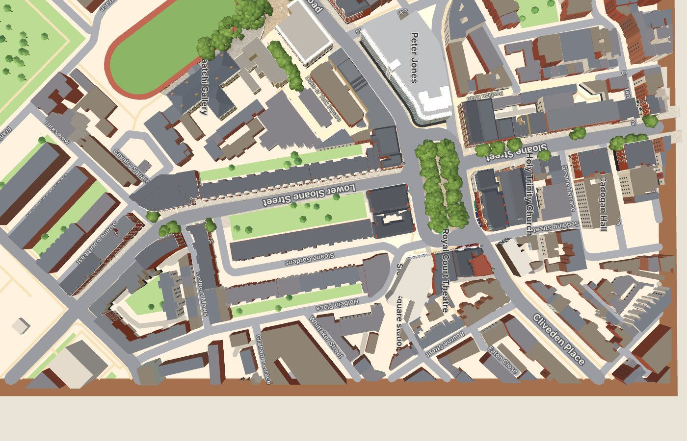 | 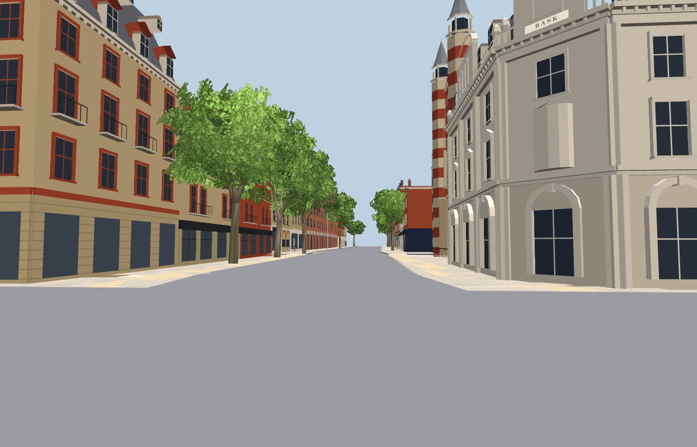 |
| 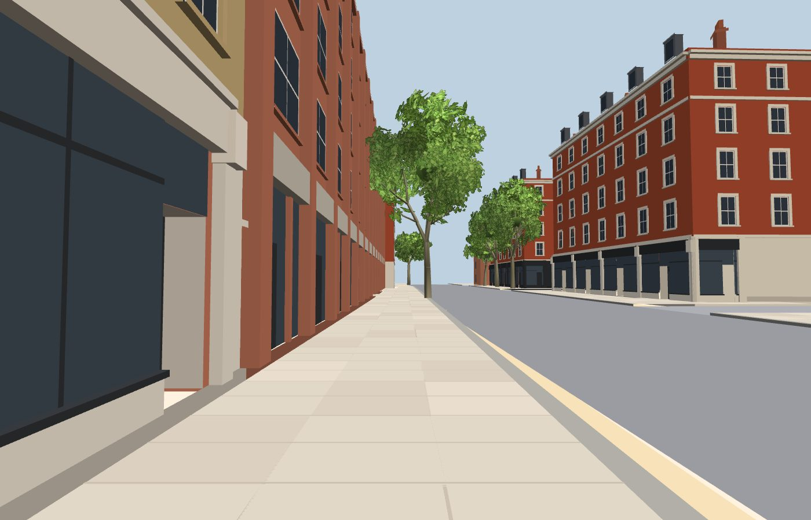 | 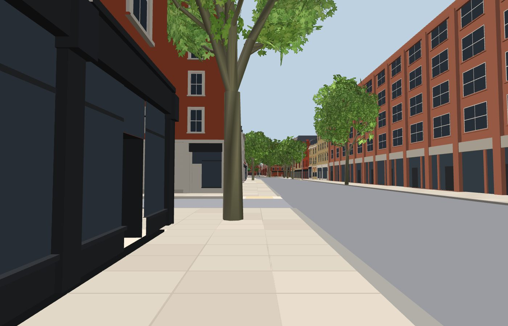 |
| 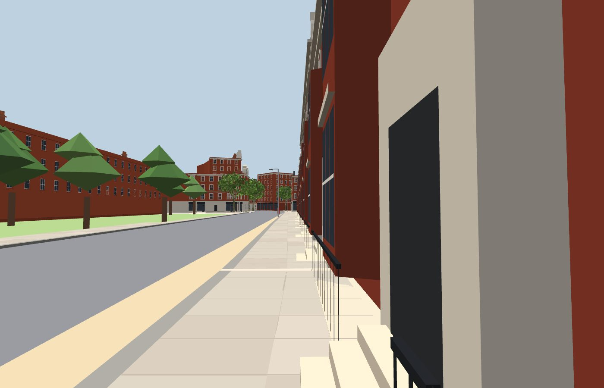 | 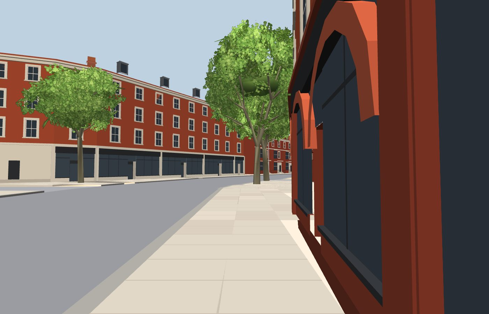 |
| 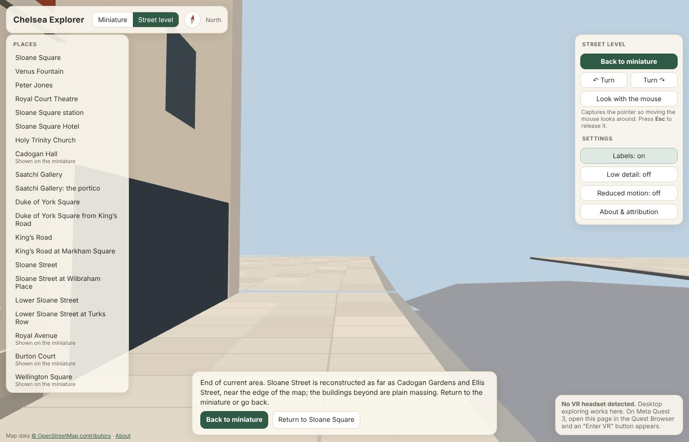 | 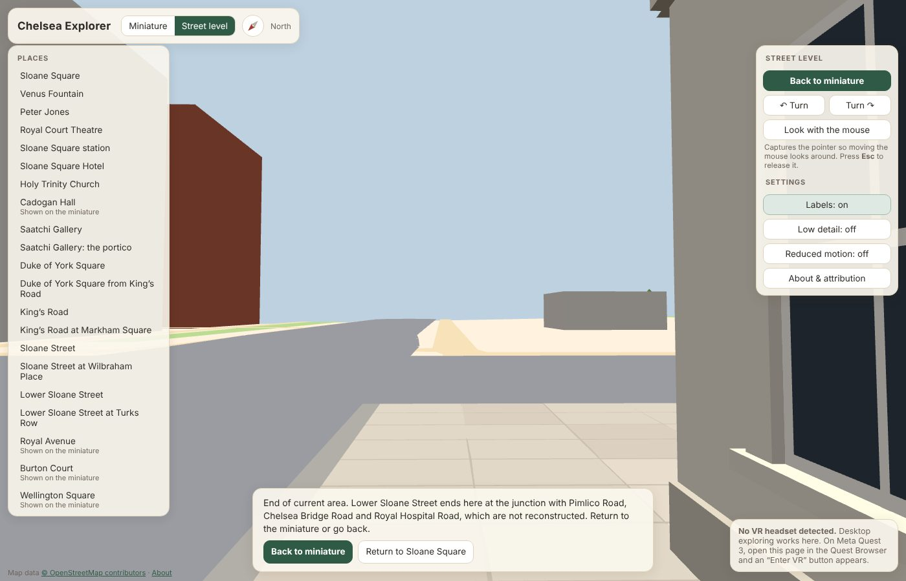 |

**Close-ups.**

| | |
|---|---|
| 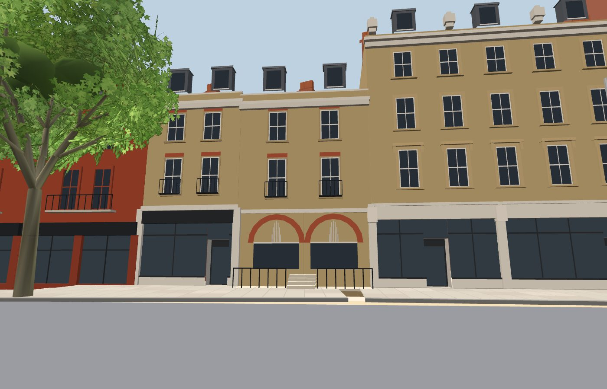 | 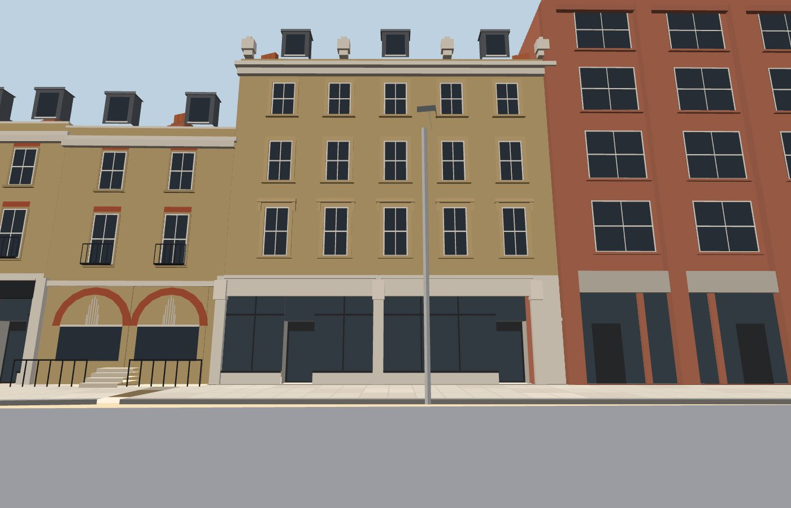 |
| 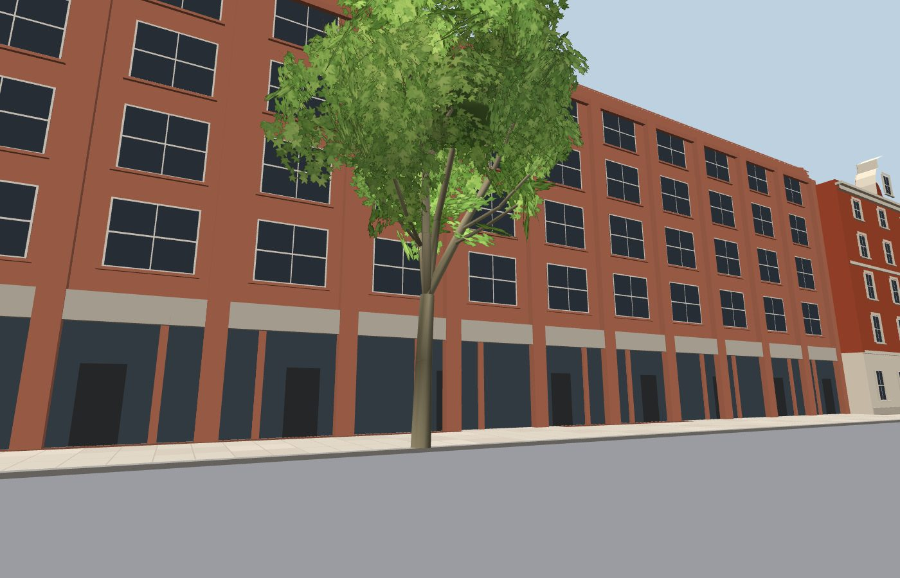 | 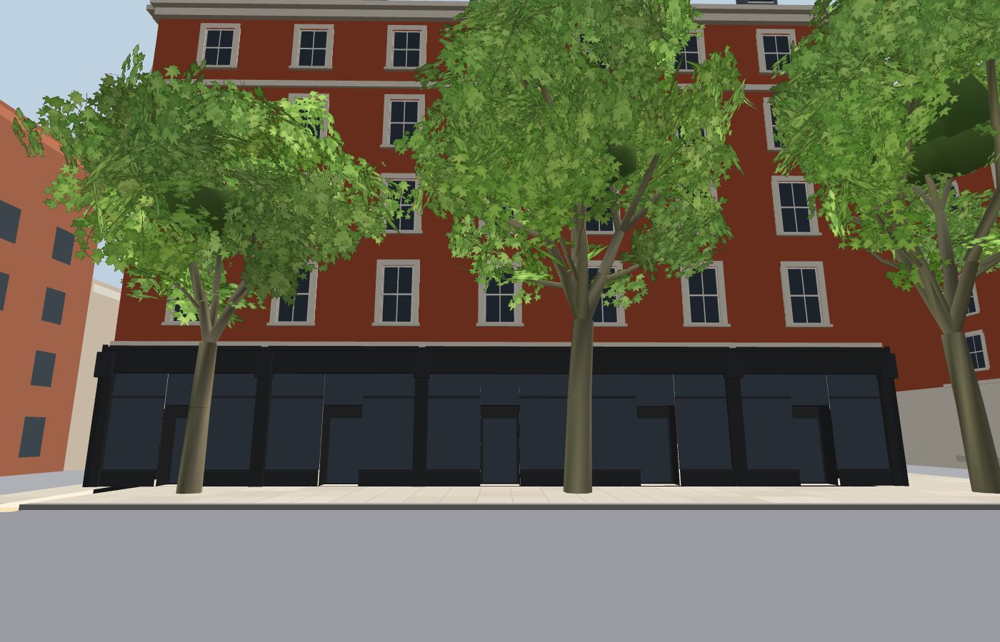 |
| 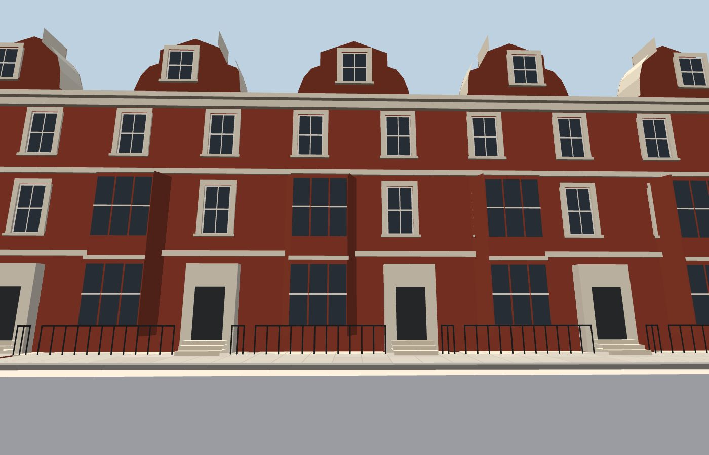 | 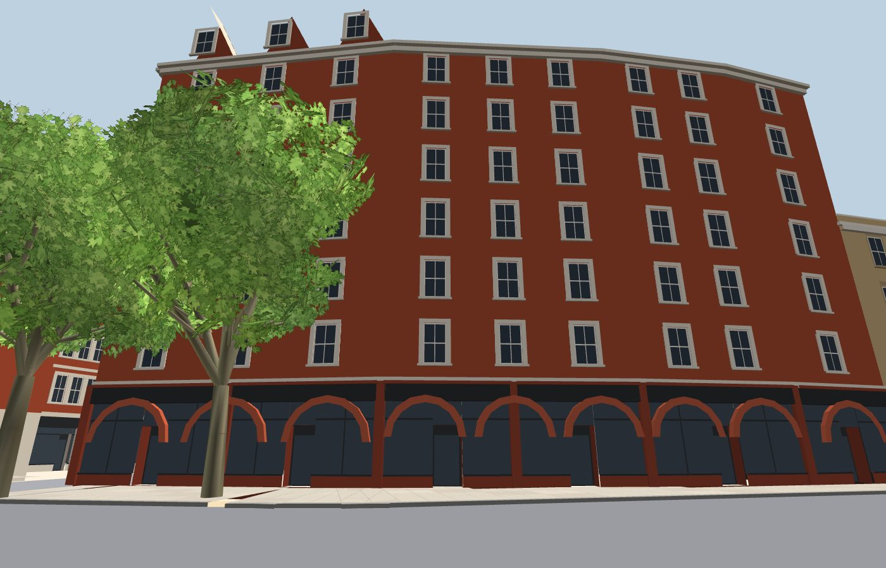 |
| 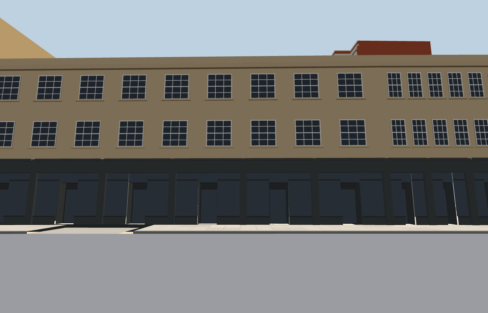 | |

## 8. Performance

Measured in headless Chromium with SwiftShader software rendering at 1400 × 900 on a 2-vCPU container. These numbers compare builds; they are not Quest frame rates, which have not been measured.

| | Before (`main`, 92ede99) | After |
|---|---|---|
| Static mesh | 253.2k triangles | 328.0k (31 new models ≈ 68k; corridor background window rows and pavements) |
| Default miniature | 350 ms, 47 calls, 305k triangles drawn | 433 ms, 47 calls, 396k |
| Street level, Sloane Square looking west | 667 ms, 38 calls, 328k | 750 ms, 38 calls, 425k |
| Street level, King's Road terrace | 200 ms, 23 calls, 184k | 217 ms, 23 calls, 211k |
| Street level, Sloane Street from the square | n/a | 250 ms, 18 calls, 210k |
| Street level, Sloane Street at Wilbraham Place | n/a | 267 ms, 18 calls, 206k |
| Street level, Lower Sloane Street | n/a | 233 ms, 26 calls, 315k |
| Street level, Lower Sloane Street at Turks Row | n/a | 150 ms, 19 calls, 168k |

**Draw calls** did not grow: the models merge into the existing tiled static mesh (6 × 6 frustum-culled tiles). No textures or transparent surfaces were added.

**Triangle counts** rose, most visibly in the busiest views around Sloane Square: about 425k drawn. That is the figure to watch on the headset. If it is too heavy, the next step is a lower-detail version of the corridor models for distant tiles, which this milestone does not add.

## 9. Remaining approximations (largest impact first)

1. **Eleven frontages are estimated** (listed above), and 15 are partly observed.
2. **Generic shopfronts.** Divisions, fascias and recessed doors are proportioned, but there is no lettering, awnings or brand detail.
3. **Simplified ornament.**
   - *Queen Anne houses:* shaped gables, terracotta panels and balustraded balconies are simplified to rounded gables, bay tops and porches.
   - *Sloane Gardens rear:* a plain grid, with no closet wings.
4. **Flat colour.** There is no brick bond texture, weathering or shadows.
5. **Carriageways fitted, not surveyed.** Both are re-centred between the footprints (section 3); widths are fitted.
6. **Cream patches.** The existing generic side-street pavements meet the raised corridor pavements with a step and show as cream patches at some corners.
7. **Background trees.** Generic low-poly trees remain in the communal gardens, which are not part of this milestone.

## 10. Quest 3 walkthrough checklist (Sloane Street and Lower Sloane Street)

Not yet verified on a headset.

- [ ] *Sloane Street* in the places menu stands you on the west pavement near the square, facing north. Teleport north on both pavements to Cadogan Gardens; the road refuses except at mapped crossings.
- [ ] At about 14 m before the end, the Sloane Street message appears on the hand panel with **Return to …** and **Back to miniature**. Beyond is refused. The map edge and the plain massing don't read as reconstructed.
- [ ] *Lower Sloane Street* and *…at Turks Row* work the same way. The Pimlico Road junction shows its own message.
- [ ] Porches, steps, bays and basement railings of the Queen Anne houses read at believable scale. Railings don't shimmer badly.
- [ ] Holy Trinity, 141–144 Sloane Street and Wellesley House look as before. The ramp from the square's pavement up to the corridor pavements isn't jarring.
- [ ] The frame rate feels smooth looking along each street in both directions, and around Sloane Square (≈ 425k triangles drawn in software rendering). Check with OVR Metrics.
- [ ] The miniature shows both corridors. Snap turn, seated mode and the saved settings behave as before.
